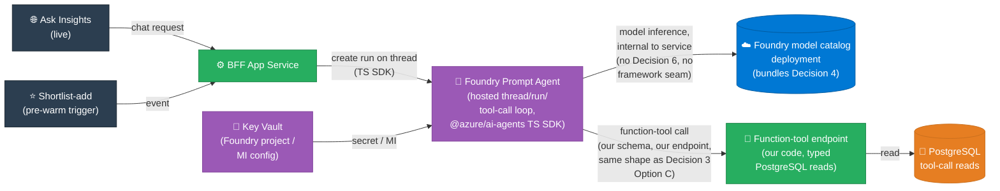
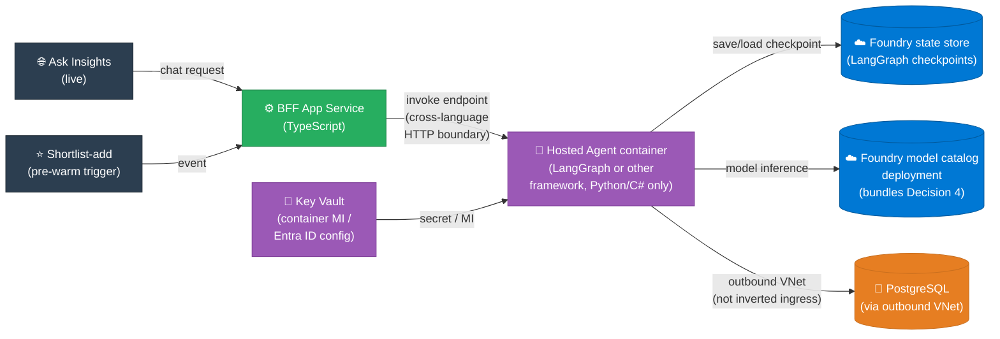

# ADLC-006: Cross-Cutting Option — Azure AI Foundry Agent Service

_Produced by the 🔍 Research phase. Owned by @architect. Do not edit after Evaluate phase begins._

## Why this is a separate, cross-cutting file

ADLC-006's research split three cross-cutting infrastructure concerns into separate decisions: Decision 4 (model hosting/access pattern), Decision 5 (agent/orchestration runtime hosting substrate), and Decision 6 (agent orchestration framework choice). Those three decisions assume a composable stack: pick a model-access pattern, pick a hosting substrate, pick a framework, and the three combine independently. "Azure AI Foundry Agent Service" turns out not to be one product but two materially different, separately-GA agent types that break this composability assumption in different ways, so each is researched here as its own option rather than as a single combined one:

- **Prompt Agents** (the thread/run/message model) pre-empt Decision 4 (model call bound to a Foundry-catalog deployment) _and_ Decision 6 (Foundry's own thread/run loop is the orchestration engine, so there is no separate framework to choose), and partially address Decision 5 by eliminating the hosting question outright (nothing to provision), but as a side effect of adopting Foundry's engine, not by hosting a team-chosen orchestrator.
- **Hosted Agents** (bring-your-own-container) pre-empt Decision 4 (model calls still go through the Foundry project endpoint) and Decision 5 (Foundry is the hosting substrate, full stop) but explicitly do **not** pre-empt Decision 6. The team still picks LangGraph, hand-rolled code, or anything else; Hosted Agents only hosts it.

Rather than force either shape into one decision's matrix, where it would be incomparable to that decision's other options or silently duplicated across three files, both are researched once here. Evaluate should treat each as a combined decision resolving a different subset of Decisions 4/5/6, scored against the combined acceptance criteria of whichever subset it touches, rather than slotting either into a single decision's AC × Options matrix alone.

## Option — Azure AI Foundry: Prompt Agents

**Description:** Prompt Agents are Azure AI Foundry's thread/run/message agent model, confirmed via the current (non-classic) Microsoft Learn docs (`learn.microsoft.com/en-us/azure/ai-foundry/agents/overview`, with the classic quickstart at `learn.microsoft.com/en-us/azure/foundry-classic/agents/quickstart` describing the same shape). You define an Agent resource, instructions, a model deployment from the Foundry/Azure OpenAI catalog, and a set of tools, and the service owns everything downstream: it manages conversation threads, executes runs, and runs its own internal tool-calling loop. Built-in tool types include Code Interpreter, File Search (vector-store-backed RAG), Bing grounding, OpenAPI tool-calling, and Azure Function tool-calling.

This is not framework-agnostic. Foundry's thread/run engine is the orchestration. There is no clean seam for bringing LangGraph's `StateGraph` router+node topology, or any other framework's control flow, inside a Prompt Agent run. The only extension point is the Function tool: you register a function schema, and the service calls out to a team-owned endpoint for execution, then feeds the result back into its own run loop. That is architecturally the same shape as Decision 3's own "Option C, single agent, tool-calling" for Ask Insights: register a function schema, let the model/engine decide when to call it, execute typed PostgreSQL reads behind that function. If Prompt Agents is adopted, Ask Insights's architecture converges on something close to Decision 3 Option C by construction, not by separate evaluation.

TypeScript SDK is GA, `@azure/ai-agents` on npm, with a confirmed working sample creating an agent, a thread, a message, and polling a run exactly as documented. This removes the language-runtime objection that disqualifies the sibling option below.

Because the Agent resource binds to a model deployment from the Foundry catalog as a first-class part of its definition, adopting this option pre-empts Decision 4: the model call happens inside the managed service, not via a standalone adapter/gateway/direct-SDK call the platform owns independently. Because the run-loop is the service's own engine with no framework seam, adopting this option pre-empts Decision 6 outright: if Prompt Agents is chosen, there is no Decision 6 to make, the orchestration framework question is answered by platform adoption, not independent evaluation. It addresses Decision 5 only incidentally: there is no hosting substrate to provision, but that is a side effect of there being no separately-hosted orchestrator at all, not a resolution of "which substrate hosts our chosen framework."

**Industry precedent:** Prompt Agents' thread/run/message API is modeled directly on OpenAI's Assistants API (itself being superseded by OpenAI's Responses API) and is Microsoft's flagship recommendation for building an agent on Azure without managing custom orchestration infrastructure. It is the Azure-native, fully-opinionated end of the spectrum, comparable in managed-PaaS intent to Bedrock AgentCore, but not in shape: AgentCore is a framework-agnostic hosting substrate, Prompt Agents is an opinionated end-to-end orchestration engine.

**Diagram:**

**Pros:**

- TypeScript SDK is GA and confirmed working (`@azure/ai-agents`), no second language runtime, unlike the sibling Hosted Agents option
- No hosting substrate to provision, scale, or patch, eliminates the "where does the orchestrator process run" question entirely
- Built-in thread/run state gives cross-turn memory for Ask Insights for free, the same category of benefit LangGraph's `PostgresSaver` gives in Decision 6's Option A, without the team owning a checkpointer schema
- Built-in observability/tracing for runs and tool calls ships with the service, addressing part of the Operational Excellence gap every self-hosted orchestration option leaves to be built
- The Function-tool shape maps directly onto Decision 3's own Option C (single agent, tool-calling) for Ask Insights, adopting this option doesn't require inventing a new Ask Insights architecture, it converges on one Decision 3 already considers
- If Solinor's provider decision lands on an Azure-first-party or Foundry-catalog model, this option resolves Decision 4's open question in the same stroke

**Cons:**

- Fully pre-empts Decision 6, there is no framework choice left to make; this conflicts with Decision 6's premise that a framework is chosen independently and composes with whatever hosting decision wins
- Pre-empts Decision 4 by binding the model call to a Foundry-catalog deployment, not viable as a "compose with whichever Decision 4 option wins" substrate, it answers Decision 4 by adoption, not by composition
- The same managed-SaaS data-residency question already flagged for LangSmith in Decision 6's research applies here with higher stakes: this is a fully managed Microsoft service processing prompts/tool-call payloads that may carry medical/talent-assessment-adjacent data inside Microsoft's managed control plane, not inside Solinor's own VNet-integrated compute
- No existing precedent anywhere in this platform for adopting an end-to-end managed AI orchestration product, every other Azure resource in this codebase is infrastructure-shaped (compute, storage, network) that the team's own code runs on top of
- Decomposing "only the Function-tool part" from the rest of the service's surface area means adopting a product whose majority feature set (File Search/RAG, Code Interpreter, Bing grounding) is explicitly unused under this Frame's no-vector-DB constraint, a proportionality concern structurally similar to Decision 6's LlamaIndex rejection reasoning
- Multi-step reasoning/routing across tool calls happens inside Foundry's run loop, which the team cannot inspect or modify the way it could inspect/modify a LangGraph graph, reduces debuggability and control over routing behaviour relative to any framework-based option in Decision 6

**Unknowns/risks:**

- Whether Function-tool call latency and reliability (network round-trip from Foundry's managed run loop to a team-owned endpoint, per tool invocation) is acceptable for Ask Insights's router-style usage pattern, where a single user turn may require several sequential tool calls, is unconfirmed, this is a new, option-specific question, not previously raised because Decision 3's Option C assumed an in-process or same-VNet tool call, not a managed-service-initiated callback
- Whether the Function-tool callback requires the tool endpoint to be publicly reachable, or can stay VNet-private, is unconfirmed, the service calling into the platform (rather than the platform calling out) inverts the "named external egress exception" posture every other Decision 4/5 option uses
- Data residency/region and tenant-isolation posture for a fully managed Microsoft-operated agent runtime handling medical/talent-assessment-adjacent prompts is unconfirmed and overlaps the data-residency open question already standing in Decisions 4 and 6
- Pricing model (per-run, per-token, per-thread-storage) and whether it is cost-predictable at 10-30-user scale is not established here

Recommended disposition, stated plainly: TypeScript viability removes the earlier blocking unknown for this agent type; the remaining gaps (Function-tool network reachability, latency under Ask Insights's multi-tool-call pattern, data residency) are scoped enough for Evaluate to score this option against Decisions 4+6's combined acceptance criteria once those are spiked or accepted as open risk.

## Option — Azure AI Foundry: Hosted Agents

**Description:** Hosted Agents is Azure AI Foundry's bring-your-own-code agent runtime, confirmed via the current, non-deprecated GA docs (`learn.microsoft.com/en-us/azure/ai-foundry/agents/concepts/hosted-agents`). This is the genuine Bedrock AgentCore equivalent: "Bring your own code, use any framework (Agent Framework, LangGraph, Semantic Kernel, or custom code)," packaged as a container image pushed to Azure Container Registry. Foundry supplies the substrate around that container: a managed endpoint, automatic per-session scaling (VM-isolated sandboxes, scale-to-zero with stateful resume, configurable idle timeout of 2-60 minutes), a dedicated Entra ID per agent, and a durable key-value state store explicitly documented as able to "hold framework checkpoints for a bring-your-own framework such as LangGraph." Networking is outbound-only via a customer-provided VNet to reach private resources, not an inverted ingress exception (this corrects an earlier wrong guess in this file's prior single-option version). Observability is built in via auto-injected Application Insights + OpenTelemetry, with no need for LangSmith and no third-party tracing data-residency concern. Supported regions include UK South and UK West.

Unlike Prompt Agents, Hosted Agents does not pre-empt Decision 6: the team still picks the orchestration framework, LangGraph, hand-rolled, or anything else, and Hosted Agents only hosts whatever is chosen. The LangGraph checkpoint support in Foundry's state store would directly replace the Postgres-checkpointer-vs-`app-db`-schema friction flagged in Decision 6's own research for LangGraph Option A, making this a strong hosting substrate answer for Decision 5 specifically, composable with Decision 6's framework choice rather than replacing it.

It does still pre-empt Decision 4 similarly to Prompt Agents: model calls from inside the hosted container go through the Foundry project endpoint, not a standalone adapter/gateway/direct-SDK call the platform owns independently of Foundry.

The disqualifying fact for this platform is narrow and confirmed, not a maturity question: Hosted Agents currently supports only Python and C#, no TypeScript/Node.js support exists, per the docs' own "Language support" section. This platform is TypeScript end to end, BFF, Compute, Synthetic, and web. Adopting Hosted Agents means introducing a second language runtime into the stack solely to host this one agent workload.

**Industry precedent:** Hosted Agents is architecturally identical in intent and shape to AWS Bedrock AgentCore, a framework-agnostic hosting substrate (session isolation, identity, state/checkpoint storage, a managed endpoint, observability) wrapped around agent code the team fully owns and controls. If this platform had a legitimate Python or C# component already, Hosted Agents plus LangGraph would be a strong, purpose-built combination: dedicated checkpoint support, outbound-only VNet networking, built-in observability, and scale-to-zero with stateful resume, matching or exceeding what a self-hosted Azure Container Apps/Durable Functions substrate would require the team to build by hand in Decision 5's other options. But introducing a second language runtime solely to host one agent workload, for a 10-30-user platform, is a disproportionate cost relative to that technical win, not a free upgrade.

**Diagram:**

**Pros:**

- Genuinely framework-agnostic, confirmed GA, explicitly supports LangGraph, so does not pre-empt Decision 6 the way Prompt Agents does
- Purpose-built LangGraph checkpoint support in Foundry's own state store directly removes the Postgres-checkpointer-vs-`app-db`-schema friction Decision 6's Option A research flags
- Outbound-only VNet networking to reach PostgreSQL, no inverted ingress exception, consistent with this platform's existing "named external egress exception" posture
- Built-in observability (Application Insights + OpenTelemetry) removes the LangSmith data-residency concern entirely for this path
- Scale-to-zero with stateful resume and VM-isolated per-session sandboxes is a stronger operational posture than most self-hosted Decision 5 options would deliver without custom engineering
- Confirmed region availability includes UK South and UK West, not a regional blocker

**Cons — disqualifying:**

- No TypeScript/Node.js support exists for Hosted Agents, confirmed via the docs' own Language support section. This platform is TypeScript end to end; this is not a workaround-able gap, it is a hard platform boundary
- Adopting this option means running Python or C# code in production solely for this one agent workload, introducing a second language runtime, toolchain, CI/CD path, dependency-management strategy, and on-call skill requirement that the rest of this platform does not have and does not need elsewhere
- For a 10-30-user platform, the cost of a second language runtime is disproportionate to the technical benefit Hosted Agents otherwise offers, the same proportionality concern this design applies elsewhere (e.g. Decision 6's LlamaIndex rejection) applies here at a much larger scale (a language runtime, not a library)

**Cons — non-disqualifying, still relevant if the Python/C# boundary is ever revisited:**

- Pre-empts Decision 4 similarly to Prompt Agents: model calls go through the Foundry project endpoint, not a standalone adapter/gateway the platform owns independently
- The cross-language HTTP boundary between the TypeScript BFF and a Python/C# Hosted Agent container adds an integration surface (contract versioning, error-shape translation, local dev parity) that a same-language hosting option in Decision 5 would not require
- Same managed-SaaS data-residency question already flagged for LangSmith (Decision 6) and Prompt Agents above applies to model calls and checkpoint data routed through Foundry's state store

**Unknowns/risks:**

- Data residency/region and tenant-isolation posture for a fully managed Microsoft-operated state store and model-catalog call, handling medical/talent-assessment-adjacent data, is unconfirmed beyond region availability, this overlaps the data-residency open question already standing in Decisions 4 and 6, and is not resolved by this option's Python/C# disqualification being clear
- Pricing model (compute-per-session, state-store storage, idle-timeout billing behaviour) and whether it is cost-predictable at 10-30-user scale is not established here
- If this platform ever legitimately needs a Python or C# component for an unrelated reason, this option should be re-evaluated on its technical merits alone, the disqualifier here is proportionality for a single-purpose adoption, not a permanent technical unsuitability

Recommended disposition, stated plainly: this option is technically excellent as a Decision 5 hosting answer and should be named as such for the record, but it is disqualified for this design by the single-language-platform constraint; Evaluate should score it as rejected on that basis rather than spending further spike effort on it, unless the Frame's language-platform constraint changes.

## Open Questions (cross-cutting)

| #   | Question                                                                                                                                                                                                                                                                                                                                                                                                                                                                                                                                                                                                                                                                                                                                            | Applies to    | Owner                             |
| --- | --------------------------------------------------------------------------------------------------------------------------------------------------------------------------------------------------------------------------------------------------------------------------------------------------------------------------------------------------------------------------------------------------------------------------------------------------------------------------------------------------------------------------------------------------------------------------------------------------------------------------------------------------------------------------------------------------------------------------------------------------- | ------------- | --------------------------------- |
| 1   | Does this design's current 3-way split (Decision 4: model access, Decision 5: hosting substrate, Decision 6: framework) accommodate options that answer only a subset of the three at once, or does evaluating Prompt Agents (4+6) and Hosted Agents (4+5) each require a dedicated cross-decision Evaluate step scored against the combined acceptance criteria of the decisions each touches? (Process-blocking, this is the structural question this file exists to flag)                                                                                                                                                                                                                                                                        | Both          | @architect / developer            |
| 2   | Whether Prompt Agents' Function-tool callback requires the tool endpoint to be publicly reachable, or can stay VNet-private, is unconfirmed, if the service must call into the platform rather than the platform calling out, this inverts the "named external egress exception" posture every other Decision 4/5 option uses. (Viability-blocking)                                                                                                                                                                                                                                                                                                                                                                                                 | Prompt Agents | @architect / Security review      |
| 3   | Is Function-tool call latency and reliability (managed-service-initiated callback to a team-owned endpoint, potentially several sequential calls per Ask Insights turn) acceptable for Ask Insights's router-style multi-tool-call usage pattern? Decision 3's Option C assumed an in-process or same-VNet tool call, not a managed-service callback round trip, this needs a timing/reliability spike, not an assumption. (Viability-blocking for Ask Insights specifically)                                                                                                                                                                                                                                                                       | Prompt Agents | @architect                        |
| 4   | Given the medical/talent-assessment data sensitivity already flagged for LangSmith (Decision 6) and the provider API itself (Decision 4), does routing prompts and/or checkpoint state through a fully Microsoft-managed agent runtime (Prompt Agents' thread/run store, or Hosted Agents' state store) raise the data-residency bar further than a model API call alone, and has Solinor's product owner's sync scope been explicitly asked about managed-agent-platform processing, not just model-provider selection? (Evaluation-input, the sync with Solinor's product owner is scoped around model provider; both options' data flows through more managed surface area than a model API call alone, which that sync may not currently cover) | Both          | sync with Solinor's product owner |
| 5   | Pricing model and cost predictability at 10-30-user scale is unestablished for both Prompt Agents (per-run/per-token/per-thread-storage) and Hosted Agents (compute-per-session/state-store/idle-timeout billing), needed before Evaluate can score either against Decision 5's cost-optimisation criteria. (Evaluation-input)                                                                                                                                                                                                                                                                                                                                                                                                                      | Both          | @architect                        |
| 6   | If a legitimate Python/C# component ever becomes part of this platform for unrelated reasons, should Hosted Agents plus LangGraph be re-evaluated as a strong, purpose-built option at that point, rather than treated as permanently rejected? (Not blocking for this design, recorded for future reference only)                                                                                                                                                                                                                                                                                                                                                                                                                                  | Hosted Agents | @architect (future)               |
