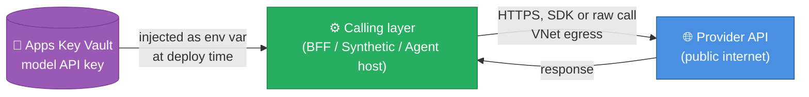
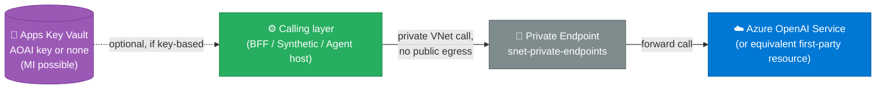
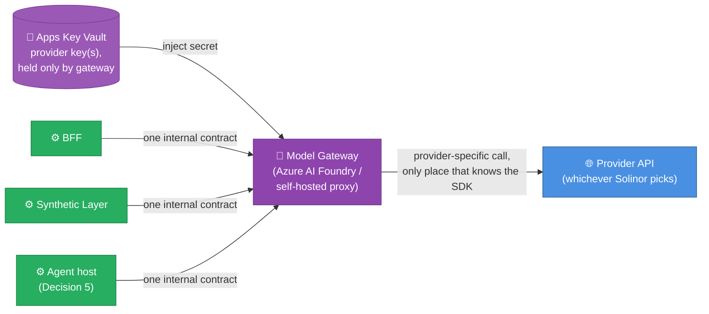
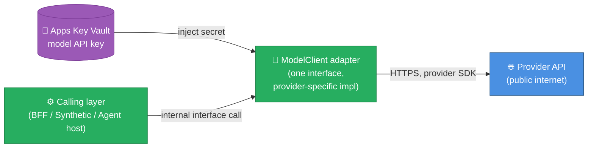

# ADLC-006: Model Hosting / Access Pattern — Research

_Produced by the 🔍 Research phase. Owned by @architect. Do not edit after Evaluate phase begins._

## Context

This is Decision 4 of 5 in ADLC-006, added after the research for Decisions 1-3 (AI-Generated Employee Summary, Strengths and Risks Summary, Ask Insights). Those three decisions each assume "a Solinor model account (Key Vault secret)" is called from wherever generation happens; this decision covers what sits inside that box. Scope is the provider-agnostic integration shape for calling whatever AI model account Solinor ends up owning, not provider selection itself — provider selection stays out of scope per Frame, pending a sync with Solinor's product owner. Every option below must work regardless of which provider is eventually picked.

Two existing platform facts bound the options. First, the Security NFR's two-Key-Vault pattern: the Apps vault holds all per-layer runtime secrets, injected as environment variables at deploy time, never committed to code or config. Second, the only existing external-egress precedent is BFF/Compute → Snowflake — a named exception with TLS and a scoped read-only service account. Any option that calls an external model API over the public internet is architecturally the same shape: a second named egress target.

## Options

### Option A — Direct SDK/HTTP call to the provider's API, key in Key Vault (status quo pattern, no gateway)

**Description:** The calling layer (BFF, Synthetic Layer, or Decision-5 agent host) holds the provider's official SDK, or a plain HTTPS client, and calls the provider's public API endpoint directly over the internet. The API key is stored in Apps Key Vault and injected as an environment variable at deploy time, exactly like the existing Snowflake, PostgreSQL, and Redis pattern.

**Industry precedent:** This is the default integration pattern for every official LLM provider SDK (OpenAI SDK, Anthropic SDK, Google GenAI SDK) — calling the provider directly with an API key is the documented first-class path for all of them, and it's how most teams start before introducing a gateway.

**Diagram:**

**Pros:**

- Simplest possible shape — one new secret, one new outbound HTTPS rule, no new Azure resource to provision or operate
- Matches the existing BFF → Snowflake precedent almost exactly: named external egress exception, key in Key Vault, dedicated scoped credential
- Fastest to ship — no new abstraction layer to build or learn, works with whichever SDK the eventual provider publishes
- Usage and cost data comes directly from the provider's own billing dashboard per API key — if a distinct key (or project/org) is provisioned per environment, cost is attributable by environment out of the box

**Cons:**

- Requires a new, currently-undocumented outbound NSG/firewall rule from `snet-bff` (and/or `snet-compute`, and/or whatever Decision 5 lands on) to the provider's public endpoint — today only Snowflake has this exception; this is a second one to maintain, or a third if BFF and the Synthetic/agent host both need it
- Provider lock-in: SDK calls, request/response shapes, auth headers, and error semantics are all provider-specific. Swapping providers later means code changes at every call site, not just a config change
- No single point to enforce consistent cross-feature guardrails (rate limiting, PII redaction, prompt logging) — each call site reimplements its own
- Per-feature/per-environment usage attribution depends entirely on whether the provider's own billing supports sub-account or tagged keys; not guaranteed for every provider Solinor might pick

**Unknowns / risks:**

- Which concrete subnet(s) need the new egress rule depends on where Decision 5 places the agent host
- Whether the eventual provider's billing dashboard supports per-key or per-project attribution is provider-specific and unconfirmed

---

### Option B — Azure-native managed proxy for an OpenAI-compatible provider (e.g. Azure OpenAI Service)

**Description:** If the provider Solinor selects turns out to be OpenAI, or anything Azure fronts natively, the platform calls an Azure-hosted, VNet-integrated resource (Azure OpenAI Service) instead of the public provider endpoint. The resource lives inside the subscription, can be given a private endpoint into the existing VNet, and Azure's own RBAC/Managed Identity model can replace or supplement the Key Vault key. This option is explicitly conditional: it only applies if the chosen provider has a first-party Azure equivalent.

**Industry precedent:** Azure OpenAI Service's own guidance recommends private-endpoint and Managed-Identity access for enterprise workloads. This mirrors the shape already used for ACR and Key Vault private endpoints in this platform's own Terraform modules.

**Diagram:**

**Pros:**

- No new public-internet egress rule needed at all — the call stays inside Azure's network via a private endpoint, consistent with the platform's existing posture that data stores are never publicly reachable
- Can use Managed Identity instead of a static API key for authentication, removing one more secret from Key Vault entirely — stronger than every other option on the "no stored credentials" principle
- Azure-native cost and usage metering (Cost Management, resource tags) gives clean per-environment attribution automatically, since it's billed like every other Azure resource in the existing Terraform-managed resource groups
- Fits the existing Infrastructure-as-Code convention directly — provisioned via Terraform like every other resource

**Cons:**

- Hard dependency on the provider decision: only viable if Solinor picks a provider with a first-party (or compatible) Azure resource — not viable if they pick a provider with no Azure equivalent. Cannot be evaluated, let alone chosen, before the sync with Solinor's product owner lands
- Still has a region/data-residency question of its own — which Azure region hosts the resource, and whether that satisfies whatever hosting/data-processing-location requirement the sync produces
- Adds a new Azure resource type and quota/region-availability considerations not covered by the current Infrastructure doc at all
- Locks the integration pattern to Azure-first-party resources — migrating off the chosen provider later may mean migrating off this resource too

**Unknowns / risks:**

- Whether the provider the sync lands on has any Azure-native equivalent at all is unknown until that sync happens
- Quota and region availability for Azure OpenAI Service (or equivalent) in the required region is unconfirmed

---

### Option C — Provider-agnostic model gateway / abstraction layer (e.g. Azure AI Foundry model catalog, or a self-hosted LLM gateway)

**Description:** Introduce one internal abstraction boundary — either a managed Azure service (Azure AI Foundry's model catalog/gateway, which fronts multiple providers including third-party ones behind one consistent endpoint/SDK shape) or a thin self-built/open-source gateway service, such as a LiteLLM-style proxy — so every call site in the platform (BFF, Synthetic Layer, Decision-5 agent host) talks to one internal interface, and only the gateway itself knows which concrete provider and credential sit behind it. Feature code is written against the gateway's contract, not the provider's SDK.

**Industry precedent:** This is the standard "LLM gateway" pattern seen in projects like LiteLLM, Portkey, and Kong AI Gateway, and is the explicit design intent of Azure AI Foundry's model catalog/endpoint abstraction: one SDK/endpoint shape, swappable backend model.

**Diagram:**

**Pros:**

- Directly resolves the "swap provider later" risk that Decisions 1-3 all flagged as outstanding — every sibling research file labels the provider as TBD. Only the gateway's internal adapter changes, not call sites in BFF, Synthetic Layer, or agent code
- Single place to enforce cross-feature guardrails the Frame already proposes as expected capabilities: per-call logging (latency, cost, success/failure), redaction before the model sees data, and a rate-limit/budget ceiling. Without a gateway, each of BFF, Synthetic Layer, and the agent host would need to reimplement these independently
- One key secret (or one per provider) lives only at the gateway boundary — reduces the number of places the model API key is injected across layers, narrower blast radius if a layer is compromised
- If Azure AI Foundry's managed catalog is used specifically, usage/cost metering and multi-provider routing come largely built in, and it can be VNet-integrated like Option B

**Cons:**

- Most moving parts of any option — a new service/resource to provision, operate, and secure, for a decision that otherwise has none of the three features' functional complexity
- If self-hosted rather than Azure AI Foundry, this is a new deployable with its own availability, scaling, and observability burden on top of everything else ADLC-006 is already adding
- Azure AI Foundry's catalog does not support every possible provider Solinor might pick — if Solinor's eventual choice isn't in Foundry's catalog, this degrades to needing a custom adapter anyway, partially eroding the abstraction benefit
- Adds one more network hop and one more component that can fail — now there are two failure domains (gateway, then provider) instead of one

**Unknowns / risks:**

- Whether the eventual provider is in Azure AI Foundry's catalog is unknown until the provider is selected
- Operational ownership of a self-hosted gateway (on-call, scaling, patching) is not yet assigned to any team or layer

---

### Option D — Direct SDK call, but with an internal adapter interface written in-house (no separate network hop)

**Description:** A middle ground between A and C: call the provider directly — same network shape as Option A, no new Azure resource, no separate gateway service — but every call site in the codebase goes through one small internal TypeScript interface/module (for example, a `ModelClient` abstraction with a single implementation per provider) rather than calling the provider's SDK inline. The key still lives in Apps Key Vault and is injected into whichever layer holds this adapter, likely co-located with wherever Decision 5 places the agent/generation code, or duplicated per layer if generation happens in more than one place.

**Industry precedent:** This is the standard "ports and adapters" / hexagonal-architecture pattern applied to an external dependency — the same shape recommended generically for any third-party integration a team expects to swap later, independent of any specific LLM tooling.

**Diagram:**

**Pros:**

- No new Azure resource, no new network hop, no new operational surface — same infrastructure footprint as Option A
- Still resolves most of the provider-lock-in concern: swapping providers means writing one new adapter implementation behind the existing interface, not touching every call site across BFF, Synthetic Layer, and agent code
- A natural place to centralize the Frame's proposed logging, redaction, and rate-limit capabilities within a single layer's codebase, even without a standalone service — though if generation happens in more than one layer, the adapter would need to be duplicated or shared as a library, not truly centralized platform-wide the way Option C's gateway is
- Cheapest option that still gets some of Option C's benefit — a reasonable "do the simple thing first" compromise

**Cons:**

- Doesn't solve cross-layer guardrail duplication as cleanly as Option C if the adapter ends up needing to live in two places (BFF and wherever Decision 5 lands) — would need to be shipped as a shared internal library, which is itself a design decision this option defers
- Still needs the same new outbound NSG/egress rule as Option A, since the network path to the provider is unchanged
- No independent cost/usage dashboard beyond what's built manually into the adapter's logging — unlike Option B or C's platform-native metering

**Unknowns / risks:**

- Whether the adapter needs to be a shared library (if generation splits across layers) or a single-layer module depends on Decision 5's outcome
- No native metering means usage/cost reporting accuracy depends entirely on the adapter's own logging implementation being complete and correct

---

### Option E — Azure AI Foundry Agent Service (cross-cutting — see shared file)

**Description:** Microsoft's managed, hosted agent runtime (threads/runs/tools model, similar in intent to OpenAI's Assistants API). Unlike AWS Bedrock AgentCore, it is not framework-agnostic — the thread/run/tool-calling loop is the service's own orchestration engine, not a substrate for arbitrary agent code. Adopting this option does not compose independently with Decision 5 (agent runtime hosting) and Decision 6 (orchestration framework choice) the way every other option on this page does: it answers all three by platform adoption in one step, not by independent choice. **This is a cross-cutting option, not scoped to this decision alone** — see `01 Research - Cross-Cutting Option - Azure AI Foundry Agent Service.md` for the full description, diagram, pros/cons, unknowns/risks, and its own open questions. Evaluate should treat picking this option as a combined decision across Decisions 4, 5, and 6, not just this one's AC × Options matrix.

**Industry precedent:** see the shared cross-cutting file.

**Pros / Cons / Unknowns/risks:** see the shared cross-cutting file — summarized there against the combined acceptance criteria of Decisions 4, 5, and 6 together, not duplicated here to avoid drift between copies.

---

| Option                          | New Azure resource?          | New public egress rule?            | Key in Key Vault?         | Swap-provider cost                      | Centralized guardrails?                               |
| ------------------------------- | ---------------------------- | ---------------------------------- | ------------------------- | --------------------------------------- | ----------------------------------------------------- |
| A — Direct SDK call             | No                           | Yes                                | Yes                       | High (every call site)                  | No                                                    |
| B — Azure-native managed proxy  | Yes                          | No (private endpoint)              | Optional (MI possible)    | Only viable for Azure-fronted providers | Partial (platform-native)                             |
| C — Model gateway / abstraction | Yes (or self-hosted service) | Depends (gateway may still egress) | Yes, held only by gateway | Low (adapter swap only)                 | Yes                                                   |
| D — In-house adapter interface  | No                           | Yes                                | Yes                       | Low-medium (adapter swap, no new infra) | Partial (code-level, needs shared lib if multi-layer) |

## Open Questions

| #   | Question                                                                                                                                                                                                                                                                                                                                               | Owner                             |
| --- | ------------------------------------------------------------------------------------------------------------------------------------------------------------------------------------------------------------------------------------------------------------------------------------------------------------------------------------------------------ | --------------------------------- |
| 1   | Does Solinor's product owner's hosting/data-processing-location decision rule out any option outright? Option B is only viable if the chosen provider has a first-party Azure resource; Options A, C, and D remain viable regardless of provider.                                                                                                      | sync with Solinor's product owner |
| 2   | Will the eventual provider support a conventional HTTPS REST/SDK API surface, as all four options assume? This is a safe assumption for mainstream providers but is nominally unconfirmed since the provider is unselected.                                                                                                                            | sync with Solinor's product owner |
| 3   | Does Solinor require per-environment distinct model accounts/keys, or one shared account with usage separated by tagging? This affects secret provisioning and whether native cost-metering suffices.                                                                                                                                                  | Solinor                           |
| 4   | What are the Frame's proposed cost-guardrail and observability expected capabilities' actual requirements? These are still proposed, not confirmed; Option C's gateway is more attractive if these are confirmed and strict.                                                                                                                           | Solinor / @architect              |
| 5   | Will generation code run in exactly one layer, or split across layers (BFF for pre-computed summaries, a Decision-5 substrate for Ask Insights)? This is a Decision-5 dependency affecting Option D's shared-library tradeoff and Option C's call-site count.                                                                                          | @architect (Decision 5)           |
| 6   | Does the existing Snowflake-exception network pattern set an accepted precedent for a second external egress target (the model API), or does security review want a stricter "no new public egress" posture given prompts may carry talent-assessment or medical data? This is a risk-tolerance question for Evaluate, not resolvable from docs alone. | @architect / Security review      |
