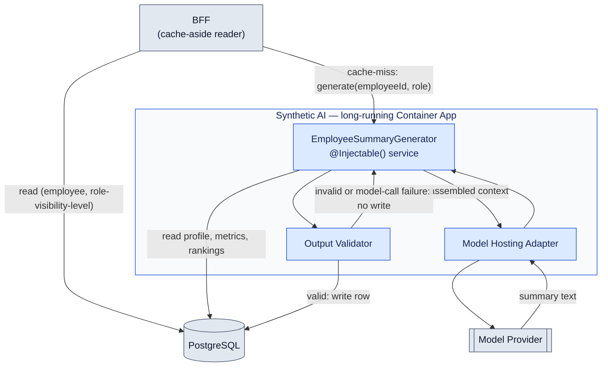
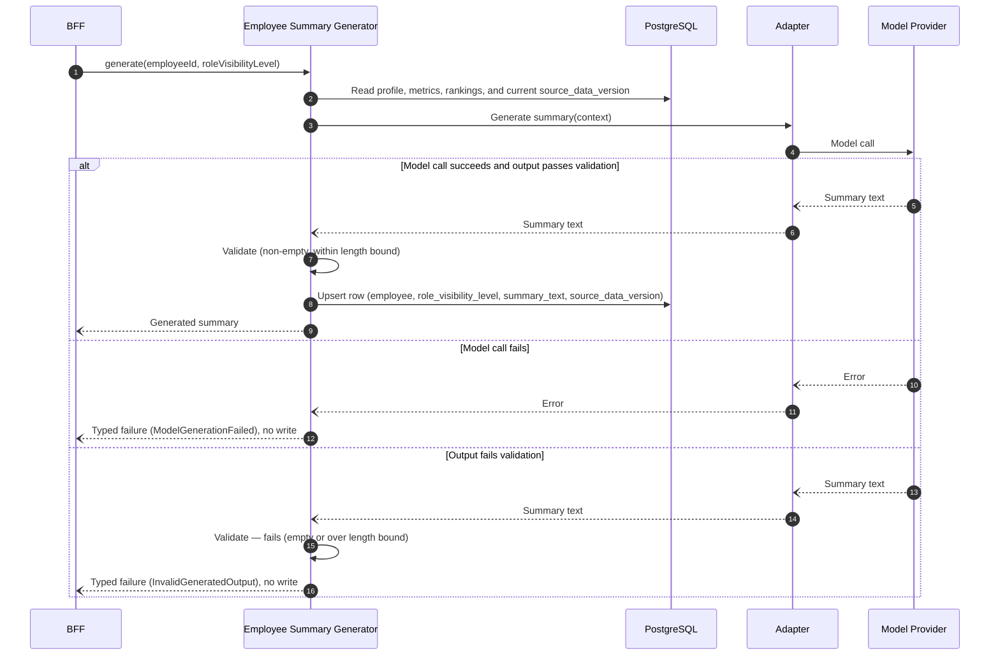

# Design — AI-Generated Employee Summary (Decision 1)

A cache-miss HTTP call from the BFF triggers synchronous generation inside Synthetic AI's long-running Container App; the result is written once per `(employee, role-visibility-level)` and invalidated by data-version comparison, never by TTL.

This document details Decision 1 against the converged architecture in `solution/Architecture.md` — the per-role cache-variant mechanism, the two-deployment-unit split, and the in-house Model Hosting Adapter (Decision 4) are settled there and not restated here.

## Component view

The Output Validator is a Employee Summary Generator responsibility, not a separate deployable — it sits between the adapter's response and the PostgreSQL write.

`EmployeeSummaryGenerator` is a NestJS `@Injectable()` service class, exposed via a controller at `POST /employee-summary/generate`, matching the request/response shapes in `Architecture.md`'s Employee Summary representative flow. The Model Hosting Adapter is injected into it through NestJS constructor injection, the same pattern `ComputeTriggerClient` uses for `ConfigService` in the BFF. Incoming requests are authenticated per `solution/Design - Agent Runtime Hosting.md`.

## Sequence — cache miss, success and failure

No row is ever written on either failure branch. The next page load is an ordinary cache-miss request — no retry queue, no background job, no special recovery path.

## Schema — `employee_ai_summary`

New table in `libs/app-db`'s Drizzle schema, following the project's existing schema conventions (`.claude/skills/app-db.md`): one row per `(employee, role-visibility-level)`.

| Column                  | Type                | Notes                                                                                                                 |
| ----------------------- | ------------------- | --------------------------------------------------------------------------------------------------------------------- |
| `employee_key`          | text, not null      | References the employee; part of the composite key                                                                    |
| `role_visibility_level` | text, not null      | Enum-backed per the app-db enum-first rule; the set of levels is owned by Access Management and consumed by reference |
| `summary_text`          | text, not null      | The generated output                                                                                                  |
| `source_data_version`   | text, not null      | Compute's current materialized-output version for this employee at generation time                                    |
| `generated_at`          | timestamp, not null | Generation timestamp                                                                                                  |

Primary key: `(employee_key, role_visibility_level)`. The BFF's read path looks up this exact composite key — it performs no authorization computation of its own, consistent with the per-role stored-variant mechanism in `solution/Architecture.md`.

## Cache invalidation: version comparison, not TTL

A stored row is stale when its `source_data_version` no longer matches Compute's current materialized-output version for that employee. This is the settled invalidation design: BFF's read path compares the two versions on every lookup and treats a mismatch as a cache miss, the same code path as a missing row. There is no expiry timestamp and no background eviction job.

## Validation

Before any write, the Employee Summary Generator checks the adapter's output against a minimal schema: non-empty, within a fixed length bound. A malformed output is a failure, not a partial write — it returns `InvalidGeneratedOutput` to BFF through the same typed-failure path as a model-call error.

## Failure handling

| Failure                                     | Behavior                                                                                                                         |
| ------------------------------------------- | -------------------------------------------------------------------------------------------------------------------------------- |
| Model call fails (adapter returns an error) | No write; BFF receives a typed `ModelGenerationFailed` failure                                                                   |
| Generated output fails validation           | No write; BFF receives a typed `InvalidGeneratedOutput` failure                                                                  |
| Either failure                              | The next request for the same `(employee, role-visibility-level)` is a fresh cache-miss call — no retry machinery, no queued job |

## Config and secrets

The Employee Summary Generator holds no secrets of its own. The Model Hosting Adapter (Decision 4) resolves the model provider's API key via Key Vault, using the platform's existing two-Key-Vault pattern.
