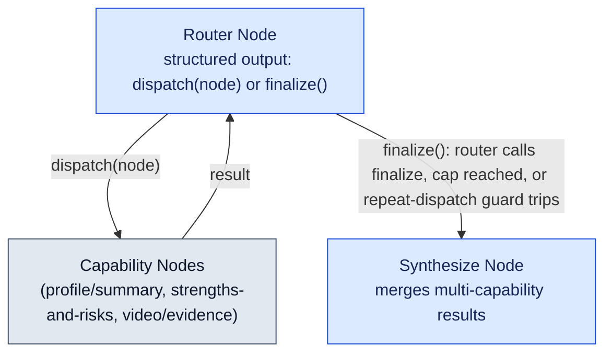
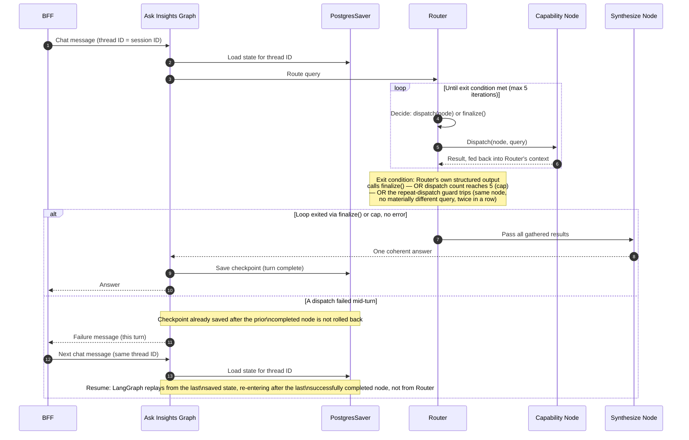
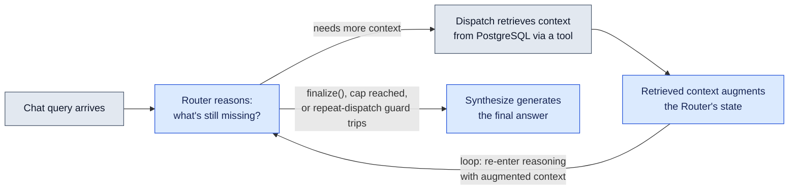

# Design — Ask Insights (Decision 3)

The Ask Insights graph is a LangGraph `StateGraph` with a router node, one capability
node per domain, and a named `synthesize` node, compiled once at Synthetic AI
startup and invoked per chat turn with the conversation's thread ID as the
`PostgresSaver` checkpoint key. The router runs a supervisor loop with the
capability nodes: each dispatch's result returns to the router, which decides
whether to dispatch again or finalize, rather than a single-pass fan-out. The
compiled graph is invoked from a NestJS controller endpoint, `POST
/ask-insights/chat`, exposed as an `@Injectable()` service the controller
calls — the graph is the service's internal implementation, not a separate
process. Incoming requests are authenticated per `solution/Design - Agent
Runtime Hosting.md`. See `solution/Architecture.md` for the converged
container, hosting, and checkpointer-schema decisions — this document covers
the graph's internal behavior only.

## Component view

| Node                       | Reads                                                                                                                                    | Returns                                                                |
| -------------------------- | ---------------------------------------------------------------------------------------------------------------------------------------- | ---------------------------------------------------------------------- |
| Router                     | Nothing directly; holds the running dispatch count and every result gathered so far for this query                                       | `dispatch(node, query)` back into the loop, or `finalize()` to exit it |
| Profile/Summary Reader     | Decision 1's stored per-role variant for the employee in question, via `getEmployeeSummary`; platform rankings via `getEmployeeRankings` | Result fed back into the Router's context for its next decision        |
| Strengths-and-Risks Reader | Decision 2's stored per-role variant, via `getEmployeeStrengthsRisks` or `compareStrengthsRisks`                                         | Result fed back into the Router's context for its next decision        |
| Video/Evidence Tool        | ClipVault clip index, filtered by the caller's role-visibility level, via `searchVideoEvidence`                                          | Result fed back into the Router's context for its next decision        |
| Synthesize                 | Every result the Router gathered across the loop for this query                                                                          | One coherent answer sent to Synthetic AI's caller                      |

No node in this graph calls an open-web or general-knowledge tool. Every
capability node reads exclusively from Solinor Insights's own stored data: Decisions
1 and 2's tables, the ClipVault clip index, and platform metrics/rankings
tables — see Tools registry below for the exact mapping.

Each capability node's own internal behavior stays a single, bounded
read/tool-call per dispatch. A node does not run its own inner loop: it
receives a query from the router, makes one tool call, and returns. The loop
lives at the Router level only. Frame's guardrails call for bounded,
deterministic reads of already-materialized data, not open-ended per-node
iterative narrowing — giving every node its own inner loop on top of the
router's loop would duplicate the same control and exceed this platform's
scope.

## Turn sequence, with mid-turn failure and resume

## RAG flow

Every loop iteration retrieves more context from PostgreSQL to augment what
the Router has to reason with before its next decision or final answer —
this is retrieval-augmented generation, not a single-pass tool fan-out.

The cycle between Reason and Augment is the loop: each pass through it adds
one capability node's retrieved result to the Router's context before the
Router decides again. The cycle ends only on the three-way exit condition
stated in the turn sequence above.

## Tools registry

Every tool a capability node can call, with its role-filtering behavior and
data source.

| Tool name                   | Capability node            | Parameters                                           | Data source                                                                                                                   | Role-filtering                                                            | Returns                                                                                                                                         |
| --------------------------- | -------------------------- | ---------------------------------------------------- | ----------------------------------------------------------------------------------------------------------------------------- | ------------------------------------------------------------------------- | ----------------------------------------------------------------------------------------------------------------------------------------------- |
| `getEmployeeSummary`        | Profile/Summary Reader     | `employeeId`, `roleVisibilityLevel`                  | `employee_ai_summary` table (Decision 1)                                                                                      | Reads only the stored variant matching the caller's role-visibility level | Summary text + `sourceDataVersion`                                                                                                              |
| `getEmployeeStrengthsRisks` | Strengths-and-Risks Reader | `employeeId`, `roleVisibilityLevel`                  | `employee_strengths_risks` table (Decision 2)                                                                                 | Reads only the stored variant matching the caller's role-visibility level | Signals + narrative text for that employee                                                                                                      |
| `compareStrengthsRisks`     | Strengths-and-Risks Reader | `employeeIds[]`, `roleVisibilityLevel`               | `employee_strengths_risks` signals, via the same comparison-weave generation path as Decision 2's comparison-weave            | Role-filtered per employee                                                | Comparison narrative — this is the tool the file's own example query, "How does this employee compare to our current left-back?", dispatches to |
| `searchVideoEvidence`       | Video/Evidence Tool        | `employeeId`, `eventCriteria`, `roleVisibilityLevel` | ClipVault clip index, with event-type matching depending on ADLC-104's dynamic metric-to-event mapping (`design/00 Frame.md`) | Role-filtered before return; ClipVault clips only, per Frame's guardrail  | List of clip references the caller is allowed to see                                                                                            |
| `getEmployeeRankings`       | Profile/Summary Reader     | `employeeId`, `metric` (optional)                    | Platform metrics/rankings tables                                                                                              | Reads already-public ranking data; no role-restriction applied            | Ranking value(s) for the requested metric(s)                                                                                                    |

## Guardrails

**Loop exit condition.** The Router loop exits when any of three conditions
is met: (1) the Router's own structured output calls `finalize()`, meaning
it has decided it holds sufficient information to answer; (2) the dispatch
count reaches the configured cap of 5, a forced termination regardless of
what the Router wanted; (3) a repeat-dispatch guard trips — the Router
dispatches to the same capability node twice in a row with no materially
different query or parameters, treated as a stall and forced to finalize
with whatever has been gathered, so a stuck loop does not burn through the
cap on repeated identical reads. The cap is a configurable value read at
graph-compile time, not a hardcoded constant inside the Router's logic.

**Data-source restriction.** Capability nodes have no open-web or
general-knowledge tool bound to this graph. Each capability node's only data
access is the tool set in Tools registry above: Decision 1's stored variant
table, Decision 2's stored variant table, the ClipVault clip index, or
platform metrics/rankings tables. Adding a new data source to this graph
means adding a new capability node or tool, not extending an existing tool's
reach.

**Video restriction.** `searchVideoEvidence` queries the ClipVault clip index
filtered by the caller's role-visibility level before returning any result.
Filtering happens inside the tool, before the result set reaches the Router
or `synthesize` — the model never sees an unfiltered clip list to filter
after the fact.

## State and checkpointing

The checkpoint key is the conversation's thread ID: one thread per Ask
Solinor Insights session. `PostgresSaver` reads and writes checkpoint rows in
`libs/app-db`'s Drizzle schema, in the checkpoints and writes tables
introduced by Decision 6 — no separate connection or store.

A failure inside a capability node does not roll back the checkpoint saved
after the previous successfully completed node. The next turn invoked with
the same thread ID resumes from that checkpoint: LangGraph replays from the
last saved state and re-enters the graph after the last successfully
completed node, rather than restarting from the router.

## Multi-capability answers

When the Router's loop dispatches to more than one capability node for a
single query, every result gathered across the loop is passed to
`synthesize` together. The `synthesize` node merges them into one coherent
answer; the graph never returns multiple disjoint fragments to the caller.
