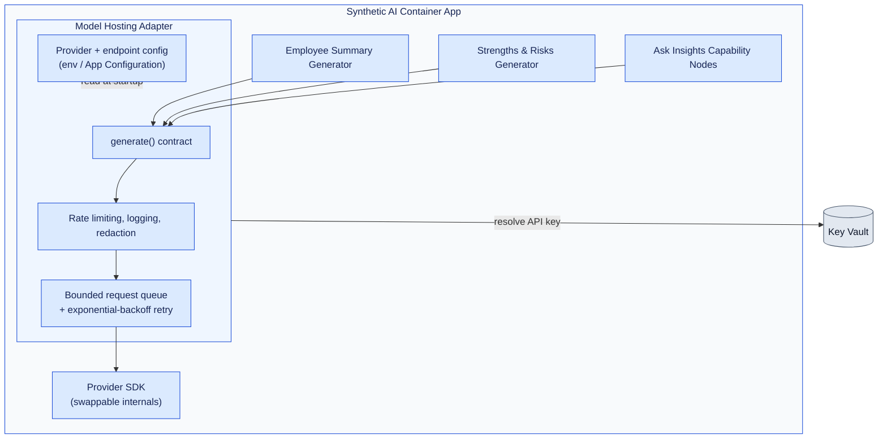
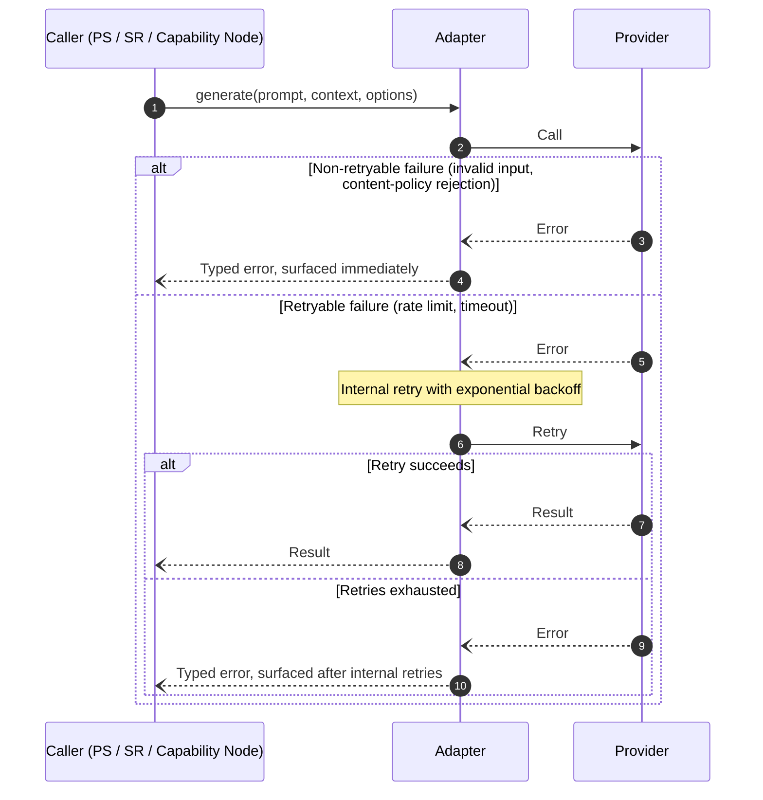

# Design — Model Hosting Adapter (Decision 4)

The Model Hosting Adapter is a single in-house module inside Synthetic AI's own codebase. Every model call from Decisions 1, 2, and 3 goes through it; no caller ever holds a provider SDK. See `solution/Architecture.md`'s Decision 4 and "Provider independence" section for the decision this design implements — this doc does not restate or extend that scope.

## Placement

The adapter lives at `apps/synthetic-ai/src/adapter/` (or equivalent path inside the Synthetic AI app), not in `libs/`. Synthetic AI is the adapter's only caller — the Employee Summary Generator, the Strengths & Risks Generator, and Ask Insights's capability nodes all run inside the same container (see Architecture.md's component view). A shared `libs/` package exists to serve more than one app; this adapter serves one, so it stays local to that app.

## Component view



## Contract

Every caller uses one function signature, regardless of which provider is configured:

```
generate(prompt, context, options) -> Result<Output, AdapterError>
```

| Part      | Content                                                                           |
| --------- | --------------------------------------------------------------------------------- |
| `prompt`  | The instruction text for this call                                                |
| `context` | Caller-supplied data: employee features, conversation history, retrieved evidence |
| `options` | Call-level parameters: model name, temperature, max tokens                        |
| `Result`  | Either the provider's generated `Output`, or a typed `AdapterError`               |

The contract is identical for Decision 1's cache-miss generation, Decision 2's on-demand generation, and Decision 3's capability-node calls. None of them construct a provider-specific request shape.

## Responsibilities centralized in the adapter

| Responsibility         | What it means                                                                                                                                                                         |
| ---------------------- | ------------------------------------------------------------------------------------------------------------------------------------------------------------------------------------- |
| Provider abstraction   | The adapter is the only code that imports a provider SDK. Swapping providers changes the adapter's internals, not any caller                                                          |
| Secrets                | The provider API key is resolved from Key Vault at call time, following the platform's existing two-Key-Vault pattern. The adapter holds no API key in code or config                 |
| Rate limiting          | Enforced once, inside the adapter, for every caller                                                                                                                                   |
| Logging                | Every call and its outcome is logged once, inside the adapter                                                                                                                         |
| Redaction              | Applied once, inside the adapter, if a provider or compliance requirement calls for it                                                                                                |
| Backpressure and retry | An internal bounded request queue with exponential-backoff retry absorbs peak on-demand request volume across all three features without exceeding the provider's rate or token quota |

The queue's concurrency limit is an implementation-time tuning parameter, confirmed once a provider is selected. The queue and retry mechanism themselves are settled; only the numeric limit is pending provider selection.

## Error handling



| Failure class | Examples                                | Adapter behavior                                             |
| ------------- | --------------------------------------- | ------------------------------------------------------------ |
| Retryable     | Rate limit, timeout                     | Retried internally with exponential backoff before surfacing |
| Non-retryable | Invalid input, content-policy rejection | Surfaced to the caller immediately, no retry                 |

Every caller receives the same typed `AdapterError`, distinguishing which class occurred, regardless of which provider produced it.

## Configuration

Provider selection and endpoint config come from environment variables and App Configuration, not hardcoded values. The adapter reads this configuration once, at startup, and resolves the API key from Key Vault using that configuration.
