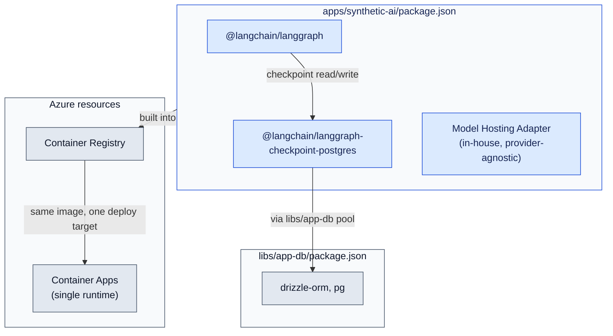

# Stack — AI Features (ADLC-006)

Six new or changed technology choices. Everything else in the platform's stack is unchanged; this document does not re-list it.

## New and changed technologies

| Technology                                 | Type                                          | Owning component / decision                                                                                                                                                              | Constraint                                                                                                                                                                                                                                                                                                                                                   |
| ------------------------------------------ | --------------------------------------------- | ---------------------------------------------------------------------------------------------------------------------------------------------------------------------------------------- | ------------------------------------------------------------------------------------------------------------------------------------------------------------------------------------------------------------------------------------------------------------------------------------------------------------------------------------------------------------ |
| Azure Container Apps                       | Azure resource (new)                          | Synthetic AI's single runtime (Decision 5): Ask Insights's conversational graph, Decision 1's cache-miss generation, Decision 2's on-demand per-employee generation and comparison-weave | Min-replica ≥ 1, UK South, platform's existing VNet, new dedicated subnet                                                                                                                                                                                                                                                                                    |
| Azure Container Registry                   | Azure resource (new)                          | CI/CD target for the deployment unit above                                                                                                                                               | First containerized build/push pipeline on the platform, alongside the existing zip-publish pipelines for Functions and App Service; one image, one deploy step                                                                                                                                                                                              |
| `@langchain/langgraph`                     | npm package, TypeScript                       | Ask Insights's router/capability-node/`synthesize` `StateGraph` (Decision 6)                                                                                                             | Declared in `apps/synthetic-ai`'s own `package.json`, not in `libs/`, per the platform's independent per-app dependency convention; compiled once at process startup, reused across every chat turn. The TypeScript package has a smaller community than its Python sibling — an operational note for support and troubleshooting, not a selection criterion |
| `@langchain/langgraph-checkpoint-postgres` | npm package, TypeScript                       | `PostgresSaver`, Ask Insights's cross-turn conversational memory (Decision 6)                                                                                                            | Exact package name confirmed at implementation time; provides the `PostgresSaver` class that reads/writes the checkpointer schema below. Declared alongside `@langchain/langgraph` in `apps/synthetic-ai`'s `package.json`                                                                                                                                   |
| Drizzle ORM (`libs/app-db`)                | Existing, reused                              | New tables: `ask_insights_checkpoints`, `ask_insights_checkpoint_writes` (Decision 6); `employee_ai_summary`, `employee_strengths_risks` (Decisions 1, 2)                                | No new ORM or connection path. Schema added via `libs/app-db`'s existing migration convention (`yarn nx run app-db:generate`); schema files edited first, migration SQL generated after, never hand-authored                                                                                                                                                 |
| Model Hosting Adapter                      | In-house module, not a third-party technology | `apps/synthetic-ai/src/adapter/` (Decision 4)                                                                                                                                            | Provider-agnostic `generate()` contract; no provider SDK is selected yet, pending the sync with Solinor's product owner, and this stack decision does not block on that choice — swapping providers changes the adapter's internals, not any caller                                                                                                          |

## Dependency placement

