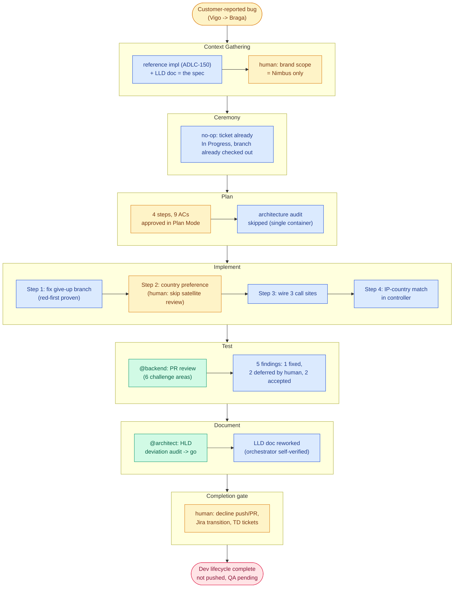
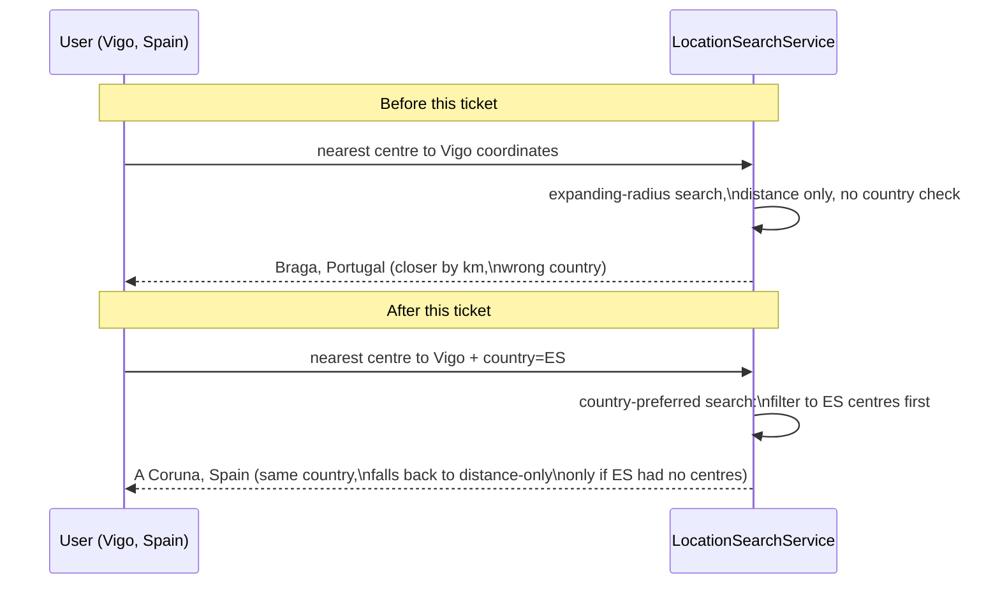
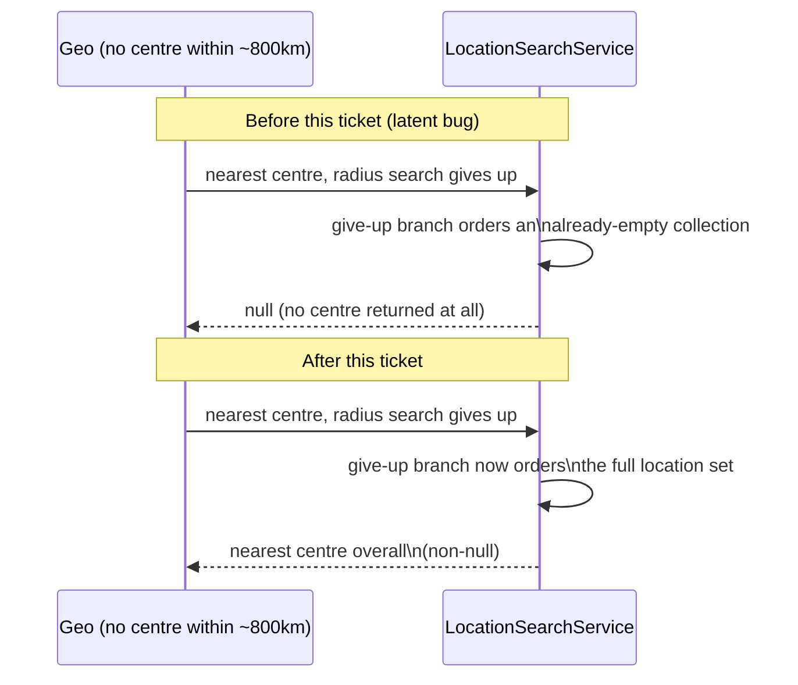

# Session Showcase — Claude ↔ Engineer Collaboration

> **Reconstruction notice.** Unlike the DESIGN-20261017-UX3J showcase, this document was **not** written by the assistant that ran this session — that session predates this conversation entirely. Everything below is reconstructed from the story's own artifacts (`impl/0-intent.md`, `impl/1-plan.md`, `impl/2-report.md`, `impl/stat.json`) rather than from a live transcript. Where the source material states something as fact, it is reported as fact; nothing here is inferred beyond what those four files actually say.

**Ticket:** ADLC-007 — Nimbus country-aware nearest centre
**Trigger:** a customer-reported bug — enquiries from Vigo (Spain) were attributed to Braga (Portugal), the nearest centre by raw distance but the wrong country's sales team
**Flow run:** full `/dev` lifecycle, Context → Ceremony → Plan → Implement (4 steps) → Test → Document
**Observed work:** 1h 3m 53s · **Wait:** 24m 34s · **Unclassified:** 6m 46s (`impl/stat.json`)
**Agent delegations:** 2 — `@backend` (PR review, Test stage) and `@architect` (HLD deviation audit, Document stage). No multi-pass review loop here; see Section 5 for why this session's shape differs so much from the design-lifecycle showcase.

---

## 1. The resulting solution, in one paragraph

`Meridian.Web.Nimbus`'s nearest-centre search (`LocationSearchService`) gains an optional `countryIso2Code` parameter: when supplied and the geo's country has any centre at all, the search returns the nearest centre **in that country**, skipping the distance-only radius loop entirely; only when the country has no centres does it fall through to the original behavior. The geo contact form, POI cards, and child-geo cards now pass their own geo's ISO2 code; a separate IP-geolocation-keyed path in `GetUserNearestCenterId` does the equivalent match on ISO-3. Shipped alongside it: a one-token fix for a latent bug where the radius search's give-up branch re-ordered an already-empty collection and so always returned `null` for any geo with no centre within ~800 km. The change is a byte-for-byte brand clone of an already-merged Meridian Prime reference (ADLC-150) — verified, not assumed, by direct diff.

---

## 2. Collaboration timeline — who decided what

| #   | Decision point                                                                                                                            | Decided by                                            | How                                                                                                                                                                                                                                                                                                                |
| --- | ----------------------------------------------------------------------------------------------------------------------------------------- | ----------------------------------------------------- | ------------------------------------------------------------------------------------------------------------------------------------------------------------------------------------------------------------------------------------------------------------------------------------------------------------------ |
| 1   | Brand scope — Nimbus only, not Meridian Core/Apex HQ/DropDesk                                                                             | 🧑 Human                                              | Confirmed against Jira before sign-off; those three brands already have their own sibling tickets                                                                                                                                                                                                                  |
| 2   | Required vs. optional `countryIso2Code`, and the two-stage call-site rollout (pass `null` in Step 2, flip to the real ISO code in Step 3) | 🤖 Claude                                             | A compiler constraint (`CS1737` forbids an optional parameter before a required one) forced the choice; Claude chose to keep the service and wiring changes independently verifiable rather than diverge from the Meridian Prime reference's parameter order                                                       |
| 3   | Plan's architecture audit — skipped                                                                                                       | 🤖 Claude, approved implicitly via Plan-Mode approval | Judged unnecessary: single HLD container, single brand project, no new module boundary, and the identical change was already audited and merged on Meridian Prime                                                                                                                                                  |
| 4   | Skip a satellite review for Steps 1 and 2                                                                                                 | 🤖 Claude recommended → 🧑 Human confirmed            | `@backend` has no agent-dispatch tool, so it couldn't call `@architect` itself; Claude judged the merged, already-audited Meridian Prime precedent sufficient and put the choice to the developer, who elected to proceed                                                                                          |
| 5   | RF-001 — the PR review's own test brief was incomplete                                                                                    | 🤖 Claude, self-correcting                            | The worker found that a `string.Empty`-only regression test (as briefed) would have passed against unguarded code — worthless as a guard. It wrote a test for the actual gap (`null` input) instead, then verified the pin **empirically** by neutralising the guard and confirming the suite failed exactly there |
| 6   | RF-002 / RF-003 — an `!` suppression and a locale-specific field read                                                                     | 🧑 Human                                              | Explicitly deferred: _"not the issues, proceed"_ (2026-09-30) — logged as tech debt (TD-1, TD-2) rather than fixed in this PR, to preserve exact behavioral parity with the Meridian Prime reference                                                                                                               |
| 7   | RF-004 — widened query performance concern                                                                                                | 🤖 Claude (`@architect`, HLD audit)                   | Accepted as non-blocking on two independently-established grounds: the widening is required for correctness (can't `Take(1)` when the in-country nearest isn't the global nearest), and the expensive O(n log n) sort already ran unconditionally before this change                                               |
| 8   | RF-005 — a pre-existing `OrderBy().ToArray()[0]` inefficiency                                                                             | 🤖 Claude                                             | Accepted as out of scope — pre-existing in all five brand copies, not introduced by this ticket, and fixing it would risk AC-9's byte-parity goal for no functional gain                                                                                                                                           |
| 9   | AC-5 and AC-6 — the two "does it actually work for a user" checks (a live Vigo page load, a live IP-geolocation call)                     | 🧑 Human                                              | Declined to run them during this session; explicitly recorded as **not verified**, carried into the separate QA ticket (ADLC-154) rather than presumed done                                                                                                                                                        |
| 10  | Document stage — skip the `@architect` consistency pass on the LLD doc update                                                             | 🤖 Claude                                             | Every factual claim in the updated doc had already been source-verified directly, and `@architect` had already returned **go** on this same change minutes earlier at Document's HLD-audit step; a second pass was judged to add no signal                                                                         |
| 11  | Completion gate — push branch / open PR, Jira transition, raise tech debt in Jira                                                         | 🧑 Human                                              | All three **declined** — branch stays local (7 commits, no upstream), Jira ticket stays `In Progress`, tech debt stays in the report's own ledger with no tracker key                                                                                                                                              |

**Pattern across this session:** far less inter-agent review than the design-lifecycle showcase — one `@backend` pass and one `@architect` pass, total. Most of the judgment work was the orchestrator's own verification discipline (diffing against the merged reference, proving the bug fix red-first, neutralising a guard to confirm a test actually pins it) rather than a second model reviewing a first model's draft. The human's role was concentrated at three points: confirming scope up front, declining two cosmetic review findings to preserve parity, and declining every externally-visible completion action at the end.

---

## 3. Stages and agent invocations

Only two subagent delegations in the whole session — `@backend` for the Test-stage PR review (covering all four implementation steps in one pass) and `@architect` for the Document-stage HLD audit. Every other verification (red-first proof, diff-based parity checks, the empirical guard-neutralisation test) was the orchestrator working directly against the codebase, not a delegated review.

---

## 4. Before vs. after — the actual bug being fixed

**Certainty check:** both diagrams describe `Meridian.Web.Nimbus` state as of this ticket's commits (`d8bb93ba2` through `2068625f6`). As recorded in Completion, the branch (`feature/ADLC-007`, 7 commits) was **not pushed** and no PR was raised — the fix exists in a local branch, verified by 108/108 passing unit tests and a clean full-solution build, but the two scenarios above were never observed against a live, running brand (AC-5/AC-6 are explicitly unverified).

---

## 5. Where this showcases human ↔ LLM judgment well

- **Self-correction, verified empirically, not asserted.** The PR review's premise for RF-001 was itself wrong (`string.Empty` does _not_ expose the bug — only literal `null` does). The implementing worker caught this, wrote a test for the real gap, and the orchestrator then proved the pin by neutralising the guard and confirming the suite failed exactly there (1 failed / 8 passed) — a judgment call checked against reality rather than left as a claim.
- **Knowing when _not_ to delegate.** Two satellite-review opportunities were explicitly skipped (Plan's architecture audit, Steps 1–2's satellite review, and the Document stage's second `@architect` pass) — each time with a stated reason (single-container scope, an already-merged precedent, or claims already source-verified) rather than silently omitted. Compare this to the design-lifecycle showcase, where the equivalent reviews ran twice each and caught real gaps — the difference is a judgment call about when a second pass adds signal, made explicitly both times.
- **Human-only calls were concentrated and low-frequency.** Scope confirmation up front, two "proceed anyway" calls on cosmetic findings, and three declines at the completion gate — five human decisions total, against the design session's twenty. The lower-risk, higher-precedent nature of a clone-of-an-already-merged-change ticket is exactly the profile where that's appropriate: most of what would otherwise require a human call (parameter shape, architecture fit, test strategy) had already been settled by the Meridian Prime precedent.
- **The one finding the audit corrected independently** (RF-004): the orchestrator's own plan had described the widened query as incidental; `@architect`'s HLD audit established it was actually _required_ for correctness, and that the expensive part of the query already ran unconditionally before this change — a case of the review strengthening the case for a decision already made, not just checking it.

---

## 6. Phase-by-phase reconstruction

### Context Gathering

The ticket carried no acceptance criteria and no Confluence links. The merged ADLC-150 reference and its LLD doc were treated as the spec in its place.

- **Human decisions:** confirmed brand scope (Nimbus only) against Jira before sign-off.
- **Agents involved:** none — orchestrator read the reference commit and LLD doc directly.

### Ceremony

No-op: the ticket was already `In Progress` and assigned to the authenticated user; the worktree was already on `feature/ADLC-007`, clean, and level with `develop`.

- **Human decisions:** none required — both ceremony gates were already satisfied.
- **Agents involved:** none.

### Plan

Approved in Plan Mode and persisted verbatim to `1-plan.md` (285 lines, 4 steps, 9 ACs).

- **Human decisions:** approved the plan as drafted.
- **Agents involved:** none — the architecture audit step was deliberately skipped, reasoned through directly by the orchestrator (single HLD container, single brand project, no new boundary, already-audited reference).

### Implement

Four steps, each landing as its own commit, each verified before moving to the next.

- **Human decisions:** confirmed proceeding without a satellite review at Step 2 (the step that actually changes the service's public signature), on the orchestrator's recommendation.
- **Agents involved:** none during Implement itself — `@backend` has no agent-dispatch tool, so review happened later, consolidated into the Test stage.
- **Notable self-checks:** Step 1's fix was proven red-first (test failed on `develop`, passed after); Step 4 independently confirmed the exact constructor-argument position being changed rather than trusting the plan's line reference.

### Test

- **Human decisions:** _"not the issues, proceed"_ on two of five PR-review findings (RF-002, RF-003), explicitly accepting them as tech debt rather than fixing them in this PR.
- **Agents involved:** `@backend` — one PR-review pass across all six changed files, briefed to challenge six specific risk areas rather than confirm the work. Verdict: go, zero BUG-class findings. It also independently verified the AC-9 byte-parity claim and the RF-004 performance reading at source.

### Document

- **Human decisions:** none explicit — the LLD doc rework and the deliberate skip of a second `@architect` pass were both the orchestrator's calls, implicitly accepted by the lifecycle proceeding to Completion.
- **Agents involved:** `@architect` — one HLD deviation audit against `Containers/Backend.md` and the NFR docs. Verdict: go, no invariant contradicted. It produced the RF-004 correction (above) and confirmed the five-brand code duplication is a pre-existing, already-established pattern, not a new finding against this ticket.

### Completion gate

- **Human decisions:** declined all three externally-visible actions — push branch / open PR, Jira transition, raising tech debt as tracked tickets. Everything left local and in-report.
- **Agents involved:** none — a human-only gate, mirroring the design lifecycle's own human-approval boundary.

---

## 7. Context captured & documentation updated

### Context captured (`impl/2-report.md`)

| Source                                                                | Captured at | What it established                                                                                                                |
| --------------------------------------------------------------------- | ----------- | ---------------------------------------------------------------------------------------------------------------------------------- |
| ADLC-150 (merged, `83b3f1205`, PR 4821)                               | Context     | Reference implementation and target shape — Meridian Prime's already-audited, already-merged equivalent change                     |
| `docs/System Architecture (LLD)/Backend/Nearest Centre Resolution.md` | Context     | Documents the reference's behavior; treated as the spec in place of missing ACs                                                    |
| Developer sign-off (brand scope)                                      | Context     | Confirms Nimbus-only scope; Meridian Core/Apex HQ/DropDesk have their own sibling tickets                                          |
| `@backend` PR review (5 findings)                                     | Test        | One fixed (RF-001), two deferred as tech debt by the developer (RF-002, RF-003), two accepted as non-blocking (RF-004, RF-005)     |
| `@architect` HLD deviation audit                                      | Document    | Verdict go; corrected the performance framing of RF-004; confirmed the five-brand duplication is pre-existing, not a new issue     |
| Developer completion decisions                                        | Completion  | Declined push/PR, Jira transition, and raising tech debt as tracked tickets — all three logged as explicit declines, not omissions |

### Documentation updated

| Doc                                                                                                                     | Kind of change | What changed                                                                                                                                                                                                                                                           |
| ----------------------------------------------------------------------------------------------------------------------- | -------------- | ---------------------------------------------------------------------------------------------------------------------------------------------------------------------------------------------------------------------------------------------------------------------- |
| `docs/System Architecture (LLD)/Backend/Nearest Centre Resolution.md`                                                   | Reworked       | Restructured from a Meridian Prime-only narrative into a brand-agnostic mechanism description with Nimbus folded into the Brand scope table; two actively-false passages corrected (Nimbus no longer has "no country parameter"; the give-up bug is no longer present) |
| `docs/Target Architecture (HLD)/**`                                                                                     | No change      | HLD audit found no settled architectural decision changed                                                                                                                                                                                                              |
| All other candidate docs (LLD README, `docs/README.md`, brand README, `backend/docs/architecture/*`, `.claude/skills/`) | No change      | Checked individually and confirmed not applicable — no new doc, port, adapter, cache key, job, or repeatable pattern introduced                                                                                                                                        |

### Session artifacts (this story's `impl/` folder)

`impl/0-intent.md`, `impl/1-plan.md`, `impl/2-report.md`, `impl/stat.json`, and this `SESSION.md` — all under `docs/Stories/[ADLC-007] Done - Nimbus country-aware nearest centre/`. Unlike the design-lifecycle story, this `/dev` story has not been moved to an `archive/` folder as part of its own lifecycle — the "Done" in its folder name is this harness's fixed naming convention, not an archive-location claim; per the Report's own Completion note, the branch is unpushed and the ticket remains `In Progress` in Jira.
