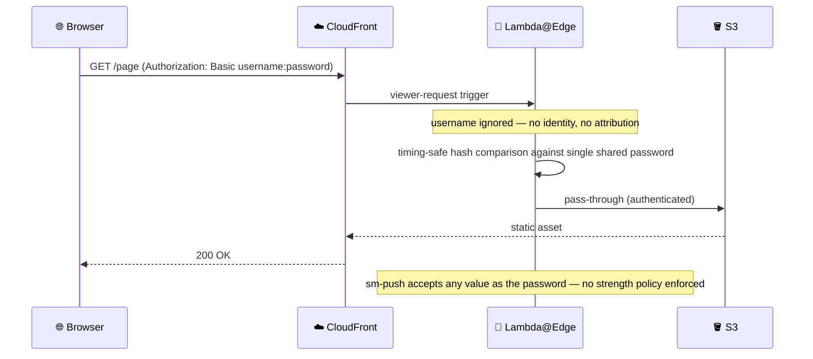
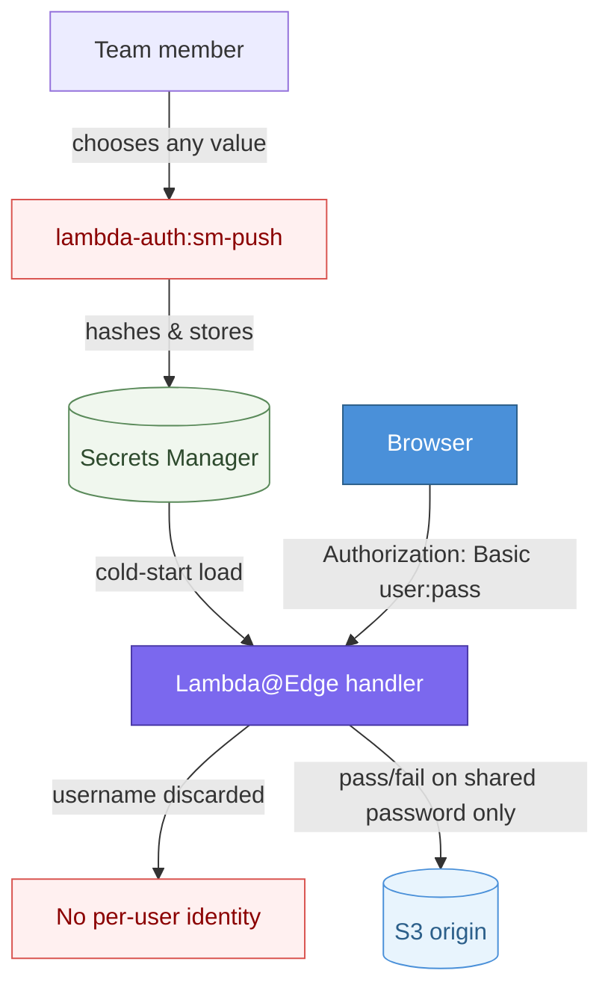

# DESIGN-20261017-UX3J — Configurable Site Authentication (No Auth / Basic Auth / OIDC SSO)

## Problem

The site currently has exactly one auth mode — a single shared HTTP Basic password with no per-user identity, no attribution, no individual revocation (only full password rotation), and no enforced password strength (any value is accepted and hashed via `sm-push`). A BSIMM security review (2026-10-15, Dmitry Vyrostkov) flagged both gaps. This matters now because client stakeholders need individually attributable, revocable access without the team being the password's single point of distribution and rotation.

**Current state:**

## Success

### Known ECs

- EC1: Three auth modes supported: `none`, `basic`, `oidc`, selectable at deployment time via configuration (not runtime toggle)
- EC2: OIDC mode reuses the existing Lambda@Edge auth handler (`apps/lambda-auth`) for redirect, token exchange, and token validation — no separate authorizer component
- EC3: OIDC session state is stored in a cookie (not query string or local storage)
- EC4: OIDC federates to a corporate IdP (e.g. Entra ID directly, or via Cognito federated to Entra ID) using authorization code + PKCE

### Proposed ECs

- [proposed] EC: Until/unless OIDC is deployed, `basic` mode's password must be a randomly generated 20+ character passphrase, not an arbitrary team-chosen string — directly from the BSIMM recommendation on Finding 2; document the generation and sharing method
- [proposed] EC: `none` mode must be clearly flagged as non-production-safe in deployment tooling/docs (e.g. CDK warning or required explicit override) to prevent an accidental open deployment
- [proposed] EC: Token/cookie from OIDC mode must have appropriate expiry and secure attributes (HttpOnly, Secure, SameSite) given this runs at Lambda@Edge in front of a static site
- [proposed] EC: Access logging (NFR-7) must be able to attribute requests to an authenticated identity under `oidc` mode, not just "authenticated/not authenticated" — closing the attribution gap raised in BSIMM Finding 1
- [proposed] EC: Switching auth mode is a deployment-time decision (redeploy), not a runtime feature flag, to avoid an auth bypass window and keep the Lambda@Edge handler's behavior statically verifiable per deployment

## Boundaries

**In scope:** the three deployment-time auth modes (`none`, `basic`, `oidc`); OIDC redirect/token-exchange/validation logic inside `apps/lambda-auth`; cookie-based session storage; the passphrase policy for `basic` mode; CDK/config surface to select the mode at deploy time.

**Out of scope:** building a new identity provider or user directory (Entra ID / corporate IdP is assumed to already exist and be reachable); requesting or provisioning the per-instance IdP app registration itself (an external Admins Helpdesk process, see Constraints); per-route or per-user authorization/RBAC beyond "authenticated or not"; changes to the giscus comment-posting gate (already independently gated by GitHub permission per NFR-6).

## Constraints

- Handler execution must complete within 5 seconds (existing Lambda@Edge constraint, `Auth.md`)
- Response payload must be under 1 MB (existing Lambda@Edge constraint)
- Today, Secrets Manager `GetSecretValue` is the only permitted external call — OIDC mode will need to add token-exchange calls to the IdP; this is a new constraint and is an open design question for Research/Evaluate, not resolved here
- Memory is capped at 128 MB (Lambda@Edge viewer-request ceiling)
- Region must never be hardcoded in source or documentation (repo-wide convention)
- NFR-1 (all routes protected, 401 challenge for unauthenticated) will need updating/generalizing once auth is configurable across three modes
- NFR-2: credentials never hardcoded, loaded from Secrets Manager at cold start
- NFR-7: CloudFront/S3 access must be logged to a private logs bucket — the only way to detect brute-forcing/credential sharing after the fact, since the Lambda@Edge handler itself keeps no record of who authenticated
- For `oidc` mode, a corporate IdP (Entra ID) application registration must be requested per deployed instance of this tool, from "Admins Helpdesk" <AdminsHelpdesk@dataart.com>; this is an external operational dependency outside the team's control, sent manually by the engagement lead (not automated), with currently unknown lead time

## Links

- Ticket: DESIGN-20261017-UX3J
- Related tickets: none
- Reference docs: `docs/Target Architecture (HLD)/v1/Containers/Auth.md`, `docs/Target Architecture (HLD)/v1/Non-Functional Concerns/Requirements.md`
