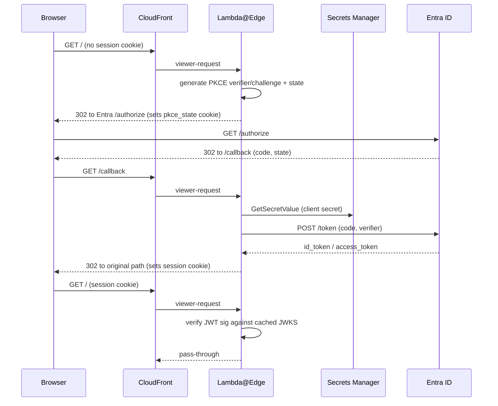
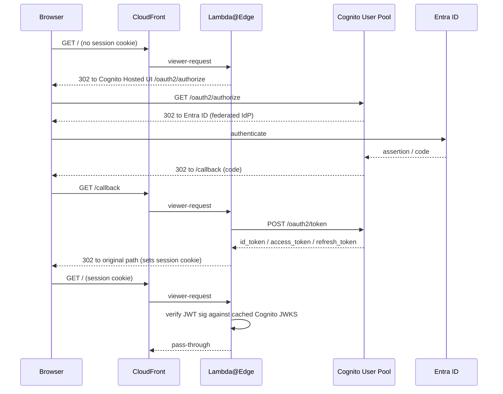
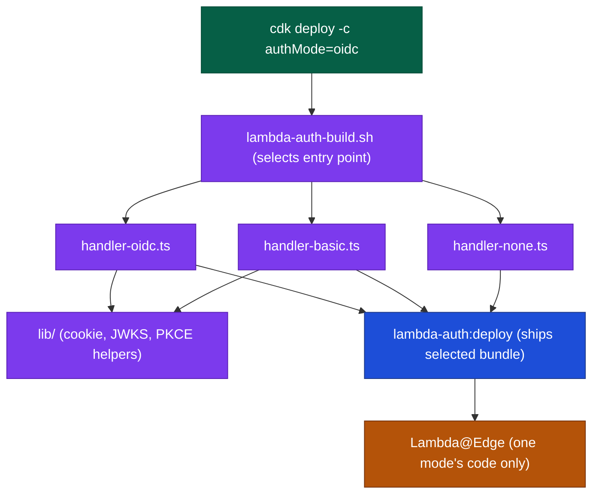
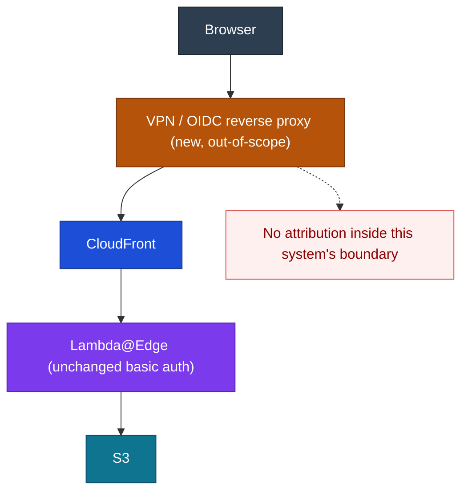
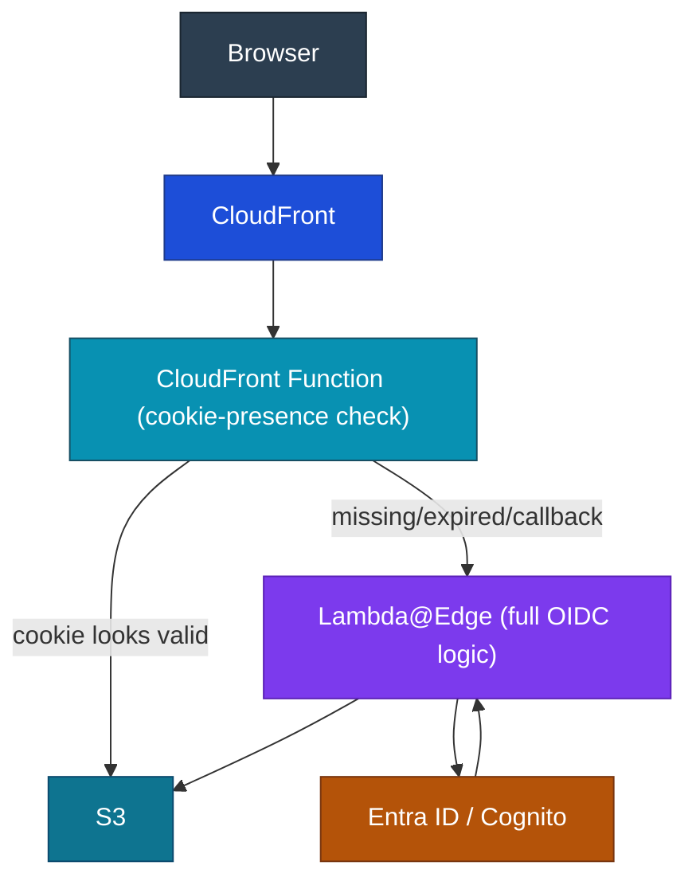

# DESIGN-20261017-UX3J: Configurable Site Authentication (No Auth / Basic Auth / OIDC SSO) — Research

_Produced by the 🔍 Research phase. Owned by `@architect`. Do not edit after Evaluate phase begins._

## Context

BSIMM findings surfaced that the shared Basic Auth password provides no SSO/identity, no per-user attribution, no revocation, and no enforced password policy. This design addresses the mechanism question those findings raise: how to implement a deploy-time-configurable `none`/`basic`/`oidc` auth system inside the existing Lambda@Edge handler (`apps/lambda-auth`), reusing it rather than adding a separate authorizer component, with OIDC federating to the corporate IdP (Entra ID) via authorization-code + PKCE and a cookie-based session. The options below are bounded by: Lambda@Edge's 5s execution timeout, 128MB memory, 1MB response size, and no VPC access; today only `GetSecretValue` is a permitted external call, so OIDC token exchange is a new outbound dependency; CDK provisions a placeholder Lambda in `EdgeStack` (`us-east-1`) with the real bundle shipped separately via `lambda-auth:deploy`; and one Entra ID app registration must be requested per deployed instance from Admins Helpdesk — an external, manual process of unknown lead time.

## Options

### Option A — Direct Entra ID OIDC, single multi-mode handler, build-time AUTH_MODE branch

**Description:** One Lambda@Edge bundle (today's `handler.ts` evolves, doesn't fork). A new `AUTH_MODE` constant (`none`|`basic`|`oidc`) is injected via `esbuild --define` in `build.ts`, exactly like `SM_SECRET_NAME`/`AWS_REGION` are today. At cold start the handler branches into one of three code paths compiled into the same bundle. For `oidc`: on an unauthenticated viewer-request, redirect (302) to Entra ID's `/authorize` endpoint with PKCE challenge + `state`, both stored in a short-lived `Secure; HttpOnly; SameSite=Lax` cookie set on the redirect response (Lambda@Edge is stateless — no server-side session to hold the PKCE verifier). The callback path (same handler, matched on a fixed callback route) does the authorization-code+PKCE token exchange directly against Microsoft identity platform's `/token` endpoint, then sets a signed session cookie (JWT or encrypted claims blob) and redirects to the original path. Subsequent requests validate the session cookie's signature locally against Entra ID's JWKS, cached in memory per the existing `cachedHash`-style pattern (fetch once per cold start, reuse across warm invocations).

**Industry precedent:** Microsoft's documented pattern for SPA/web apps doing auth code + PKCE directly against the Microsoft identity platform (v2.0 endpoint, `/authorize` and `/token`) — the "no intermediary IdP" shape, commonly implemented in edge/serverless contexts without MSAL (following the generic OAuth2 PKCE RFC 7636 flow).

**Diagram:**

**Pros:**

- No new AWS service dependency — satisfies "reuse the existing Lambda@Edge handler, no separate authorizer component" most literally.
- Mode selection is a direct extension of the proven `esbuild --define` pattern already in `apps/lambda-auth/build.ts`.
- One app registration per deployed instance, used directly — simplest Admins Helpdesk ask (single redirect URI, single client ID/secret).

**Cons:**

- Microsoft identity platform client libraries (MSAL) are not edge-optimized; a from-scratch or trimmed implementation must handle PKCE, state/nonce, JWKS rotation, and clock skew without them, increasing bundle size against the 1MB/128MB ceiling and increasing maintenance surface for security-sensitive token-validation code.
- Token exchange is a new external HTTPS call Lambda@Edge doesn't make today — `EdgeStack`'s IAM role only grants `GetSecretValue`; no VPC means this is a new outbound internet call from the edge runtime (new timeout budget, retry, failure-mode UX territory).
- Base option has no session revocation primitive before JWT `exp` — refresh-token handling must be added explicitly to meet the confirmed silent-refresh requirement (see Unknowns).

**Unknowns / risks:**

- Whether Lambda@Edge's 5s timeout reliably covers a cross-region call to Microsoft's token endpoint under edge-location network variance.
- JWKS cache coherency across the ~13 CloudFront edge-location Lambda@Edge replicas (each with its own cold start and cache lifetime) — acceptable risk; document a cache TTL policy.
- Secrets Manager now needs to hold the Entra client secret in addition to/instead of the basic-auth hash — payload shape needs definition, to be resolved in Solution.
- Silent token refresh (confirmed required) must be implemented via a refresh token in this flow — adds complexity not shown in the base diagram above.

---

### Option B — Entra ID federated via Amazon Cognito User Pool, single multi-mode handler

**Description:** Same single-bundle, `AUTH_MODE`-branched handler as Option A, but the `oidc` branch never talks to Entra ID directly. Instead, a Cognito User Pool is provisioned (new CDK construct, e.g. in `DocsStack` or a new stack) with Entra ID registered as a SAML or OIDC federated identity provider on the pool, and Cognito's own Hosted UI/OAuth2 endpoints become the IdP the Lambda@Edge handler redirects to. The handler's redirect target is Cognito's `/oauth2/authorize`; the token exchange is against Cognito's `/oauth2/token`; the session cookie holds Cognito-issued tokens, validated against Cognito's regional JWKS (cached the same way).

**Industry precedent:** AWS's own reference architecture `aws-samples/cloudfront-authorization-at-edge` ("Authorization@Edge") — Lambda@Edge functions at viewer-request performing redirect/callback/refresh against a Cognito User Pool Hosted UI, explicitly built for this edge-auth shape. AWS blog "Authorization@Edge – How to Use Lambda@Edge and JSON Web Tokens to Enhance Web Application Security."

**Diagram:**

**Pros:**

- Cognito absorbs IdP-protocol complexity (SAML-to-OIDC translation, token refresh, standard hosted login UI) — thinner, more auditable Lambda@Edge client code.
- Cognito User Pools natively support refresh-token rotation (directly satisfies the confirmed silent-refresh requirement) and a `GlobalSignOut` revocation API (would exceed the confirmed "wait for JWT expiry is acceptable" bar — a capability headroom, not a requirement here).
- Decouples the Admins Helpdesk app-registration request from Entra specifics beyond "federate this one Cognito pool" — Entra side only needs one enterprise app trusting Cognito's fixed redirect URI, more stable than a CloudFront custom domain if that changes later.

**Cons:**

- Adds a new AWS service (Cognito User Pool + domain + Identity Provider config) as infrastructure the team now owns, tests, and pays for. Confirmed acceptable as a dependency, but the developer's stated preference is to stay within existing services (Lambda@Edge + Secrets Manager) where possible — this option is viable but deprioritized relative to Option A on that basis.
- Per-instance footprint grows: one Entra app registration (trusting Cognito) _and_ one Cognito User Pool + federation config per deployed instance — more CDK surface in `apps/infra` than Option A.
- Still a new outbound HTTPS call from Lambda@Edge (to Cognito's token endpoint) replacing rather than eliminating the external-call constraint question.

**Unknowns / risks:**

- Region handling — Cognito User Pools are regional; the "region never hardcoded" convention (`apps/infra/lib/conventions.ts`) would need Cognito's region/pool ID threaded through the same build-time `--define` mechanism as `SM_SECRET_NAME`.
- SAML vs OIDC federation choice between Cognito and Entra ID is itself a sub-decision not resolved here.

---

### Option C — Per-mode Lambda bundles selected at CDK synth time

**Description:** Instead of one bundle with an `AUTH_MODE` branch baked via `--define`, maintain three thin entry points (`src/handler-none.ts`, `src/handler-basic.ts`, `src/handler-oidc.ts`) sharing common library code (cookie helpers, JWKS cache, PKCE helpers). `apps/infra`'s `EdgeStack` takes a CDK context parameter (e.g. `-c authMode=oidc`) that selects which entry point `build.ts`/`lambda-auth-build.sh` compiles and which bundle `lambda-auth:deploy` ships. The OIDC entry point itself can use either the direct-Entra (Option A) or Cognito-fronted (Option B) token flow — this option is orthogonal to that choice; it's about _how the mode selection and branching happens_, not which IdP integration.

**Industry precedent:** General serverless "build variant" patterns (feature-flagged Lambda deployments via separate artifacts rather than in-process flags), recommended in AWS Lambda best-practices guidance for keeping blast radius and cold-start payload minimal per deployed function; conceptually similar to maintaining separate CDK stack variants per environment profile.

**Diagram:**

**Pros:**

- Each deployed bundle contains only the code path it needs — smaller, more auditable artifacts; a `none`-mode deployment ships no OIDC/basic-auth code at all, reducing attack surface and bundle size against the 1MB Lambda@Edge response/code constraints.
- Static verifiability is stronger than Option A/B's runtime-branch-in-one-bundle: no `if (AUTH_MODE === ...)` dead code path to audit out in review.
- Still deploy-time, not runtime-toggle — satisfies "not a runtime toggle" even more strongly than a baked env var would.

**Cons:**

- Triples the entry points and build configurations to maintain (`project.json` configurations, `.env.*` files, CI build scripts) versus one branching bundle.
- CDK context parameters (`-c`) are easy to omit or mistype at `cdk deploy` time with no compile-time enforcement the way a required `--define` throwing (as `build.ts` does today for missing `SM_SECRET_NAME`) provides.
- Shared library code between three entry points still needs the same OIDC flow risk (Option A) or Cognito dependency (Option B) — this option doesn't remove those unknowns, only changes how mode is selected.

**Unknowns / risks:**

- Whether CDK context-param-driven conditional synthesis introduces drift risk between what was last deployed and what the stack definition currently points to, especially combined with the existing placeholder/real-handler split (`lambda-auth:deploy` ships code out-of-band from the CDK-managed Lambda resource).
- Testing matrix: three bundles mean three separate test suites to keep passing, versus one bundle's three branches today covered by extending `apps/lambda-auth/src/handler.spec.ts`.

---

### Option D — Minimal change: keep Basic-Auth-only Lambda@Edge, bolt on external perimeter control

**Description:** Do not implement `oidc` inside `apps/lambda-auth` at all. Keep today's single-shared-password Basic Auth handler (with the already-proposed 20+ char passphrase policy as the only change), and address per-user identity/revocation by requiring an external perimeter — e.g. a corporate VPN, an IdP-aware reverse proxy/ALB with an OIDC authenticate-action in front of CloudFront, or a corporate IP allowlist combined with a separate SSO-gated jump point.

**Industry precedent:** AWS ALB's native "Authenticate OIDC" listener action (`elasticloadbalancingv2` `AuthenticateOidcConfig`) is the standard AWS-native precedent for perimeter OIDC without touching application/edge code — commonly used in front of ALB-fronted workloads, though not CloudFront+S3 static sites.

**Diagram:**

**Pros:**

- Zero change to `apps/lambda-auth/src/handler.ts` or the CDK stacks — lowest implementation risk and fastest to ship.
- Avoids all Lambda@Edge constraint questions (timeout for token exchange, memory, no VPC, external call expansion) entirely, since the new auth logic lives outside this container.

**Cons:**

- Directly contradicts the Frame's confirmed requirement that OIDC reuse the existing Lambda@Edge auth handler with no separate authorizer component — included only for completeness, not because it satisfies the Frame's requirements.
- Does not solve BSIMM Finding 1 within this system's own boundary — identity/attribution now depends on an external, undocumented component.
- An ALB-with-OIDC-listener approach needs its own compute (ALB + target group) in front of or instead of CloudFront, conflicting with the existing CloudFront+S3 static-site architecture and far exceeding this design's scope.

**Unknowns / risks:**

- What "external perimeter" concretely means is undefined — VPN access provisioning, ALB OIDC listener, and IP-allowlisting are three different unbounded sub-designs, each with its own IdP app-registration and operational burden outside this team's stated boundaries.

---

### Option E — Split edge compute: CloudFront Function for cheap cookie gate, Lambda@Edge only for IdP calls

**Description:** Introduce a lightweight CloudFront Function (sub-millisecond, viewer-request or viewer-response, no network calls) that does the fast-path check — "is there a valid-looking session cookie present?" — and only invokes the existing Lambda@Edge function (heavier, has network access) when a redirect, token exchange, or full JWT/JWKS validation is actually needed (no cookie, expired cookie, or callback path). The OIDC token exchange and validation logic itself still lives in `apps/lambda-auth` (satisfying "reuse the existing handler" for the actual protocol logic), with the CloudFront Function acting purely as a cost/latency optimization in front of it, not as a second authorizer.

**Industry precedent:** AWS guidance on combining CloudFront Functions with Lambda@Edge in tiered authorization pipelines (CloudFront Functions vs Lambda@Edge use-case guidance), though not specifically documented for OIDC.

**Diagram:**

**Pros:**

- Reduces Lambda@Edge invocation volume/cost for the common case (valid session, most requests) by filtering at the cheaper CloudFront Function layer first.
- Keeps all OIDC protocol logic (the security-sensitive part) inside `apps/lambda-auth` — confirmed that this doesn't disqualify the option; it remains a normal tradeoff for Evaluate.

**Cons:**

- Introduces a second edge-compute runtime (CloudFront Functions — distinct JavaScript-only, no-npm-dependency runtime from Lambda@Edge's Node.js) into the Auth container — a second thing to build, test, and deploy, and a second place security logic could drift from `apps/lambda-auth`'s source of truth.
- Marginal benefit given this is a small-team, internal, low-traffic site (~10 users per NFR constraints) — the cost/latency optimization this buys is unlikely to matter at this scale, weakening the case for the added complexity.

**Unknowns / risks:**

- Where PKCE/state and full session JWT validation logic would need to be duplicated or shared between the CloudFront Function and Lambda@Edge runtimes, given CloudFront Functions can't make network calls (no JWKS fetch, no Secrets Manager) and have a much smaller feature set (no `crypto` module parity, 2MB memory, 1ms budget) — likely forces full JWT signature validation to stay in Lambda@Edge anyway, shrinking this option's actual benefit to presence-of-cookie string checks only.

---

## Open Questions

| #     | Question                                                                                                                                 | Owner    |
| ----- | ---------------------------------------------------------------------------------------------------------------------------------------- | -------- |
| OQ-1  | Does "no separate authorizer component" rule out Cognito (Option B) and/or a CloudFront Function (Option E)?                             | Evaluate |
| OQ-2  | Is silent token refresh in scope, or is re-login after expiry acceptable for this ~10-user internal site?                                | Evaluate |
| OQ-3  | Is "wait for JWT expiry" (no instant revocation) an acceptable logout/session-invalidation SLA?                                          | Evaluate |
| OQ-4  | How should multi-region Lambda@Edge JWKS/secret cache staleness across edge-location replicas be handled (TTL policy)?                   | Evaluate |
| OQ-5  | Is Amazon Cognito an acceptable new AWS service dependency for this engagement?                                                          | Evaluate |
| OQ-6  | What clock-skew tolerance should JWT `exp`/`nbf`/`iat` validation use at the edge?                                                       | Evaluate |
| OQ-7  | What PKCE verifier/state cookie attributes (TTL, SameSite) and CSRF/state-replay protections are needed on the callback path?            | Evaluate |
| OQ-8  | What is the new Secrets Manager payload shape once an OIDC client secret is added alongside/instead of the basic-auth hash?              | Evaluate |
| OQ-9  | How is Entra app-registration redirect-URI stability managed given the Admins Helpdesk lead time if the CloudFront domain changes later? | Evaluate |
| OQ-10 | Does "attribution" need to reach CloudFront/S3 access logs (NFR-7), or is Lambda@Edge CloudWatch execution logging sufficient?           | Evaluate |
