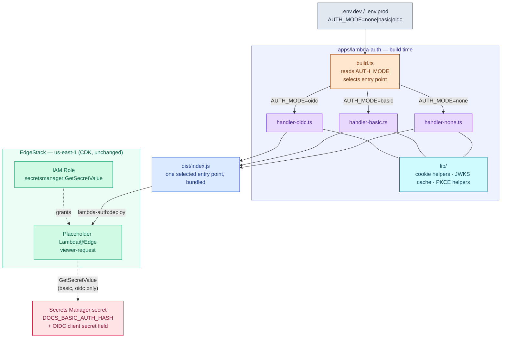
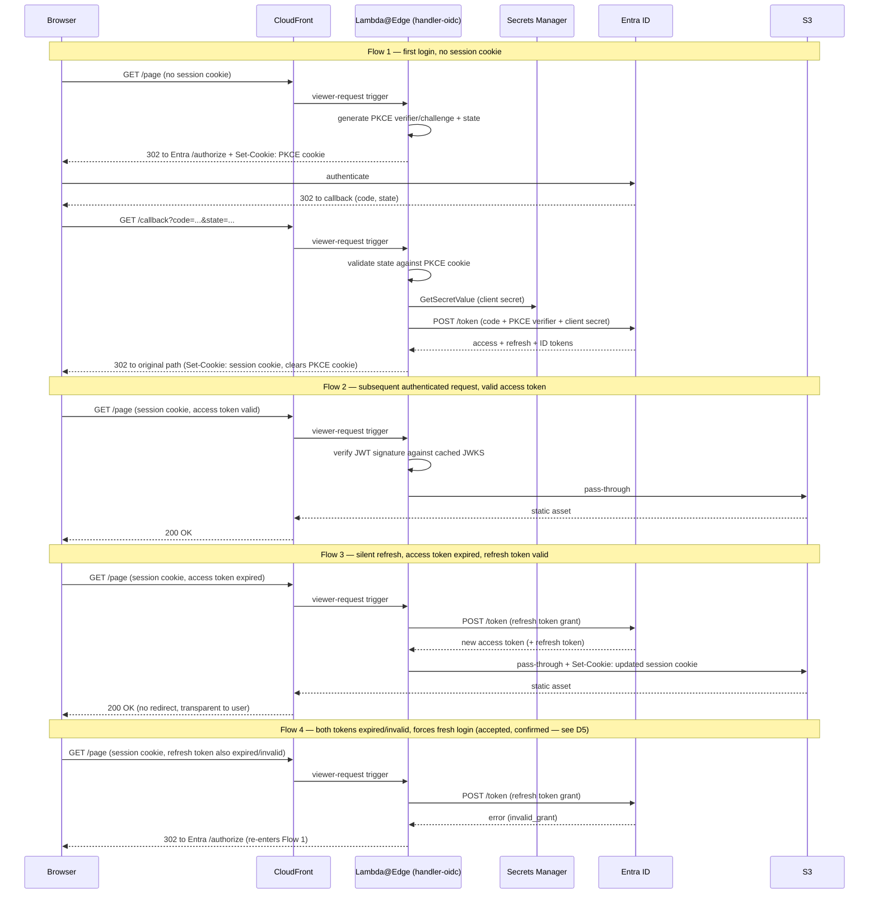

# DESIGN-20261017-UX3J: Configurable Site Authentication — Architecture

_Settled solution record. Rationale for the chosen option lives in `design/02 Evaluate.md` (see Considered Options appendix). This document states only confirmed outcomes._

## Affected boundary and responsibility distribution

The change is contained to the **Auth** container (`apps/lambda-auth`) and its build tooling. **Infrastructure** (`apps/infra`) is unchanged in the resources it provisions — `EdgeStack` still provisions one placeholder Lambda@Edge function and one IAM role; `DocsStack` still provisions one empty Secrets Manager secret. What changes is the **content** of the bundle `lambda-auth:deploy` ships into that placeholder, and the **shape** of the secret `lambda-auth:sm-push` populates.

| Responsibility                                          | Owner                                                       | Change                                                                                   |
| ------------------------------------------------------- | ----------------------------------------------------------- | ---------------------------------------------------------------------------------------- |
| Select which auth behavior ships to a given environment | `apps/lambda-auth` build tooling (`build.ts`, `.env.{env}`) | New — deploy-time `AUTH_MODE` selector                                                   |
| Enforce no-auth pass-through                            | `handler-none.ts`                                           | New entry point, trivial pass-through                                                    |
| Enforce basic-auth challenge/check                      | `handler-basic.ts`                                          | Renamed/relocated from today's `handler.ts`; behavior unchanged                          |
| Enforce OIDC login, session, refresh                    | `handler-oidc.ts`                                           | New entry point                                                                          |
| Shared cookie/JWKS/PKCE helpers                         | `apps/lambda-auth/src/lib/`                                 | New — factored out so all three entry points share one implementation of common concerns |
| Provision placeholder Lambda@Edge + IAM role            | `apps/infra` `EdgeStack`                                    | Unchanged                                                                                |
| Provision auth secret container                         | `apps/infra` `DocsStack`                                    | Unchanged (payload shape inside it changes, schema not infrastructure)                   |
| CloudFront routing to the edge function                 | `apps/infra` `DocsStack` distribution                       | Unchanged                                                                                |

## Deployment/boundary diagram

Exactly one entry point is bundled per build. `build.ts` never ships more than one handler; the other two are not present in `dist/index.js`. `EdgeStack`'s CDK-managed resources (the placeholder Lambda, its IAM role, its 5s timeout) are not re-synthesized by a mode change — only the out-of-band `lambda-auth:deploy` artifact changes.

## Decision register

### D1 — Deploy-time mode selection via `AUTH_MODE` env var

- **Outcome**: A new `AUTH_MODE` env var (`none` | `basic` | `oidc`) in `apps/lambda-auth/.env.dev` / `.env.prod` selects, at build time, which of `handler-none.ts` / `handler-basic.ts` / `handler-oidc.ts` `build.ts` bundles into `dist/index.js`. This follows the existing `SM_SECRET_NAME`/`AWS_REGION` deploy-time-config pattern (envFile locally, SSM via `scripts/ci/lambda-auth-build.sh` in CI, `esbuild --define` injection). No runtime toggle exists — changing mode requires a rebuild and redeploy via `lambda-auth:deploy`.
- **Migration default**: if `AUTH_MODE` is unset, `build.ts` defaults to `basic`, preserving today's behavior for already-deployed instances with zero required action. An explicitly set but invalid value throws at build time, the same guard class as today's `SM_SECRET_NAME` check.
- **Scope/ownership**: `apps/lambda-auth` only. `apps/infra` is not touched by this decision.
- **Affected interfaces**: `build.ts`'s esbuild invocation (new `entryPoints` selection logic); `.env.example` gains an `AUTH_MODE` line; no change to `EdgeStack`'s CDK interface.
- **Failure/recovery**: an invalid `AUTH_MODE` value fails the build before any deploy artifact exists — `lambda-auth:deploy` cannot ship a bad bundle. An unset value is not a failure; it silently preserves current behavior.
- **Operational/security consequence**: each deployed instance carries exactly one mode's code, eliminating dead `AUTH_MODE`-branch logic from the shipped artifact — there is no live code path to audit for a mode the instance doesn't use.
- **Rollout consistency**: Lambda@Edge version propagation across CloudFront edge locations is asynchronous (confirmed by `EdgeStack`'s `RETAIN` removal policy on Lambda versions, which allows multiple versions to coexist during rollout) and can take several minutes. During a mode-switch redeploy, different edge locations may transiently serve the previous `AUTH_MODE`'s behavior for the same site until propagation completes — e.g. some requests still get a Basic Auth challenge while others get redirected to Entra. This is an accepted, transient operational risk inherent to any Lambda@Edge code change (not unique to this design); mitigation is to schedule mode-switch deploys during low-traffic windows, consistent with the ~10-user internal access NFR constraint.
- **Verification**: `build.ts` unit coverage for all three valid values, the unset-defaults-to-basic path, and the invalid-value-throws path.

### D2 — OIDC token flow is direct Entra ID, no intermediary IdP

- **Outcome**: `handler-oidc.ts` implements authorization-code + PKCE directly against the Microsoft identity platform's `/authorize` and `/token` endpoints. No Cognito or other intermediary.
- **Scope/ownership**: `apps/lambda-auth`.
- **Affected interfaces**: a new callback route, handled by the same Lambda@Edge function and matched by request path (no new CloudFront behavior or additional edge function).
- **Failure/recovery**: see Flow 4 below (expired/invalid tokens force re-login).
- **Operational/security consequence**: this is hand-rolled, security-sensitive token-validation code with no MSAL library backing it. An independent security review is required before production rollout of any `oidc`-mode deployment — tracked as an Efforts obligation, not resolved in this document. The post-login redirect target (the originally requested path, restored after the callback) must be validated as a same-origin relative path before use — absolute URLs, protocol-relative URLs (`//evil.com`), or any value that doesn't match the expected relative-path shape are rejected, falling back to the site root (`/`) instead. This prevents the redirect target from being used as an open-redirect vector.
- **Verification**: integration test against Entra's token endpoints (or a mocked equivalent) covering the authorization-code exchange and signature validation; a handler test asserting a crafted absolute/protocol-relative redirect target is rejected and falls back to `/`.

### D3 — Session state held in a signed cookie, no server-side store

- **Outcome**: access token + refresh token are held in a single signed session cookie set by `handler-oidc.ts`, with `HttpOnly; Secure; SameSite=Lax`. No server-side session store — Lambda@Edge remains stateless, consistent with the existing handler. A separate short-lived cookie holds the PKCE verifier and `state` during the redirect round-trip only, and is cleared once the callback completes.
- **Scope/ownership**: `apps/lambda-auth`, specifically `handler-oidc.ts` and `lib/` cookie helpers.
- **Affected interfaces**: two new Set-Cookie response headers (session cookie, PKCE cookie); no new storage infrastructure.
- **Cookie size budget**: the signed session cookie must stay within common browser single-cookie size limits (~4KB). To keep it within that budget, it holds only the access token, refresh token, and the minimal claims needed for D7's attribution logging (subject/UPN) — it does not carry the full ID token or its optional claims (group/role claims etc.). If Entra's access token itself grows too large (e.g. due to group claims), the Entra app registration should be configured to omit optional claims from the token — a registration-level setting, not a code change.
- **Failure/recovery**: a missing or malformed session cookie is treated as unauthenticated and routes to Flow 1 (fresh login). A session cookie that is well-formed and not expired, but fails JWT signature verification (tampered, wrong `kid`, JWKS rotation mismatch), is treated identically — it fails closed and routes to Flow 1, never silently retried or passed through. This is consistent with D2's "hand-rolled, security-sensitive code" posture.
- **Operational/security consequence**: no server-side revocation surface exists because there is no server-side store (see D5).
- **Verification**: cookie-attribute assertions in handler tests (`HttpOnly`, `Secure`, `SameSite=Lax` present on every Set-Cookie); a handler test asserting the serialized session cookie stays under a defined byte budget (e.g. 4096 bytes) for a representative token payload.

### D4 — Silent token refresh

- **Outcome**: on a request with an expired access token but a still-valid refresh token, `handler-oidc.ts` transparently exchanges the refresh token for a new access token against Entra's `/token` endpoint and updates the session cookie — no redirect, no visible re-login. Only when the refresh token itself is expired or invalid does the handler fall back to a fresh login redirect.
- **Scope/ownership**: `apps/lambda-auth`.
- **Affected interfaces**: an additional outbound call from `handler-oidc.ts` to Entra's `/token` endpoint on the expired-access-token path.
- **Failure/recovery**: refresh failure (network error, invalid refresh token) falls back to Flow 4 (fresh login), never to an error page.
- **Operational/security consequence**: adds a token-exchange network call inside the Lambda@Edge viewer-request path, within the existing 5-second execution ceiling.
- **Verification**: handler test simulating an expired access token + valid refresh token, asserting pass-through with an updated Set-Cookie and no redirect.

### D5 — No session revocation mechanism

- **Outcome**: no deny-list or external revocation call is implemented. A compromised or offboarded session remains valid until the access/refresh token pair's natural expiry. This is an accepted, confirmed design limit — confirmed during Evaluate — not an oversight.
- **Scope/ownership**: `apps/lambda-auth`; accepted by engagement stakeholders.
- **Affected interfaces**: none — this is an absence of a capability, not a contract.
- **Failure/recovery**: not applicable; this is the accepted behavior, not a failure mode.
- **Operational/security consequence**: token lifetime values (set by the Entra app registration) become the de facto maximum exposure window for a compromised or offboarded session.
- **Verification**: documented in the published Auth container doc as a stated limit, confirmed accepted by the engagement lead.

### D6 — Secrets Manager payload extended, read scoped per mode

- **Outcome**: the existing per-environment secret gains two new fields, alongside the existing `DOCS_BASIC_AUTH_HASH`: the Entra ID client secret, and a dedicated `OIDC_SESSION_SIGNING_KEY` used to sign/verify the session cookie. The signing key is kept separate from the client secret specifically for rotation independence — rotating the Entra-side client secret must not silently invalidate every live session cookie. Each mode's handler reads only the field(s) it needs: `handler-basic.ts` reads `DOCS_BASIC_AUTH_HASH` only; `handler-oidc.ts` reads the client-secret and `OIDC_SESSION_SIGNING_KEY` fields only; `handler-none.ts` makes no `GetSecretValue` call at all.
- **Scope/ownership**: secret schema owned by `apps/lambda-auth`; secret container provisioning owned by `apps/infra` `DocsStack` (unchanged — still an empty placeholder populated by `lambda-auth:sm-push`).
- **Affected interfaces**: `lambda-auth:sm-push`/`sm-pull` tooling and `.secrets.{env}`/`.secrets.example` files gain the new field; `DocsStack`'s CDK secret resource definition is unchanged.
- **Failure/recovery**: a missing or malformed client-secret field at cold start causes `handler-oidc.ts` to fail closed (fail the request, not pass through), mirroring today's basic-auth behavior on a malformed hash.
- **Operational/security consequence**: IAM role in `EdgeStack` is unchanged — `secretsmanager:GetSecretValue` already covers the extended payload, since it is scoped to the secret ARN, not individual fields. For an `AUTH_MODE=none` deployment, this grant remains present but unused (per the Responsibility table, `handler-none.ts` makes no such call) — `EdgeStack`'s IAM role is defined once, independent of which mode's bundle the separate `lambda-auth:deploy` step will later ship. Tightening this per-mode would require coupling the CDK synth to the build-time `AUTH_MODE` selection, which is explicitly not this design's chosen deployment model (D1 keeps `apps/infra` and `apps/lambda-auth`'s build fully decoupled). This is an accepted tradeoff: a narrow, single-purpose grant (`GetSecretValue` on one named secret ARN, no wildcard) left unused in the `none` case is judged acceptable simplicity cost, not a least-privilege violation requiring a code/infra change.
- **Verification**: handler test for `handler-oidc.ts` asserting fail-closed behavior on a missing/malformed client-secret field.

### D7 — NFR-7 attribution via correlated CloudWatch + CloudFront logs

- **Outcome**: `handler-oidc.ts` logs the authenticated principal's identity claim (e.g. UPN/email from the validated ID token) to CloudWatch alongside CloudFront's `x-edge-request-id` header value, on every authenticated request. An investigator correlates that CloudWatch entry to the corresponding CloudFront/S3 access-log entry via the shared request ID.
- **Scope/ownership**: `apps/lambda-auth`, `handler-oidc.ts` logging only. No change to `DocsStack`'s existing logs bucket or CloudFront standard logging configuration.
- **Affected interfaces**: none beyond the CloudWatch log line format `handler-oidc.ts` emits.
- **Failure/recovery**: not applicable — this is an observability addition, not a request-path control.
- **Operational/security consequence**: this is a manual join an investigator performs across two log sources, not automatic enrichment of the access-log record itself. No new infrastructure (no real-time logs, no Kinesis) is introduced.
- **Verification**: handler test asserting the identity claim and `x-edge-request-id` both appear in the emitted log line for an authenticated `oidc`-mode request.

### D8 — External Entra app registration, outside code scope

- **Outcome**: one Entra ID app registration is requested per deployed instance from Admins Helpdesk — external, manual, outside this design's code scope. Redirect-URI stability risk if the CloudFront domain changes post-registration is an accepted, tracked operational risk, not solved in code.
- **Scope/ownership**: engagement lead / Admins Helpdesk, carried forward from Frame.
- **Affected interfaces**: none in this codebase.
- **Failure/recovery**: not applicable — process risk, not a system failure mode.
- **Operational/security consequence**: a domain change without a corresponding app-registration update breaks the OIDC redirect; this is a known, accepted operational dependency.
- **Verification**: tracked as a process item, not a code verification obligation.

### D9 — `basic` mode passphrase policy (operational, not code-enforced)

- **Outcome**: the shared `basic`-mode password must be a randomly generated passphrase of 20+ characters (e.g. via `openssl rand -base64 24` or an equivalent password-manager-generated value), documented in the team's runbook alongside its generation method and sharing process (e.g. a password manager vault, not plaintext chat/email). This is enforced operationally, not by `handler-basic.ts` — the handler only ever compares an incoming password against a stored SHA-256 hash (`DOCS_BASIC_AUTH_HASH`); it has no access to the raw password at generation time to validate its length or entropy.
- **Scope/ownership**: engagement team process / runbook documentation, not `apps/lambda-auth` code.
- **Affected interfaces**: none in code; a documentation obligation for Publish.
- **Failure/recovery**: not applicable — this is a process control, not a runtime behavior.
- **Operational/security consequence**: closes the BSIMM Finding 2 gap ("no password policy is defined or enforced... any value is accepted") for as long as `basic` mode remains in use anywhere.
- **Verification**: the runbook update itself is the verification artifact — tracked as a Publish/documentation obligation, not a code test.

### D10 — `none` mode build-time warning

- **Outcome**: when `build.ts` selects `AUTH_MODE=none`, it prints a warning to stdout (visible in local builds and CI logs) stating that the deployed instance will have no access control whatsoever and should not be used for any instance serving real/non-public content. This is a warning only — the build does not fail or require an additional confirmation variable.
- **Scope/ownership**: `apps/lambda-auth`'s `build.ts`.
- **Affected interfaces**: `build.ts`'s console output; no new env var, no build failure path.
- **Failure/recovery**: not applicable — informational only, by design (a hard block was considered and explicitly not chosen, to keep `none` mode's build path as simple as `basic`/`oidc`'s).
- **Operational/security consequence**: makes an accidental or under-considered `none`-mode deployment visible in build logs without adding friction to legitimate uses (e.g. fully public documentation with no confidentiality need).
- **Verification**: a `build.ts` test asserting the warning is printed to stdout when `AUTH_MODE=none` is resolved (including via the default-to-`basic` path NOT triggering it).

## Representative flows

### Flows 1–4 — first login, steady-state, silent refresh, and forced re-login

Traced together below since the recovery and failure branches both extend the same request path as the normal login flow.

**Initial token-exchange failure (Flow 1).** If Entra's token endpoint is unreachable, times out, or returns anything other than a successful token response during Flow 1's `POST /token` step (network error, 5xx, malformed response), `handler-oidc.ts` fails closed: it returns an error response to the browser directly — no pass-through, no silent retry. The user recovers by reloading the page, which restarts Flow 1 from the top. This is distinct from D4's refresh-grant failure handling (Flow 4), which explicitly re-enters Flow 1 after a _refresh_ failure — this case is a failure of the _initial_ code exchange, not a refresh.

### `basic` mode and `none` mode

Unchanged from today's documented behavior: `basic` performs the existing timing-safe password check; `none` passes through unconditionally. See `docs/Target Architecture (HLD)/v1/Containers/Auth.md`'s existing sequence diagram — no material change to either flow in this design.

## References to existing architecture (delta only)

- `docs/Target Architecture (HLD)/v1/Containers/Auth.md` describes today's single-mode basic-auth handler. The delta: three deploy-time modes, the `AUTH_MODE` build selector, the OIDC flow, and the extended Secrets Manager payload — all recorded in this document's decision register.
- `docs/Target Architecture (HLD)/v1/Containers/Infrastructure.md` describes `EdgeStack`/`DocsStack` provisioning. The delta: none to the CDK-managed resources themselves; only a note that the shipped Lambda code now varies by `AUTH_MODE` at build time.
- `docs/Target Architecture (HLD)/v1/Non-Functional Concerns/Requirements.md` NFR-1 currently states "protected by basic auth"; the delta generalizes this to "protected per the configured `AUTH_MODE`," and a new NFR is needed for OIDC-specific requirements (token validation, PKCE, attribution per D7).

## Affected architecture documents (for Publish)

| Document                                                                    | Change                                                                                                                                   |
| --------------------------------------------------------------------------- | ---------------------------------------------------------------------------------------------------------------------------------------- |
| `docs/Target Architecture (HLD)/v1/Containers/Auth.md`                      | Full rewrite — three modes, deploy-time selection mechanism, OIDC flow, Secrets Manager payload shape, NFR-7 attribution approach        |
| `docs/Target Architecture (HLD)/v1/Containers/Infrastructure.md`            | Minor delta — note that `EdgeStack`'s shipped Lambda code varies by `AUTH_MODE` at build time; CDK-managed resources unchanged           |
| `docs/Target Architecture (HLD)/v1/Non-Functional Concerns/Requirements.md` | Generalize NFR-1 to "per the configured `AUTH_MODE`"; add a new NFR for OIDC-specific requirements (token validation, PKCE, attribution) |

## Open items for Solution follow-through

- Define a concrete JWKS/secret cache TTL policy before implementation (governs staleness across Lambda@Edge's edge-location replicas).
- Define concrete PKCE cookie TTL and CSRF/state-replay protection parameters before implementation.
- Commission an independent security review of the OIDC/PKCE/JWT code before production rollout of any `oidc`-mode deployment (WAF P1 obligation).
- Load/latency-test the token-exchange call against the Lambda@Edge 5-second timeout from representative edge locations before rollout.

## Considered Options

A full options analysis is in `design/02 Evaluate.md`. In summary: five architectural approaches were evaluated for implementing a deploy-time-configurable `none`/`basic`/`oidc` auth system inside the existing Lambda@Edge handler — (A) direct Entra ID OIDC in a single branching bundle, (B) Entra ID federated via a new Amazon Cognito User Pool, (C) per-mode Lambda bundles selected at build time, (D) keeping Basic Auth unchanged and bolting on an external perimeter (VPN/ALB), and (E) splitting a CloudFront Function cookie-check in front of Lambda@Edge. The chosen approach combines (A)'s direct-Entra token flow with (C)'s per-mode build-time bundle selection — it avoids adding a new AWS service (Cognito), keeps the per-instance operational footprint to one Entra app registration, and ships zero auth-protocol code for modes an instance doesn't use. Option B was not disqualified but was deprioritized against a stated preference to avoid new AWS service dependencies; Option D was excluded outright for not reusing the existing Lambda@Edge handler at all; Option E's added runtime split wasn't justified at this site's traffic scale.
