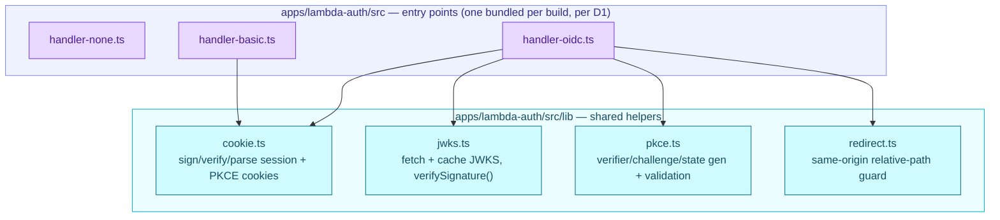
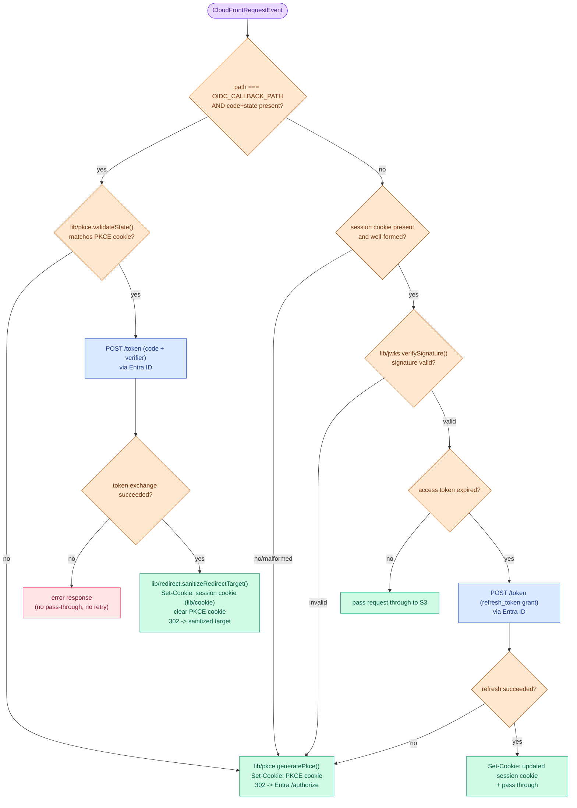

# DESIGN-20261017-UX3J: Configurable Site Authentication — Design

_Implementation design. Every decision here traces to Architecture.md's register (D1–D10), which is settled and authoritative. This document adds only implementation-level detail — module shapes, contracts, concrete schemas, and verification obligations — not new architectural decisions._

## Module structure



`handler-none.ts` uses no `lib/` module — it has no state to manage. `handler-basic.ts` uses only `lib/cookie.ts`... actually it uses none of the new `lib/` modules; it keeps today's `handler.ts` logic (Secrets Manager hash check) verbatim and is not shown attached to `lib/` above because it owns no cookie/JWKS/PKCE concern. Only `handler-oidc.ts` depends on all four `lib/` modules.

### `handler-none.ts`

- **Responsibility**: unconditional pass-through. No auth check, no Secrets Manager call, no cookie.
- **Owns**: nothing beyond the Lambda@Edge contract.
- **Must not**: import `@aws-sdk/client-secrets-manager` or any `lib/` module — keeping the bundle minimal is itself evidence the mode ships no dead auth logic (Architecture.md D1).

```ts
export const handler = async (event: CloudFrontRequestEvent): Promise<CloudFrontRequestResult>
```

Returns `event.Records[0].cf.request` unconditionally.

### `handler-basic.ts`

- **Responsibility**: today's `handler.ts` logic, relocated verbatim — timing-safe SHA-256 password check against `DOCS_BASIC_AUTH_HASH`, module-level `cachedHash`, `Basic` challenge on 401.
- **Owns**: the only code path that reads `DOCS_BASIC_AUTH_HASH`.
- **Must not**: change behavior from today's `handler.ts` — this is a file move/rename, not a rewrite.

```ts
export const handler = async (event: CloudFrontRequestEvent): Promise<CloudFrontRequestResult>
```

### `handler-oidc.ts`

- **Responsibility**: route an incoming request to one of {initial redirect, callback/token-exchange, steady-state validation, silent refresh} and enforce D2–D7.
- **Owns**: the single entry point for all four OIDC flows; the only place that decides which flow applies to a given request.
- **Must not**: implement cookie signing, JWKS fetching, PKCE generation, or redirect-target validation itself — those are delegated to `lib/`.

```ts
export const handler = async (event: CloudFrontRequestEvent): Promise<CloudFrontRequestResult>
```

### `lib/cookie.ts`

- **Responsibility**: sign, verify, and parse the session cookie and the PKCE cookie; enforce `HttpOnly; Secure; SameSite=Lax`; enforce the ~4KB budget (D3).
- **Signing key**: derived from a **dedicated signing-key field** in the Secrets Manager payload (`OIDC_SESSION_SIGNING_KEY`, see schema below), not reused from `OIDC_CLIENT_SECRET`. Rationale: the client secret is Entra-issued and rotates on Entra's schedule, outside this codebase's control; a compromised or rotated client secret must not silently invalidate every live session cookie, and a dedicated key keeps the two rotation lifecycles independent.
- **Session cookie shape** (JSON, short keys, base64url-encoded, HMAC-SHA256-signed):
  ```json
  {
    "at": "<access_token>",
    "rt": "<refresh_token>",
    "sub": "<subject>",
    "upn": "<user principal name>",
    "exp": 1700000000
  }
  ```
  Deliberately excludes the full ID token and any optional claims (group/role) — only `sub`/`upn` are carried, matching D3's attribution-only claim set and byte budget.
- **Owns**: the only module that knows the cookie wire format and signing key derivation.
- **Must not**: make any network call (no JWKS fetch, no token exchange) — it is pure encode/decode/sign/verify.

```ts
export function signSessionCookie(payload: SessionPayload, signingKey: Buffer): string;
export function verifySessionCookie(cookieValue: string, signingKey: Buffer): SessionPayload | null;
export function signPkceCookie(payload: PkcePayload, signingKey: Buffer): string;
export function verifyPkceCookie(cookieValue: string, signingKey: Buffer): PkcePayload | null;
export function assertByteBudget(cookieValue: string, maxBytes?: number): void; // throws if exceeded
```

### `lib/jwks.ts`

- **Responsibility**: fetch Entra's JWKS endpoint once per cold start and cache in module scope (mirrors today's `cachedHash` pattern); verify a JWT's signature against the cached key set.
- **Owns**: the only outbound JWKS fetch in the codebase. Both the steady-state check (Flow 2) and the invalid-signature fail-closed path (D3) call `verifySignature` here — no duplicate verification logic elsewhere.
- **Must not**: parse cookies or make token-exchange calls — those belong to `handler-oidc.ts` and `lib/cookie.ts` respectively.

```ts
export async function getJwks(issuerUrl: string): Promise<Jwks>; // cached per cold start
export function verifySignature(token: string, jwks: Jwks): boolean;
```

### `lib/pkce.ts`

- **Responsibility**: generate the PKCE code verifier/challenge pair and the `state` value for the initial redirect; validate `state` on callback against the value stored in the PKCE cookie.
- **Owns**: PKCE/state generation and comparison logic exclusively.
- **Must not**: set or read cookies directly — it returns values for `handler-oidc.ts` to hand to `lib/cookie.ts`.

```ts
export function generatePkce(): { verifier: string; challenge: string; state: string };
export function validateState(expected: string, received: string | undefined): boolean;
```

### `lib/redirect.ts`

- **Responsibility**: validate that a post-login redirect target is a same-origin relative path (D2's open-redirect fix); return `/` otherwise.
- **Owns**: the only redirect-target validation logic in the codebase.
- **Must not**: perform the redirect itself — it returns a sanitized path for `handler-oidc.ts` to use in a `Location` header.

```ts
export function sanitizeRedirectTarget(candidate: string | undefined): string; // always returns a safe relative path, defaults to "/"
```

## Request handling — `handler-oidc.ts` branching



Branch order is fixed: path/callback check first, then session-cookie presence, then signature, then expiry/refresh. This mirrors Architecture.md's Flows 1–4 one level more granular, naming the exact `lib/` call each branch makes.

## Changed interfaces / contracts

### Callback route

`OIDC_CALLBACK_PATH = /_auth/callback` — a fixed, build-time-known path under a `_auth/` prefix unlikely to collide with real VitePress content (VitePress routes never start with `_`), matched by `handler-oidc.ts` before any session-cookie check.

### Secrets Manager payload (extends today's shape)

```json
{
  "DOCS_BASIC_AUTH_HASH": "<64-char lowercase hex, basic mode only>",
  "OIDC_CLIENT_ID": "<Entra app registration client ID, oidc mode only>",
  "OIDC_CLIENT_SECRET": "<Entra app registration client secret, oidc mode only>",
  "OIDC_TENANT_ID": "<Entra tenant ID, used to derive issuer/authorize/token URLs, oidc mode only>",
  "OIDC_SESSION_SIGNING_KEY": "<random 32+ byte secret, base64, oidc mode only — see lib/cookie.ts>"
}
```

All fields are optional at the schema level; each handler reads only what its mode needs, per D6. `handler-none.ts` reads none. `handler-basic.ts` reads `DOCS_BASIC_AUTH_HASH` only. `handler-oidc.ts` reads `OIDC_CLIENT_ID`, `OIDC_CLIENT_SECRET`, `OIDC_TENANT_ID`, `OIDC_SESSION_SIGNING_KEY`.

### `build.ts` selection logic (conceptual — not literal code)

- Read `AUTH_MODE` from `process.env`; default to `'basic'` if unset (D1); throw before any esbuild call if set to a value outside `{none, basic, oidc}`.
- Select `entryPoints: ['src/handler-' + AUTH_MODE + '.ts']` in place of today's fixed `'src/handler.ts'`.
- Keep injecting `SM_SECRET_NAME` and `AWS_REGION` via `--define` for every mode (even `none`, for build-config consistency, though `handler-none.ts` never reads them at runtime).
- For `AUTH_MODE=oidc` only, additionally inject build-time constants `handler-oidc.ts` needs that are not secret-sourced: `OIDC_CALLBACK_PATH` (fixed value, could be hardcoded in `lib/redirect.ts`/`handler-oidc.ts` instead of env-injected — either is acceptable; env-injection keeps it consistent with the existing `--define` pattern) and `OIDC_REDIRECT_URI` if the full callback URL cannot be derived from the incoming CloudFront request's `Host` header at runtime (deriving it from the request avoids a new build-time constant and is preferred if viable; fall back to an injected `OIDC_REDIRECT_URI` constant otherwise).
- `external: ['@aws-sdk/client-secrets-manager']` remains for every mode that uses it (`basic`, `oidc`); `handler-none.ts`'s bundle naturally excludes it since nothing imports it.

### `build.ts` `none`-mode warning (D10)

When the resolved `AUTH_MODE` is `none`, `build.ts` prints a warning to stdout before invoking esbuild, stating that the deployed instance will have no access control; this does not affect the build's exit code or output artifact. The warning fires only on an explicit `AUTH_MODE=none`, not on the unset-defaults-to-`basic` path.

### Session cookie

- **Name**: `__Host-docs_session` (the `__Host-` prefix enforces `Secure`, `Path=/`, no `Domain` attribute at the browser level, hardening against the absence of a server-side revocation store, D5).
- **Attributes**: `HttpOnly; Secure; SameSite=Lax; Path=/`.
- **Contents**: see `lib/cookie.ts` shape above — `{at, rt, sub, upn, exp}`, byte-budgeted to stay under ~4096 bytes.

### PKCE cookie

- **Name**: `__Host-docs_pkce`.
- **Attributes**: `HttpOnly; Secure; SameSite=Lax; Path=/`.
- **TTL**: 10 minutes (bounds the redirect round-trip to Entra and back; well short of Entra's own `/authorize` code lifetime).
- **Contents**: `{ "v": "<code verifier>", "s": "<state>" }`, base64url-encoded, HMAC-signed with the same `OIDC_SESSION_SIGNING_KEY`.

## Error handling and failure modes

| Scenario                                                            | Handling                                                                                                                                                                                                      |
| ------------------------------------------------------------------- | ------------------------------------------------------------------------------------------------------------------------------------------------------------------------------------------------------------- |
| Missing/malformed session cookie                                    | Treated as unauthenticated → Flow 1 (`REDIRECT_LOGIN`: generate PKCE, redirect to `/authorize`)                                                                                                               |
| Expired access token, valid refresh token                           | Silent refresh via `POST /token` (refresh grant); on success, `Set-Cookie` updated session cookie, pass through — no redirect (D4)                                                                            |
| Refresh token expired/invalid                                       | Refresh grant fails (`invalid_grant`) → Flow 4, re-enters Flow 1 (fresh login redirect)                                                                                                                       |
| Invalid JWT signature (non-expired)                                 | `lib/jwks.verifySignature()` returns false → fail closed, routed identically to a missing cookie, Flow 1 (D3 correction) — never passed through, never silently retried                                       |
| Initial token-exchange failure (network/5xx/malformed response)     | Fail closed: return an error response directly to the browser, no pass-through, no auto-retry; user recovers by reloading, which restarts Flow 1 from the top                                                 |
| Missing/malformed Secrets Manager client-secret field at cold start | `handler-oidc.ts` fails closed (fails the request, does not pass through), mirroring `handler-basic.ts`'s malformed-hash behavior (D6)                                                                        |
| Redirect target not same-origin relative path                       | `lib/redirect.sanitizeRedirectTarget()` falls back to `/` (D2 correction)                                                                                                                                     |
| `state` mismatch on callback                                        | Treated as a failed login attempt: fail closed, discard the PKCE cookie, restart Flow 1 (redirect to `/authorize` again) — standard CSRF/state-replay protection, consistent with D2/D3's fail-closed posture |
| `AUTH_MODE=none` resolved at build time                             | `build.ts` prints a no-access-control warning to stdout before invoking esbuild; the build still succeeds (D10)                                                                                               |

## Configuration and secrets

- `.env.dev` / `.env.prod` gain an `AUTH_MODE` line (`none`\|`basic`\|`oidc`); `.env.example` documents it with the unset-defaults-to-`basic` note.
- `.secrets.{env}` / `.secrets.example` gain `OIDC_CLIENT_ID`, `OIDC_CLIENT_SECRET`, `OIDC_TENANT_ID`, `OIDC_SESSION_SIGNING_KEY` alongside the existing `DOCS_BASIC_AUTH_HASH`.
- `sm-push`/`sm-pull` (`scripts/local/sm-push.sh`, `scripts/local/sm-pull.sh`, wired via `apps/lambda-auth/project.json`'s `sm-push`/`sm-pull` targets) are **schema-agnostic** — they parse/emit the entire `.secrets.{env}` file generically as `key=value` lines serialized to/from the Secrets Manager JSON blob, with no field names hardcoded. **No script changes are required** for the new fields; only the `.secrets.{env}`/`.secrets.example` file contents change.

## Verification obligations

Extending `apps/lambda-auth/src/handler.spec.ts`-equivalent coverage (one spec file per handler, e.g. `handler-oidc.spec.ts`, plus `lib/*.spec.ts`):

- `build.ts`: all three valid `AUTH_MODE` values select the correct entry point; unset defaults to `basic`; an invalid value throws before any esbuild call; a warning is printed to stdout when `AUTH_MODE=none` is resolved, and is NOT printed when it defaults to `basic` (D10).
- `handler-none.ts`: any request passes through unconditionally.
- `handler-basic.ts`: full existing `handler.spec.ts` suite, unchanged, re-targeted at the relocated file.
- `handler-oidc.ts` — one test per error-handling table row above:
  - missing/malformed session cookie → redirect to `/authorize`
  - expired access token + valid refresh token → pass-through with updated `Set-Cookie`, no redirect (D4)
  - refresh token expired/invalid → re-enters Flow 1
  - invalid JWT signature (non-expired) → fail closed, routed to Flow 1, not passed through
  - initial token-exchange failure (mocked network error / 5xx / malformed response) → error response returned, no pass-through, no retry
  - missing/malformed `OIDC_CLIENT_SECRET` at cold start → fail closed
  - crafted absolute/protocol-relative redirect target → `lib/redirect.sanitizeRedirectTarget()` falls back to `/`
  - `state` mismatch on callback → fail closed, PKCE cookie discarded, restarts Flow 1
- `lib/cookie.ts`: cookie-attribute assertions (`HttpOnly`, `Secure`, `SameSite=Lax` present on every `Set-Cookie`); byte-budget test asserting a representative session payload serializes under 4096 bytes.
- `lib/jwks.ts`: `verifySignature()` correctly accepts a validly-signed token and rejects a tampered/wrong-`kid` token against a fixture JWKS.
- `lib/pkce.ts`: `validateState()` accepts a matching state and rejects a missing/mismatched one.
