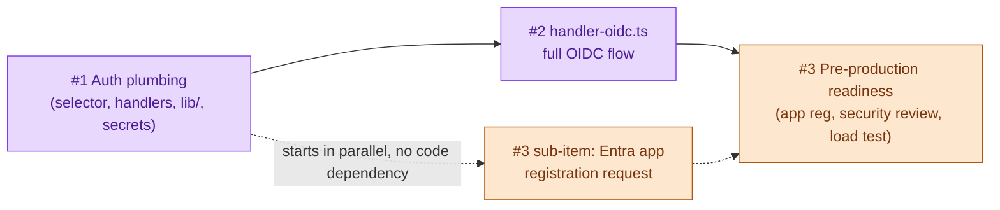

# DESIGN-20261017-UX3J: Configurable Site Authentication — Efforts

_Delivery breakdown. Every unit here traces to a decision in `solution/Architecture.md`'s register (D1–D10), an implementation contract in `solution/Design.md`, or a technology choice in `solution/Stack.md`. No new scope is introduced._

## WBS

| #   | Summary                                                                                                                                                                                                                                                                                                                                                                                                                                                                                                                                                                                                                                                                                                                               | Type          | Layer                                                       | Depends on                                                     |
| --- | ------------------------------------------------------------------------------------------------------------------------------------------------------------------------------------------------------------------------------------------------------------------------------------------------------------------------------------------------------------------------------------------------------------------------------------------------------------------------------------------------------------------------------------------------------------------------------------------------------------------------------------------------------------------------------------------------------------------------------------- | ------------- | ----------------------------------------------------------- | -------------------------------------------------------------- |
| 1   | Auth plumbing: deploy-time `AUTH_MODE` selector in `build.ts` (migration default to `basic`, throw on invalid value, per D1); a stdout warning printed by `build.ts` when `AUTH_MODE=none` resolves, stating the deployed instance has no access control (per D10); `handler-none.ts` (new, trivial pass-through) and `handler-basic.ts` (relocate today's `handler.ts` verbatim, no behavior change); OIDC shared library (`lib/cookie.ts`, `lib/jwks.ts`, `lib/pkce.ts`, `lib/redirect.ts` + `jose` dependency); extended Secrets Manager payload (`OIDC_CLIENT_ID`, `OIDC_CLIENT_SECRET`, `OIDC_TENANT_ID`, `OIDC_SESSION_SIGNING_KEY`) and updated `.secrets.example`/`.secrets.dev`/`.secrets.prod`/`.env.example` documentation | feat          | apps/lambda-auth                                            | —                                                              |
| 2   | `handler-oidc.ts` — full OIDC flow (initial redirect, callback/token-exchange, steady-state JWT validation, silent refresh) covering every row of Design.md's error-handling table                                                                                                                                                                                                                                                                                                                                                                                                                                                                                                                                                    | feat          | apps/lambda-auth                                            | 1                                                              |
| 3   | Pre-production readiness: Entra ID app registration request to Admins Helpdesk (per deployed instance); independent security review of the hand-rolled OIDC/PKCE/JWT-validation code (WAF P1 obligation); token-exchange load/latency test against the Lambda@Edge 5s timeout from representative edge locations; runbook documentation for D9's `basic`-mode passphrase generation/sharing process                                                                                                                                                                                                                                                                                                                                   | spike / chore | External / engagement lead, Security / QA, apps/lambda-auth | 2 (app-registration sub-item: none — start in parallel with 1) |

### Why each unit traces

- **#1** implements D1 exactly (the `AUTH_MODE` selector, migration default, build-time throw guard), D10's `build.ts` stdout warning for `AUTH_MODE=none`, the `handler-none.ts`/`handler-basic.ts` split Architecture.md's responsibility table and Design.md's module structure call for, Design.md's four `lib/` modules and Stack.md's `jose` addition, and D6's extended Secrets Manager payload plus the schema-agnostic `sm-push`/`sm-pull` tooling note in Design.md. These sub-items are independent of each other with no code dependencies outside this ticket: the D10 warning is a few lines in `build.ts`'s existing `AUTH_MODE` branch; `handler-none.ts` owns no shared module and `handler-basic.ts` is a verbatim relocation; the shared library's functions take keys/secrets as parameters (`signSessionCookie(payload, signingKey)`) rather than reading Secrets Manager themselves; the secrets schema is a documentation/tooling change only. Together they constitute everything `handler-oidc.ts` needs to exist before it can be written.
- **#2** is `handler-oidc.ts`, which per Design.md's module structure imports all four `lib/` modules, is one of the three entry points `build.ts` selects between, and reads the four new Secrets Manager fields at cold start — all delivered by #1, so #2 cannot start before #1 lands.
- **#3** implements D8 (Entra ID app registration — external, manual, outside code scope, carried forward from Frame's constraint on unknown lead time), the Architecture.md D2 obligation ("An independent security review is required before production rollout") and its matching Open Item, and the Open Item "Load/latency-test the token-exchange call against the Lambda@Edge 5-second timeout." The security review and load test sub-items review and exercise the code #2 produces (the load test additionally needs a real Entra app registration), so those sub-items cannot start before #2 exists. The app-registration sub-item has no such dependency and should be kicked off immediately, in parallel with #1, given its unknown external lead time — it is grouped into #3 for tracking only, not because it is sequenced after #2. #3 also includes writing the runbook documentation for D9's `basic`-mode passphrase generation/sharing process (operational documentation, not code) — it has no code dependency and can proceed alongside the other pre-production readiness sub-items.

## Sequencing

#1 has no dependencies and starts day one. #2 cannot start until #1 lands (selector, handlers, shared library, and secret schema it all needs). #3's security-review and load-test sub-items gate on #2 (they review/exercise the code it produces); its app-registration sub-item has no code dependency and should start in parallel with #1, not wait for #2.

**The app-registration sub-item of #3 should be kicked off immediately, in parallel with #1, despite #3 as a whole being sequenced after #2.** It is a human process request to Admins Helpdesk, not a technical task — its lead time is unknown and outside this team's control (the constraint carried forward from Frame). It is not required for #1 or #2 to be implemented and unit-tested against a mocked Entra endpoint, but it is a hard prerequisite for the load-test sub-item (needs a real app registration to exchange real tokens against) and, downstream, for any production rollout of `oidc` mode. Starting it late risks it becoming the long pole that blocks rollout even after all code work is done.

## Spikes

The app-registration and load-test sub-items of #3 are dedicated spike work rather than MCP-assisted investigations resolvable during design:

- **App-registration request** cannot be resolved via any available MCP connector — it is a human process request to an external mailbox (Admins Helpdesk) requesting an Entra ID app registration, not a technical investigation with a queryable answer. No MCP can submit or expedite this request on the team's behalf.
- **Load/latency test** requires implementation-time validation: it needs a real, deployed `handler-oidc.ts` (the artifact #2 produces) making a real token-exchange call against a real Entra app registration (the artifact the app-registration sub-item produces) from representative edge locations, measured against the Lambda@Edge 5-second execution ceiling. This is not knowable from documentation or a mocked endpoint at design time — it can only be answered once both prerequisites exist.

Both are therefore legitimate spike work within #3, not design-time MCP lookups.

## Estimate

| #         | Description                                                                                                                                            | Estimate |
| --------- | ------------------------------------------------------------------------------------------------------------------------------------------------------ | -------- |
| 1         | Auth plumbing: `AUTH_MODE` selector, `handler-none.ts`/`handler-basic.ts` split, OIDC shared library, Secrets Manager payload extension + tooling docs |          |
| 2         | `handler-oidc.ts` full OIDC flow                                                                                                                       |          |
| 3         | Pre-production readiness: Entra ID app registration request, independent security review, token-exchange load/latency test                             |          |
| **Total** |                                                                                                                                                        |          |

Estimates are left for the developer to fill in after reviewing each unit's scope in their IDE against Architecture.md, Design.md, and Stack.md.
