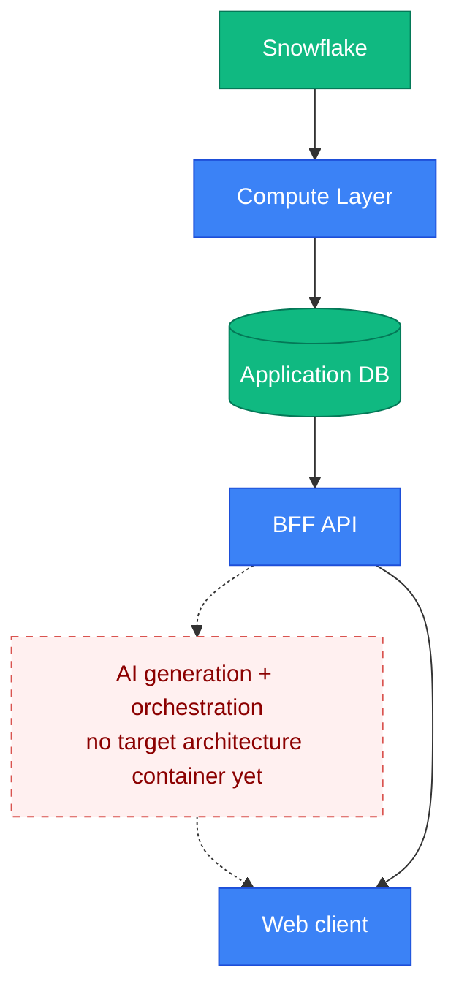

# ND-679 — AI Features (Player Summary, Strengths and Risks, Ask Magpie)

## Problem

M1.5 needs a technical design for three AI features before implementation can start: an AI-generated Player Summary, a Strengths and Risks Summary, and Ask Magpie, a conversational Q&A assistant. All three read only data already in Magpie AI, use NUFC-owned model accounts and pay for every call, and must follow the platform's existing rule that the BFF never queries Snowflake directly (Snowflake → Compute Layer → Application DB → BFF API → client). The generation strategy for each feature — pre-computed ahead of time, generated at runtime, or a hybrid — is still open, since NUFC sets the freshness bar and absorbs the per-call cost; the design must support whichever strategy NUFC picks while keeping cost bounded. Ask Magpie also needs an orchestrator plus sub-agent structure (player summary, strengths and risks, video) that the current Target Architecture has no container for, and it must enforce the same role-based data restrictions — notably medical and scouting data — as every other read path. Player Summary and Strengths & Risks are committed to the First Release and Ask Magpie to the Full Release; without an agreed architecture, neither commitment can be estimated or built.

**Current state:**

## Success

### Known ECs

- Architecture decision recorded for generation strategy (pre-computed, runtime, or hybrid) per feature, including how it maps to the platform's Synthetic Layer target architecture
- Data flow diagrams for all three features that follow the Snowflake → Compute Layer → Application DB → BFF API → client rule
- Permission and role-restriction handling defined for summaries that contain medical or scouting data
- Ask Magpie agent structure reconciled (two-agent vs. orchestrator with sub-agents) and documented
- Caching strategy defined to bound AI generation cost for runtime-generated content
- Open questions list compiled for NUFC: freshness bar, player population per feature, cost per generation, acceptable wait times

### Proposed ECs

- [proposed] Observability EC: log and track AI generation calls (latency, cost per call, success/failure rate) per environment so NUFC-owned model spend is visible and auditable, not just functionally correct
- [proposed] Graceful degradation EC: define what the user sees when model generation fails, times out, or a pre-computed summary is stale or missing — for Ask Magpie's guardrail case and for the Player Summary / Strengths & Risks display states
- [proposed] Data-processing boundary EC: define exactly which fields are excluded or redacted before any model call, since Ask Magpie's free-text mode and scouting-note content could otherwise expose personal or restricted data to the model
- [proposed] Cost guardrail EC: define a per-environment rate limit or budget ceiling on model API calls, independent of caching, so a runaway client or bug cannot produce unbounded NUFC billing

## Decisions

This Frame confirmed 6 independent decisions bundled under ND-679 (3 at the original Frame sign-off, 2 added once Decisions 1–3's research surfaced a recurring cross-cutting hosting question, and 1 more added once the hosting research assumed a specific framework — LangGraph — without that choice itself having been evaluated); each gets its own Research → Evaluate → Solution loop per `.claude/skills/design/patterns/multi-decision-split.md`.

| #   | Decision                                      | Why it's independent                                                                                                                                                                                                                                                                                                                                                                                                                                                                                                                                                                                                                      |
| --- | --------------------------------------------- | ----------------------------------------------------------------------------------------------------------------------------------------------------------------------------------------------------------------------------------------------------------------------------------------------------------------------------------------------------------------------------------------------------------------------------------------------------------------------------------------------------------------------------------------------------------------------------------------------------------------------------------------- |
| 1   | AI-Generated Player Summary                   | Own option set (where/when it's generated — pre-computed, runtime, or hybrid), own First Release timeline, approvable without touching the other two decisions                                                                                                                                                                                                                                                                                                                                                                                                                                                                            |
| 2   | Strengths and Risks Summary                   | Different scope shape (comparison-set narratives behave differently from single-player ones), own First Release timeline, separate from Ask Magpie's architecture                                                                                                                                                                                                                                                                                                                                                                                                                                                                         |
| 3   | Ask Magpie                                    | Full Release (not First), structurally different problem (live orchestration + sub-agents vs. generate-and-store narrative), reuses outputs from decisions 1 and 2 but has its own architecture decision                                                                                                                                                                                                                                                                                                                                                                                                                                  |
| 4   | Model hosting / access pattern                | How the platform integrates with whichever AI model provider NUFC eventually selects (Azure OpenAI Service, Azure AI Foundry, direct third-party API, networking and Key Vault pattern) — a provider-agnostic integration-shape decision, distinct from (and not resolving) the out-of-scope provider-selection choice itself. Applies uniformly across all three features rather than being specific to any one of them.                                                                                                                                                                                                                 |
| 5   | Agent/orchestration runtime hosting substrate | Where the agent/orchestrator process itself physically runs (a new BFF module, a new sibling Container App, a reshaped Durable Function, etc.) — this surfaced as the same unresolved open question independently across Decisions 1, 2, and 3's research (each proposed an agent-framework option and each flagged "where does this run" as unresolved), so it is elevated to its own cross-cutting decision rather than re-litigated three times.                                                                                                                                                                                       |
| 6   | Agent orchestration framework choice          | Which library/framework implements the multi-step agent logic itself (LangGraph, plain LangChain, LlamaIndex, Vercel AI SDK, Azure AI Agent Service, Mastra, or a hand-rolled state machine) — distinct from _where_ it runs (Decision 5, hosting substrate) and from the per-feature generation-strategy decisions (1–3), which only assumed "some agent framework" without committing to one. Decisions 1–3's agent-based options all named LangGraph as a placeholder/example, not a confirmed choice; this decision resolves that framework selection once, for reuse across all agent-based options chosen in Decisions 1, 2, and 3. |

## Boundaries

**In scope:** architecture and design for all three features' generation strategy, data flow, caching approach, and permission handling; the Ask Magpie orchestrator/sub-agent structure and guardrails; the new Target Architecture container(s) needed to host this; identifying the open questions NUFC must answer (model provider/hosting, freshness bar, player populations, cost targets).

**Out of scope:** selecting the model provider, hosting, or data-processing location (pending a separate NUFC/Michael decision; this design surfaces it as an open question but does not resolve it); writing the actual prompt wording (NUFC's responsibility); implementing the agent/orchestrator code; the Access Management feature itself (a dependency, not part of this design); RAG database and cross-session memory (not planned for M1.5); player dossier/PDF export (dropped 7 Sep); recommendations or predictive analysis (ruled out 3 Sep); mobile AI entry points (cut from M1.5).

## Constraints

- Model provider, hosting, and data-processing location are not yet decided — a separate NUFC/Michael sync owns that call; this design must not assume a specific provider
- NUFC owns model accounts, API keys, and usage costs in every environment — keys live in Key Vault, per the existing Security NFR pattern already used for Snowflake, PostgreSQL, Redis, and video credentials
- NUFC writes the prompt wording for Player Summary and Strengths & Risks; this design covers generation, storage, and display only
- AI content reads only data already in Magpie AI — no external sources such as news or transfer rumours
- AI content tracks the published dynamic metric configuration and is considered stale when NUFC republishes it
- The BFF never calls Snowflake directly; AI services follow Snowflake → Compute Layer → Application DB → BFF API → client. The BFF container doc documents one exception today — a bounded on-demand Snowflake fallback when no precomputed row exists — and Research must reconcile whether AI services may use that same exception or must not
- Ask Magpie can only point to existing Wyscout clips — no hosting, proxying, or transcoding; roughly a third of metrics have no footage and must degrade to a "no video for this metric" message
- Scope is read-only insight over existing data; no recommendations or predictions
- Ask Magpie depends on Access Management's roles landing in the same release (Full Release)
- Player Summary and Strengths & Risks ship in the First Release; Ask Magpie ships in the Full Release

## Links

- Ticket: ND-679
- Related tickets: ND-45 (Profile AI Summary flag), ND-46 (Comparison Strengths and Risks flag), ND-74 (Medical tab, role-restricted), ND-625 (dynamic Evidence/metric-to-event mapping), ND-671 (Profile Overview "risks" relabelled to "Reports", risk detection deferred to this design)
- Reference docs: `docs/Target Architecture (HLD)/MVP/01. Containers/03. Synthetic.md` (existing Synthetic Layer scope), `docs/Target Architecture (HLD)/MVP/01. Containers/04. Serving (BFF).md` (BFF entry-point rules, Snowflake-fallback exception), `docs/Target Architecture (HLD)/MVP/02. Non-Functional Concerns/01. Security.md` (Key Vault secrets pattern)
