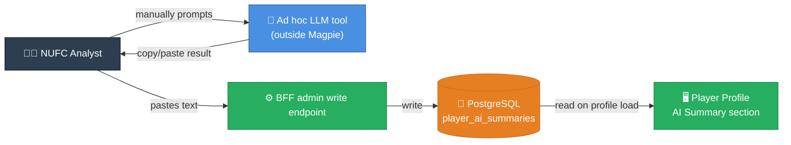
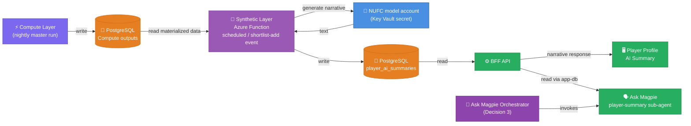
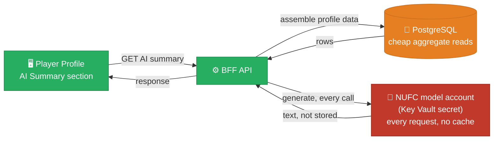
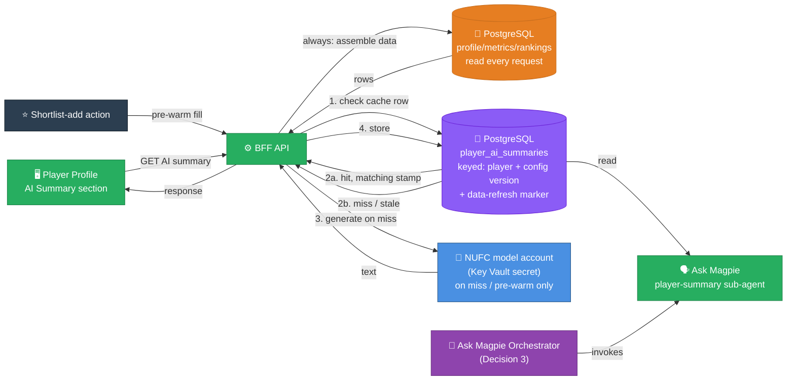
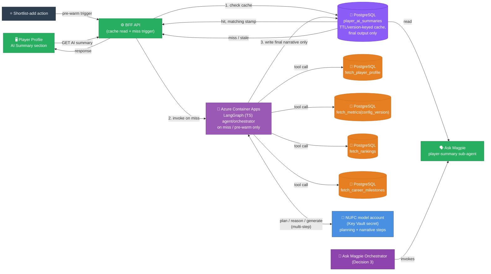

```mermaid
flowchart LR
    WEB["🖥️ Player Profile\nAI Summary section"]:::serving
    SHORTLIST["⭐ Shortlist-add action"]:::actor
    BFF["⚙️ BFF API\n(pure reader + request writer)"]:::serving
    PG_CACHE[("🐘 PostgreSQL\nplayer_ai_summaries\nstatus: ready/pending/stale")]:::cache
    SYNTH["🧠 Synthetic Layer\nevent/poll-triggered generation"]:::synthetic
    MODEL["🤖 NUFC model account\n(Key Vault secret)"]:::external
    ASKM["🗣️ Ask Magpie\nplayer-summary sub-agent"]:::serving
    ORCH["🧭 Ask Magpie Orchestrator\n(Decision 3)"]:::orch

    SHORTLIST -->|"request generation"| BFF
    WEB -->|"GET AI summary"| BFF
    BFF -->|"read status/text"| PG_CACHE
    PG_CACHE -->|"ready → text"| BFF
    PG_CACHE -->|"stale/missing → request row"| BFF
    BFF -->|"write generation request"| PG_CACHE
    PG_CACHE -->|"pick up pending requests"| SYNTH
    SYNTH -->|"generate"| MODEL
    MODEL -->|"text"| SYNTH
    SYNTH -->|"write ready"| PG_CACHE
    BFF -->|"pending or ready response"| WEB
    PG_CACHE -->|"read"| ASKM
    ORCH -->|"invokes"| ASKM

    classDef serving fill:#27AE60,stroke:#1E8449,color:#fff
    classDef actor fill:#2C3E50,stroke:#1A252F,color:#fff
    classDef cache fill:#8B5CF6,stroke:#6D28D9,color:#fff
    classDef synthetic fill:#9B59B6,stroke:#7D3C98,color:#fff
    classDef external fill:#4A90E2,stroke:#2E5C8A,color:#fff
    classDef orch fill:#8E44AD,stroke:#6C3483,color:#fff
```

# ND-679: AI-Generated Player Summary — Research

_Produced by the 🔍 Research phase. Owned by @architect. Do not edit after Evaluate phase begins._

## Context

This is Decision 1 of 3 in ND-679 (AI Features tech design). The problem: decide the generation strategy (pre-computed, runtime, or hybrid) for the AI-Generated Player Summary, a narrative shown in the Player Profile's "AI Summary" section behind the `flagAIProfileSummary` flag, triggered on shortlist-add and on demand. Key constraints: NUFC owns model costs and API keys and sets the freshness bar; AI content reads only platform data and the published dynamic metric config; the BFF never calls Snowflake directly (the path is Snowflake → Compute Layer → Application DB → BFF API → client); medical and scouting inputs are role-restricted; the output must be reusable by Ask Magpie's player-summary sub-agent (Decision 3).

## Options

No implementation code exists yet for this feature; the UI is hidden behind `flagAIProfileSummary`. Every option below is evaluated against documented target-architecture container contracts, not running code. A search of the HLD docs for an existing medical/scouting role-restriction model returned nothing — that enforcement model does not exist yet (see Open Question 6).

### Option A — Do nothing / fully manual (baseline)

**Description:** No automated generation pipeline. An NUFC analyst or scout manually triggers (or pastes into) a one-off LLM call out-of-band, and the result is pasted into a PostgreSQL `player_ai_summaries` table (or even a CMS-style admin field) via an existing admin-style endpoint, shown as-is by the BFF with no regeneration logic. "Generation" is a human action, not a system behavior.

**Industry precedent:** Equivalent to "editorially curated content" patterns (e.g., early-stage CMS blurbs written by staff), standard as a stopgap before investing in generation infrastructure, but universally treated as a bridge, not a target state.

**Diagram:**

**Pros:**

- Zero new infrastructure, no Synthetic Layer build-out needed.
- No per-call cost risk: a human decides when to spend tokens.
- Trivially satisfies the Key Vault and cost-ownership constraints, since there's no automated model account usage pattern to secure beyond one ad hoc client.

**Cons:**

- Does not scale past a handful of players and contradicts the "generated on shortlist-add, and on demand" trigger requirement in the constraints. Those triggers imply a system-initiated call, not a human pasting text.
- No freshness enforcement: a stale summary next to a republished metric config has no automatic invalidation signal.
- Doesn't produce a shape Ask Magpie's player-summary sub-agent can reuse (no API contract, no generation trace), which fails the reuse constraint directly.
- Doesn't exercise or populate the Synthetic Layer scope already carved out in `03. Synthetic.md` ("AI-generated player summaries and insights" is explicitly named as a planned output there).

**Unknowns / risks:**

- None beyond the cons above. This option is included as the mandatory minimal baseline, not a scalable candidate.

---

### Option B — Pre-computed batch (Synthetic Layer, scheduled/event-driven, full narrative)

**Description:** Follows `03. Synthetic.md` literally: a Synthetic Layer Azure Function job runs on a schedule (nightly, after Compute) or on an event (shortlist-add webhook), reads Compute's materialized PostgreSQL outputs, calls the model, and writes the full generated narrative text into PostgreSQL. The BFF only ever reads a precomputed row; there is no runtime generation path at all. On-demand "regenerate" requests either queue a job for async pickup or are rejected/deferred until the next batch.

**Industry precedent:** Classic "batch ML scoring" pattern: recommendation engines, fraud scores, and content-tagging pipelines that run nightly over the full catalog and serve from a precomputed table (e.g., retail product-description enrichment pipelines). It works well when freshness tolerance is "next batch," poorly when a user expects same-session freshness.

**Diagram:**

**Pros:**

- Exactly matches the existing (if "planned, not yet implemented") Synthetic Layer container contract: "AI narratives" is already a named target output, triggered "scheduled... or event-driven," writing to PostgreSQL, with no direct Snowflake access. Zero new architecture needed, only new implementation inside an already-scoped container.
- Cost is fully predictable and bounded: one model call per player per trigger event, easy to rate-limit and log per NUFC's cost-ownership and observability constraints.
- BFF read path stays in the documented "precomputed PostgreSQL" shape used everywhere else (`04. Serving (BFF).md` primary flow), adding no new BFF-Snowflake or BFF-model coupling.
- Naturally reusable by Ask Magpie's sub-agent: it's just another PostgreSQL row, consumable by any backend service with database access.

**Cons:**

- Does not cleanly satisfy "generated... on demand when a user requests one". A genuine synchronous on-demand request (user clicks "regenerate now" and expects fresh text within the page load) has no path in this option without either blocking on a job or polling.
- A blanket background job regenerating every player nightly burns cost on players nobody is looking at, which works against the hypothesis that most of the value (and cost) should be bounded to players actually in view (shortlisted or profile-viewed).
- Freshness: a scheduled run only catches a metric-config republish if the schedule itself is re-triggered by that event, or every profile is regenerated on every nightly run regardless of needing it. Either path adds unneeded cost or needs an invalidation signal threaded into the Synthetic job trigger, which doesn't exist yet.
- The event-driven trigger ("shortlist-add") implies synchronous latency from this layer back into a user-facing action (add a player to shortlist, wait for an AI job before the profile shows the summary) unless the UI tolerates an empty or pending state for a while.

**Unknowns / risks:**

- Freshness-invalidation plumbing is not yet designed.
- Event-driven latency UX is unresolved.

---

### Option C — Pure runtime generation, no storage (on-demand only, BFF-orchestrated)

**Description:** No Synthetic Layer involvement at all. Every time a user opens the AI Summary section, the BFF assembles the inputs from PostgreSQL (already-cheap aggregate reads) and calls the model synchronously, every single time, returning fresh text with no caching or storage. This mirrors the BFF's existing bounded on-demand Snowflake fallback exception pattern, but extended to a brand-new external dependency (the model API) rather than Snowflake.

**Industry precedent:** This is the "no cache" anti-pattern Performance Efficiency explicitly calls out, and the kind of per-request external-LLM-call-on-every-view mistake widely documented as a cost blowup in early RAG/chat products before cache-aside got added. Most production AI-summary features (e.g., GitHub Copilot PR summaries, Notion AI page summaries) now cache or store the generated text and regenerate only on explicit invalidation.

**Diagram:**

**Pros:**

- Simplest option to reason about for freshness: it always reflects the latest data and the latest published metric config, trivially.
- No invalidation logic needed at all.
- Fastest to build if the goal were just a demo: no new storage schema, no Synthetic job.

**Cons:**

- Directly violates the architecture rule under evaluation: the BFF would hold a direct, uncached external paid-API dependency on every page view, exactly the shape the Performance Efficiency NFR's "Cache first" principle and "bound every operation" principle argue against. Repeat views of the same unchanged player cost real money every time.
- Cost is unbounded and directly visible to NUFC: a scout re-opening the same profile 10 times in a session triggers 10 billed model calls for identical output. This is the one constraint ("cost is a first-order concern") this option fails hardest against.
- Does not match the documented BFF Snowflake-fallback exception's own shape: that fallback exists because there's sometimes genuinely no precomputed row (new filter combination); here a precomputed-or-cached narrative is always buildable, so the "no data available another way" justification for bypassing cache-first doesn't hold.
- Latency: synchronous LLM calls are typically 1-5+ seconds, well outside the BFF's documented "cached page < 1 s" / "uncached page < 3 s" latency targets in `03. Performance Efficiency.md`.
- Poor reuse for Ask Magpie: the sub-agent would need to either re-run the same expensive call or duplicate this logic, with no single source of truth.

**Unknowns / risks:**

- None beyond the cons above. Included as the fully-runtime reference point.

---

### Option D — Hybrid: runtime data assembly + cache-aside narrative, selective pre-warm (the developer hypothesis)

**Description:** Split the feature into two cost tiers. First, data assembly (profile header, metrics, rankings, milestones) is always computed at runtime by the BFF from PostgreSQL on every request; this is cheap and needs no caching. Second, the narrative text, the expensive part, is stored in PostgreSQL as a cache-aside artifact keyed by `(player_key, metric_config_version, data_refresh_marker)`. On a cache hit (a row exists and its config/data stamp matches current), the BFF serves the stored text. On a miss (new player, stale config stamp, or explicit "regenerate" request), the BFF (or a Synthetic Layer call it triggers) generates once, stores, and serves. Shortlist-add triggers a background pre-warm fill for that player only, not a blanket job.

**Industry precedent:** This is textbook cache-aside with TTL/version-keyed invalidation, the same pattern already named in `03. Performance Efficiency.md`'s Cache-Aside diagram and used elsewhere in this codebase (`BoundedPromiseCache`, `bff-caching.md`). At industry scale, this mirrors how products like Notion AI and GitHub Copilot's PR/issue summaries cache generated text keyed on content hash/version and regenerate lazily on a cache miss or explicit "regenerate" action, rather than batch-regenerating everything nightly.

**Diagram:**

**Pros:**

- Matches the platform's own established cache-aside idiom (`03. Performance Efficiency.md`'s Redis cache-aside pattern, and `bff-caching.md`'s TTL + stale-check pattern), just applied to PostgreSQL-backed rows instead of Redis: a consistent engineering pattern, nothing novel to invent.
- Directly satisfies both triggers in the constraints: shortlist-add pre-warms (so the summary is usually already warm by view time), and on-demand requests get instant cache-hit responses for anyone who already triggered a generation, falling back to a bounded synchronous generate-once-and-store only on a genuine miss.
- Cost-bounded: narrative generation happens once per (player, config version, data epoch) tuple, not once per view and not once per player regardless of interest. It bounds spend to players that are actually being looked at.
- Freshness ties naturally to the constraint "stale when NUFC republishes config": the cache key invalidates itself on config version bump, with no manual purge logic needed.
- Cleanly reusable by Ask Magpie's sub-agent: same PostgreSQL row, same BFF (or shared service) read path, same freshness semantics.
- Keeps the BFF's Snowflake-never-direct rule fully intact (no Snowflake involvement at all; this is pure PostgreSQL plus a model call).

**Cons:**

- Most moving parts of the five options: needs a cache-key design (config version + data-refresh marker), a miss-path generation call, and a decision on whether the miss-path call blocks the request (adds latency) or returns a "pending" state and generates asynchronously.
- Needs a decision on whether the generation step lives inside the BFF itself (a new external dependency added to the Serving container, a layer-boundary question Research must flag) or is delegated to the Synthetic Layer (an extra network hop/orchestration step for what could be a single call).
- "Selective pre-warm" (shortlisted players only) needs a defined policy: if NUFC wants broader always-warm coverage later, this needs to extend, not be rebuilt.
- Blocking-miss-path latency is the LLM call duration (1-5+ seconds), which exceeds BFF latency targets unless the UI explicitly supports a loading/pending state for first-time generations. It needs explicit product sign-off, not just an engineering choice.

**Unknowns / risks:**

- Whether generation lives in the BFF or the Synthetic Layer is unresolved.
- Blocking vs. async miss-path UX needs product sign-off.

---

### Option E — Synthetic Layer as the generation+cache owner, BFF stays a pure reader (hybrid, layer-pure variant)

**Description:** Same cache-aside logic as Option D, but the generation step and cache-miss handling live entirely inside the Synthetic Layer, not the BFF. The BFF only ever reads `player_ai_summaries` from PostgreSQL (status: `ready` / `pending` / `stale`) and never talks to the model directly. On-demand requests from the web client hit a BFF endpoint that, on a miss, writes a "generation requested" row/queue entry for the Synthetic Layer to pick up (polled or event-triggered), and the BFF returns a `pending` state immediately; the web client polls, or the BFF holds the request briefly and then returns pending. Shortlist-add writes the same request row.

**Industry precedent:** This is the standard async job + status-polling pattern used for expensive backend-triggered AI/ML work (e.g., video transcoding completion callbacks, OpenAI's older async fine-tune/batch job status model, Stripe's async report generation), appropriate when generation genuinely can't be instant and the UI is built to tolerate it.

**Diagram:**

**Pros:**

- Strictly preserves the "BFF never calls Snowflake directly... AI services follow Snowflake → Compute → DB → BFF → client" layering by extension. The model-calling responsibility sits in the same layer (Synthetic) already scoped for "AI-generated player summaries and insights," and the BFF's job description in `04. Serving (BFF).md` ("orchestrates queries, applies caching," not "calls third-party paid AI APIs") stays unchanged.
- Cleanest separation of concerns for cost and observability: all model spend funnels through one deployment unit (Synthetic), letting per-call cost logging and rate-limiting centralize naturally rather than being one more concern bolted onto the BFF.
- Scales to Ask Magpie's future orchestrator/sub-agent structure (Decision 3) without re-litigating which layer owns model calls. If Ask Magpie's sub-agents also need to trigger generation, they go through the same Synthetic contract.
- Avoids adding a new external paid-API secret and SDK dependency directly into the BFF's App Service, keeping its hosting/secrets footprint (Snowflake, Postgres, Redis, Wyscout) unchanged per `01. Security.md`'s secrets table.

**Cons:**

- On-demand generation ("generated... on demand when a user requests one") becomes asynchronous almost by construction. A user-initiated miss cannot get a same-request answer without either the BFF holding the HTTP request open while polling the Synthetic Layer (defeats the separation) or the UI accepting a polling/pending UX, which is a product decision not yet made.
- Adds a new request/trigger path into the Synthetic Layer that doesn't exist yet (today it's purely scheduled/event-from-Compute per `03. Synthetic.md`): "a user clicked a button" is a new trigger class for that container to support.
- More deployment surface than Option D (two Function Apps/services involved in the request path instead of one), more to build and operate for the same outcome.
- The latency floor for a true on-demand case is bounded by however the BFF-Synthetic hand-off is built (HTTP trigger plus poll, queue, etc.), and is likely to land outside the BFF's documented latency targets regardless, the same issue as Option D but with an extra hop.

**Unknowns / risks:**

- The Synthetic Layer needs a new request-driven trigger class it doesn't have today.
- Async UX needs product sign-off.

---

### Option F — Runtime agent orchestration (LangGraph-style), tool-calling retrieval over PostgreSQL, cache-aside output

**Description:** Same trigger model as Options C/D/E (shortlist-add pre-warm + on-demand), but the generation step itself is restructured from "one stuffed-context prompt call" into a multi-step agent run. A Node.js/TypeScript process running an agent-orchestration graph (LangGraph or a comparable library — e.g. a Durable Functions-style orchestrator reimplemented as a graph, or Vercel AI SDK's agent primitives) is hosted on Azure as its own deployment unit — most naturally as an Azure Container Apps job/service (LangGraph's persistent graph state, checkpointing, and longer cold-start-sensitive dependency tree fit Container Apps' always-warm or scale-to-zero container model better than a thin Flex Consumption Function; a Durable Function orchestration is an alternative if the team prefers to stay inside the existing Compute/Synthetic Functions runtime pattern instead of introducing a new hosting primitive).

The orchestrator does not receive one giant pre-assembled prompt. Instead it exposes a small set of tool/function-call definitions backed by existing PostgreSQL reads (the same tables Options C/D/E already read for data assembly): `fetch_player_profile`, `fetch_metrics(metric_config_version)`, `fetch_rankings`, `fetch_career_milestones`. The graph's nodes plan which tools to call, call them (each a bounded PostgreSQL query, no Snowflake access), optionally reason over partial results across more than one step, and only then invoke the LLM to produce the final narrative. This is "RAG" only in the loose sense of retrieval-augmented generation over the platform's own structured data via tool-calling — explicitly not a vector database or semantic-search retrieval layer; a dedicated RAG/vector-store build is out of scope for M1.5, and this option does not introduce one. All "retrieval" here is typed SQL reads gated behind tool definitions, not embedding search.

The `player_ai_summaries` PostgreSQL table plays exactly the same role as in Option D: a TTL/version-keyed cache-aside store for the final output only. The cache key is unchanged (`player_key`, `metric_config_version`, `data_refresh_marker`); what differs is that a cache miss now triggers an agent run (potentially several LLM calls plus several tool calls across multiple graph steps, likely several seconds to tens of seconds end to end) instead of one completion call. Intermediate agent state (tool-call traces, partial reasoning) is not persisted to `player_ai_summaries` — only the finished narrative is written, same shape as every other option's cache row.

Because this is a new, heavier runtime dependency, it is a new deployment unit distinct from both the BFF and today's scoped Synthetic Layer scheduled/event-driven jobs. Today's Synthetic Layer is specified as thin Azure Functions, Node.js, with no mention of a stateful agent-graph runtime, container-based hosting, or a framework dependency like LangGraph — this option would be the first place in the HLD introducing that shape.

**Industry precedent:**

- LangGraph's own documented "agentic RAG" pattern (retrieval as a tool the agent decides to invoke, rather than retrieval happening unconditionally before generation) is exactly this option's shape, applied here to structured PostgreSQL reads instead of a vector store
- LangGraph.js (TypeScript) is the concrete framework named
- OpenAI's function-calling/tool-use pattern is the general industry precedent for structured-data retrieval via tool calls rather than embeddings
- Production precedent for multi-step agentic content generation over internal structured data (not search/vector retrieval) is less common than agentic RAG over documents; the closest analogues are internal "data-to-narrative" BI copilots that plan a sequence of internal API/SQL calls before writing a summary — a thinner-precedent space than Option D's cache-aside pattern, worth flagging as higher execution risk given fewer directly comparable production deployments at this scale

**Diagram:**

**Pros:**

- Produces the most data-grounded narrative of any option: tool-gated retrieval lets the agent skip irrelevant data and selectively pull context only when needed, reducing wasted prompt tokens
- Decouples "what data could inform the summary" from "what data is force-fed into one prompt" — adding a new fetchable fact later is a new tool definition, not a prompt-template rewrite
- Inherits every structural benefit of Option D's cache: on a hit, the BFF read path is identical to Option D
- If Ask Magpie's own sub-agent orchestration (Decision 3) ends up using LangGraph or similar anyway, this option pre-validates that framework choice on a smaller, single-purpose agent first

**Cons:**

- Introduces a materially larger engineering surface than Option D for a feature whose output is "a short narrative paragraph" — the player summary's required inputs are already fully known and bounded ahead of time, so the agent's "decide what to fetch" step may be solving a problem that doesn't exist here (see Open Question F-3)
- New hosting primitive and new framework dependency not present anywhere else in the HLD — needs either a new Container Apps deployment or a reshaping of Durable Functions orchestration, either a bigger lift than extending the existing Synthetic Function app
- Multi-step tool-calling materially increases latency and cost versus a single stuffed-context call — likely tens-of-seconds miss-path latency rather than single-digit-seconds, making the sync-vs-async UX question even more pressing
- Cost is harder to bound and predict than Option D — a multi-step agent's number of tool calls and reasoning turns can vary per player
- Same medical/scouting role-restriction gap as every other option, but worse here, because tool-based retrieval means the agent can autonomously decide to call a tool that touches restricted data mid-run — every individual tool definition needs gating, not just one entry-point assembly step
- Debuggability/observability is harder: a failed or low-quality narrative requires inspecting a multi-step trace, adding operational burden not scoped in current NFR docs

**Unknowns/risks:**

- Whether LangGraph (or any agent framework) is justified at all for a task with a small, fully-known, bounded input set — versus simply being an over-engineered substitute for Option D's deterministic data assembly plus a single prompt (the central open question this option raises)
- Hosting shape is undecided: Container Apps (new primitive) vs. a Durable Functions reimplementation of graph-style orchestration is a real architectural fork
- No existing precedent in this codebase for a stateful/checkpointed agent runtime
- Framework lock-in and maintenance cost: LangGraph is a fast-moving library; the TypeScript variant is less mature than the Python one
- Tool-call-level authorization is new design surface not covered anywhere in current HLD

## Open Questions

| #   | Question                                                                                                                                                                                                                                                                                                                                                                                                             | Owner                                 |
| --- | -------------------------------------------------------------------------------------------------------------------------------------------------------------------------------------------------------------------------------------------------------------------------------------------------------------------------------------------------------------------------------------------------------------------- | ------------------------------------- |
| 1   | Does NUFC accept an asynchronous/pending UX for a first-time on-demand generation, or must the summary always return synchronously within normal page-load latency? Disqualifies Options C and E outright if synchronous-always is required.                                                                                                                                                                         | NUFC                                  |
| 2   | What is NUFC's actual freshness bar: same-session fresh, fresh as of the last metric-config publish, or fresh as of the last nightly Compute run? Eliminates Option B if same-session freshness is required, eliminates Option A if any system SLA is required.                                                                                                                                                      | NUFC                                  |
| 3   | Should the model-calling responsibility live in the BFF (a new external dependency in the Serving Layer) or exclusively in the Synthetic Layer (matches existing scope but needs a new on-demand trigger class)? This is the actual fork between Option D and Option E.                                                                                                                                              | @architect / tech lead                |
| 4   | What volume of on-demand requests is expected: rare manual regenerate, or routine on every profile open? Changes the cost math across options.                                                                                                                                                                                                                                                                       | NUFC                                  |
| 5   | How is the data-refresh marker / staleness signal actually computed: an existing reliable timestamp/version, or new plumbing needed?                                                                                                                                                                                                                                                                                 | @architect                            |
| 6   | Is there an existing or planned role-restriction mechanism for medical/scouting data reachable from the BFF or Synthetic Layer today, or does this design need to invent the first one? No existing documented pattern was found in the HLD, only Access Management (ND-74) as a named dependency. Every "store once, serve to all" option needs either a redaction-before-storage step or per-role stored variants. | @architect / Access Management design |
| 7   | Is the on-demand "regenerate" trigger meant to bypass the cache intentionally, or just fetch the latest cached copy?                                                                                                                                                                                                                                                                                                 | NUFC                                  |
| 8   | Does the agent runtime get hosted as a new Azure Container Apps deployment, or reshaped as a Durable Functions orchestration to stay inside the existing Compute/Synthetic Functions hosting convention? (Evaluation-input — architecture-pattern fork with cost/ops tradeoffs, decidable without NUFC input)                                                                                                        | @architect / tech lead                |
| 9   | Is multi-step tool-calling latency (likely tens of seconds for a miss) acceptable anywhere in the sync request path, or does this option mandate async/pending UX unconditionally — stronger than Option D/E's "might need it"? (Viability — latency tolerance is a product/UX decision)                                                                                                                             | NUFC                                  |
| 10  | Given the player summary's inputs are fully known and bounded ahead of time, does an agent framework's dynamic "decide what to fetch" capability add real value over Option D's deterministic data assembly, or is it solving a problem this feature doesn't have? (Evaluation-input — the core proportionality question between Option D and Option F)                                                              | @architect / tech lead                |
| 11  | Who defines and reviews the tool-call authorization boundary (which tools an agent run is permitted to invoke, whether any tool could reach medical/scouting-restricted tables) before this option could ship? (Evaluation-input, extends existing role-restriction open question with an agent-specific wrinkle)                                                                                                    | @architect / Access Management design |
| 12  | Is LangGraph.js (TypeScript) mature enough for a production dependency here, or should the team default to a lighter orchestration primitive, given the Synthetic Layer's existing Node.js/TypeScript convention? (Evaluation-input — engineering judgment call)                                                                                                                                                     | @architect / tech lead                |
