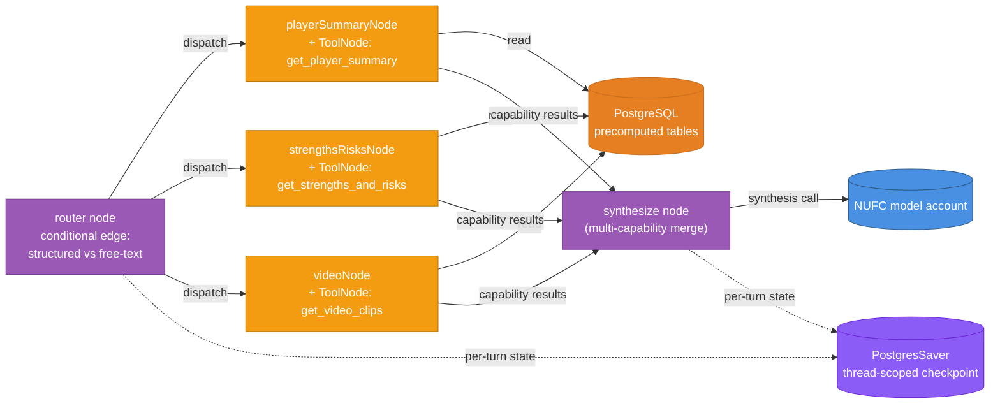
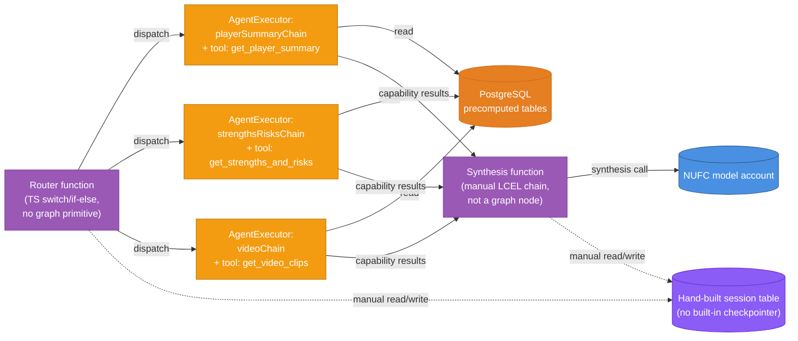
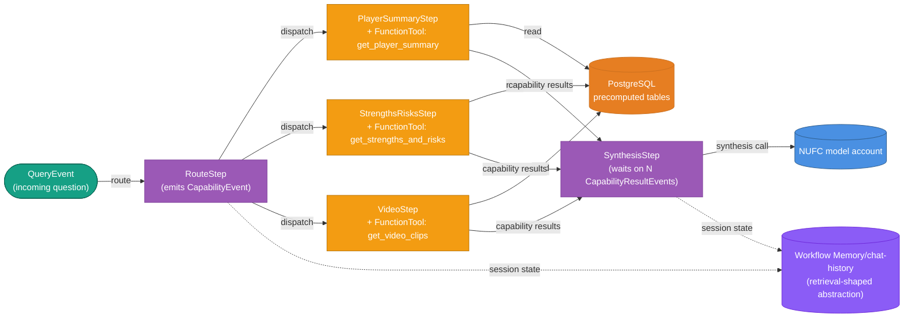
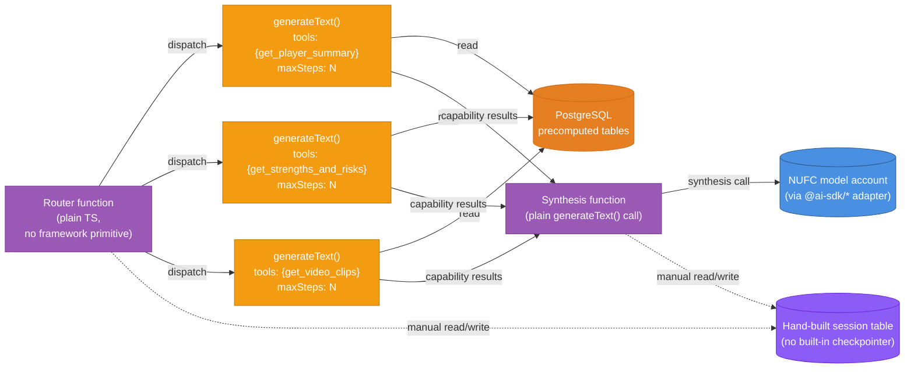
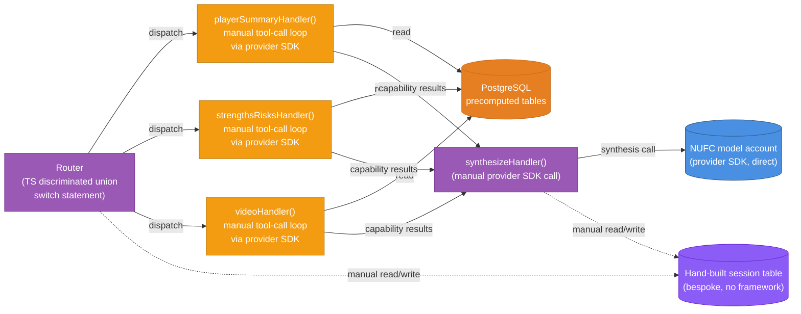

# ND-679: Agent Orchestration Framework Choice — Research

_Produced by the 🔍 Research phase. Owned by @architect. Do not edit after Evaluate phase begins._

## Context

This is Decision 6 of 6 in ND-679, added after Decisions 1-3's research each independently named LangGraph (TypeScript) as "the concrete framework" for an agent-based generation option, in every case as an illustrative placeholder never evaluated against alternatives. Decision 5 (hosting) inherited the same unexamined assumption. This decision evaluates the framework/library choice on its own, decoupled from where it runs (Decision 5) and from whether an agent-based option is even chosen over a simpler single-call option for any given feature — Decisions 1-3's own Evaluate stage decides that per feature.

Three constraints bound every option below. No vector database and no retrieval-augmented generation: all retrieval is typed tool-calls over existing PostgreSQL tables (`players_search_index`, `metric_config_versions`/`dynamic_metrics_precomputed`, `nufc_index_precomputed`, `milestone_catalog_precomputed`). The chosen approach must express an orchestrator + sub-agents/router + capability-nodes + optional synthesis step + short-term in-conversation memory (needed for Ask Magpie). And it must fit the platform's existing Node.js/TypeScript stack (NestJS BFF, React/Vite web, Azure Functions Compute/Synthetic). Cost/predictability and engineering/ops overhead are evaluation axes in their own right for a 10-30-user platform, not a secondary capability checklist.

## Options

### Option A — LangGraph (TypeScript / `@langchain/langgraph`)

**Description:** A low-level library for building stateful, graph-structured LLM workflows. Programming model: define a `StateGraph` with a typed state shape (reducers for how each node's output merges into shared state), add nodes (plain async functions, each receiving and returning partial state), wire edges (including conditional edges for routing), compile to a runnable graph. Built-in checkpointers (`MemorySaver`, `PostgresSaver`, `SqliteSaver`) persist state per `thread_id` across invocations — this is the mechanism Decisions 1-3's research already leaned on for Ask Magpie's short-term memory and for resumable/inspectable multi-step runs. Supports cycles (a node can loop back, e.g. retry-with-refined-query), which plain request/response chains cannot express natively.

Maps directly onto the required topology: a `router` node → conditional edges to capability nodes (`playerSummaryNode`, `strengthsRisksNode`, `videoNode`) → optional `synthesize` node → `cache-write` node. This is the shape Decisions 1-3's Option E/F diagrams already drew — those diagrams are LangGraph `StateGraph` diagrams in substance, just not labeled as evaluated.

**Industry precedent:** LangGraph's documented "multi-agent supervisor"/"hierarchical agent teams" pattern is the canonical reference for this exact router + specialist-node topology. Cited production users of LangGraph JS/TS include Replit's Agent, Klarna's support assistant, and Uber's internal developer-tooling agents. GitHub: `langchain-ai/langgraphjs` — actively maintained, but materially fewer stars/contributors than the Python `langchain-ai/langgraph` repo.

**Diagram:**

**Pros:**

- First-class cyclic graph support and conditional branching — a node can route back to the router or retry a tool call, not just move forward linearly
- Built-in checkpointer solves Ask Magpie's in-conversation memory requirement off the shelf, with a documented Postgres-backed implementation (`PostgresSaver`) rather than hand-rolled session storage
- Native streaming (`stream()`/`streamEvents()`) matches a conversational UX without custom SSE plumbing
- Tool-calling is a first-class primitive (`ToolNode`, bind tools to a model) — fits the typed function-calls-over-PostgreSQL constraint directly, without misusing a RAG-shaped API
- Directly reusable: one framework commitment serves all three features' agent-based options if chosen per-feature, rather than evaluating three separate libraries

**Cons:**

- `@langchain/langgraph` (TS) is a smaller, newer package than `langgraph` (Python) — fewer production postmortems, smaller community Q&A surface, and historically has lagged the Python package in feature parity
- Full LangChain ecosystem dependency tree (even using only `@langchain/langgraph` + `@langchain/core` pulls in LangChain's abstraction layers for models/tools) — more surface area and version-churn risk than a hand-rolled loop
- Its natural observability companion, LangSmith, is a hosted SaaS product — raises a data-residency question for medical/scouting-adjacent data (already flagged as an open question in Ask Magpie Research)
- Checkpointer's Postgres footprint is a new schema-ownership question against the app-db library's Drizzle-managed schema (already flagged in Ask Magpie Research)
- Steeper learning curve than a plain function-calling loop — nodes/edges/reducers/checkpointers are new idioms the team has to internalize for a 10-30-user platform's benefit

**Unknowns/risks:**

- TS/JS SDK maturity relative to Python sibling for the exact primitives needed here (conditional edges, `PostgresSaver`) — needs a direct version/changelog check at Evaluate time, not assumed
- Whether LangGraph's execution model composes cleanly with Flex Consumption's cold-start/short-execution model if Decision 5 lands there

---

### Option B — Plain LangChain (TypeScript), no LangGraph layer

**Description:** Uses LangChain's simpler, pre-LangGraph abstractions: `AgentExecutor` wrapping a ReAct-style or OpenAI-tools-style agent, `Runnable`/LCEL (LangChain Expression Language) chains for composing prompt → model → tool-call → model steps, and plain application code (a switch/if-else router function, not a graph primitive) for the orchestrator/sub-agent dispatch. The router + capability-nodes topology is expressed as hand-written TypeScript control flow that calls into one `AgentExecutor` or `Runnable` chain per capability, rather than as graph nodes/edges.

**Industry precedent:** LangChain's `AgentExecutor` + LCEL predate LangGraph and were the standard agent-building pattern industry-wide roughly 2023-2024. LangChain's own current documentation now recommends LangGraph for anything beyond a simple single-agent tool loop. GitHub: `langchain-ai/langchainjs` — large, mature, widely used, but its agent-specific (`AgentExecutor`) surface is the part explicitly being superseded.

**Diagram:**

**Pros:**

- Materially smaller API surface than LangGraph — one mental model (chains/executors), not graph theory (nodes, edges, reducers, checkpointers)
- Still gets LangChain's tool-calling abstractions, output parsers, and model-provider adapters without the graph-state layer
- Easier to reason about for a single bounded tool-call sequence where no cyclic retry logic is actually needed
- Smaller dependency footprint than full LangGraph + its checkpointer backends

**Cons:**

- `AgentExecutor`'s ReAct loop is a simpler one-shot plan-act-observe loop without first-class persistent cross-turn state — no built-in checkpointer equivalent to LangGraph's `PostgresSaver`. Ask Magpie's short-term memory requirement would need to be hand-built
- No native cyclic-graph or conditional-routing primitive — the router/synthesis topology is bespoke application code wrapping multiple independent chains, harder to visualize, test, and debug as a unit than LangGraph's explicit graph
- LangChain's core `AgentExecutor` abstraction is the part of the LangChain ecosystem most commonly cited (including by LangChain's own docs) as being superseded by LangGraph for anything beyond a single-tool-loop agent
- Still inherits the full LangChain dependency tree and its version-churn reputation, without gaining LangGraph's graph/checkpoint benefits in exchange

**Unknowns/risks:**

- Whether LangChain's base TS package is being actively deprioritized in favor of `@langchain/langgraph` by the maintainers — if so, adopting plain LangChain now risks adopting the legacy path
- Hand-rolled session memory means Ask Magpie's memory requirement becomes bespoke code to design, test, and maintain — effort that Option A gets for near-free

---

### Option C — LlamaIndex (TypeScript, `llamaindex`)

**Description:** A data-framework originally built around indexing and querying document/vector corpora for retrieval-augmented generation, which has since grown agent/workflow primitives (`Workflow` API — event-driven steps with typed input/output events, `AgentWorkflow`/multi-agent orchestration helpers, `FunctionTool` for tool-calling). Programming model: define `Workflow` steps as functions that consume and emit typed events, with branching achieved by which event a step emits next; or use the higher-level `AgentWorkflow` helper to compose multiple named agents with handoff rules.

Honest fit assessment given no vector DB/RAG in scope: LlamaIndex's single biggest differentiator — purpose-built `Index` abstractions over vector stores, document loaders/parsers, retrievers, re-rankers — is explicitly the exact component this design has ruled out for M1.5. Using LlamaIndex here means adopting a document/vector-retrieval-first framework while using none of its vector/retrieval machinery, exercising only its newer, less central `Workflow`/agent layer. This is a materially different proportionality argument than Options A/B, which were built for exactly this tool-calling-over-structured-data shape from the start.

**Industry precedent:** LlamaIndex is widely used and well-regarded specifically for RAG over documents (its original and still-dominant use case). Multi-agent `Workflow`-based production deployments are a newer and thinner precedent set than LangGraph's supervisor-pattern production users. GitHub: `run-llama/LlamaIndexTS` — active, but with a noticeably smaller contributor base and star count than both the Python repo and `langchain-ai/langgraphjs`.

**Diagram:**

**Pros:**

- `Workflow` API's event-driven step model does map onto the router + capability-nodes + synthesis topology (each node is a step reacting to a typed event, synthesis is a step that waits on multiple prior events)
- `FunctionTool` gives straightforward typed tool-calling over PostgreSQL reads, structurally equivalent to LangGraph's `ToolNode` or LangChain's tool-binding
- If a future decision ever does introduce document/vector retrieval (e.g. scouting notes or match reports as unstructured text), LlamaIndex would already be in the stack and that capability would not require adopting a second framework later

**Cons:**

- Core value proposition (indexing/retrieval over documents and vectors) is unused by design under this Frame's constraints — adopting LlamaIndex here means paying for a framework's dependency weight and conceptual model without using its reason for existing
- `Workflow`/`AgentWorkflow` is a comparatively newer addition to LlamaIndex (the project's center of gravity is still retrieval, not multi-agent orchestration) — less battle-tested for this specific router/specialist shape than LangGraph's purpose-built graph model or even plain LangChain's agent executor
- LlamaIndex's TS package is generally reported as less feature-complete and less actively extended than its Python sibling — same TS-lags-Python pattern as LangGraph, without LangGraph's comparatively larger TS-specific production-user list
- No built-in Postgres-backed checkpointer equivalent for cross-turn conversational memory as polished as LangGraph's `PostgresSaver` — memory in LlamaIndex workflows is typically handled via its retrieval-adjacent `Memory`/chat-history abstractions, a further sign the framework's defaults assume a retrieval use case this design doesn't have

**Unknowns/risks:**

- Whether `llamaindex` (TS)'s `Workflow` API has reached a stable, non-breaking API surface — LlamaIndex has had more API churn historically than LangChain/LangGraph
- Real risk of picking a framework for the wrong reason (team familiarity or name recognition) when its core competency doesn't match this design's actual retrieval shape

---

### Option D — Vercel AI SDK (`ai` package, `generateText`/`streamText` with `tools`, `maxSteps`)

**Description:** A thinner, less opinionated SDK focused on the model-call/streaming/tool-calling boundary rather than full agent orchestration. Core primitives: `generateText`/`streamText` accept a `tools` map (each tool a Zod-typed schema + execute function) and a `maxSteps`/`stopWhen` setting that lets the SDK automatically loop tool-call → tool-result → model-call until the model stops calling tools or the step limit is hit — effectively a built-in single-agent ReAct loop, without LangChain/LangGraph's abstraction layers on top. Multi-agent/router topology (dispatch to a specialist, then an optional synthesis call) is hand-written orchestration code that calls `generateText`/`streamText` once per capability and then once more for synthesis — the SDK provides the model-call/tool-loop primitive, not the multi-agent graph.

**Industry precedent:** Vercel AI SDK is widely adopted specifically for Next.js/React AI features (streaming chat UIs, tool-calling assistants) — v4/v5's `tools`+`maxSteps` pattern is Vercel's own documented "agent" pattern for exactly this shape, already named in Decision 5's Research (Option A's industry precedent) as the standard "API route as agent host" pattern. GitHub: `vercel/ai` — large, very actively maintained, broad community adoption, though adoption skews toward single-agent chat/tool-calling use cases rather than the specific multi-agent-supervisor topology this design needs.

**Diagram:**

**Pros:**

- Lightest-weight option with a first-party TS SDK (Vercel builds it TS-first, not as a port of a Python library) — no TS-lags-Python maturity gap, because there is no Python sibling to lag behind
- Minimal API surface: `tools` + `maxSteps` covers the single-agent tool-calling loop each capability node needs; no graph/chain abstraction to learn
- Model-provider-agnostic adapter layer (`@ai-sdk/openai`, `@ai-sdk/azure`, `@ai-sdk/anthropic`, etc.) cleanly decouples this choice from Decision 4's still-open model-provider question
- Native streaming primitives are a strong fit if the web client (React/Vite) ever wants to stream Ask Magpie's answer token-by-token — same vendor's SDK spans both the Node/BFF and React sides of the stack
- Smallest dependency tree of any framework option — lowest version-churn and audit surface for a 10-30-user platform

**Cons:**

- No built-in graph/state-machine primitive for the router + capability-nodes + synthesis topology — that control flow is application code the team writes and maintains directly, same shape as Option B but without even LangChain's chain/tool abstractions underneath
- No built-in checkpointer — Ask Magpie's cross-turn conversational memory is entirely hand-built, identical gap to Option B
- Newer entrant to the "agent framework" conversation specifically — the SDK's `tools`/`maxSteps` single-agent loop is well-established, but Vercel's own multi-agent guidance is thinner and less battle-tested than LangGraph's documented supervisor pattern
- "Framework" is arguably the wrong word for this option — it is closer to Option E (hand-rolled) with vendor-provided scaffolding for the model-call/tool-loop part only

**Unknowns/risks:**

- Whether `maxSteps`' automatic tool-loop model is flexible enough for genuinely conditional routing without the team layering its own routing logic on top anyway — likely yes, but unverified against this platform's router requirement specifically
- Whether Vercel's primarily Next.js-centric positioning introduces friction integrating into a NestJS BFF or an Azure Functions/Container App host — a smaller risk than outright incompatibility, but worth a spike

---

### Option E — Hand-rolled state machine (no third-party agent framework)

**Description:** Direct provider SDK calls (whichever Decision 4 settles on) wrapped in custom TypeScript: a typed switch/discriminated-union state machine for the router, plain async functions for each capability node (each doing its own typed tool-call loop against the provider SDK directly, no abstraction layer), a hand-written synthesis step, and a bespoke Postgres-backed session table for cross-turn memory. No agent framework dependency of any kind — only the model provider's own SDK, already a dependency regardless of which other option is chosen.

**Industry precedent:** Direct provider SDK tool-calling loops (no agent framework) are OpenAI's and Azure OpenAI's own documented "function calling" quickstart pattern. Many production chat/assistant products ship this way before adopting a framework, often explicitly to avoid the dependency/abstraction overhead — a common, unremarkable production pattern.

**Diagram:**

**Pros:**

- Zero framework dependency and zero framework-specific idiom to learn, document, or keep current against upstream breaking changes — the smallest possible dependency/version-churn surface of any option
- Full control over every step: no fighting a framework's opinions about state shape, streaming format, or tool-call retry behavior
- Easiest to reason about and debug for a small team: the entire control flow lives in plain, readable TypeScript the team already knows
- No TS/Python parity question at all — there is no sibling implementation to lag behind
- Directly proportional to this design's actual complexity: a bounded router with 3 capability nodes over structured Postgres tool-calls is a small, well-understood state machine shape, not a problem that obviously needs a dedicated orchestration framework

**Cons:**

- Every capability a framework gives for free is now owned, built, and maintained by the team: conversational memory/checkpointing, streaming plumbing, retry/backoff on tool-call failures, and any future cyclic/conditional routing logic beyond the initial three-capability shape
- No off-the-shelf debugging/tracing tooling — observability has to be built in-house regardless, but with no starting scaffold at all
- Harder to onboard a new engineer unfamiliar with this specific hand-rolled shape than onboarding onto a named, documented framework with public docs/examples
- If the team later needs genuinely complex branching, this option's custom code has to grow into something that starts resembling a hand-built LangGraph anyway — a real risk of reinventing the framework piecemeal under time pressure

**Unknowns/risks:**

- No external validation that the hand-rolled approach stays simple as requirements grow
- Engineering estimation risk: the pros/cons above assume the team's hand-rolled version reaches rough feature parity with what a framework gives for free, in less total effort than learning a framework — unverified without a time-boxed spike

---

### Option F — Azure AI Foundry Agent Service (cross-cutting — see shared file)

**Description:** Microsoft's managed, hosted agent runtime (threads/runs/tools model, similar in intent to OpenAI's Assistants API). Unlike AWS Bedrock AgentCore, it is not framework-agnostic — the thread/run/tool-calling loop is the service's own orchestration engine, not a substrate for arbitrary agent code. Adopting this option does not compose independently with Decision 4 (model hosting/access pattern) and Decision 5 (agent runtime hosting) the way every other option on this page does: it answers all three by platform adoption in one step, not by independent choice. **This is a cross-cutting option, not scoped to this decision alone** — see `01 Research - Cross-Cutting Option - Azure AI Foundry Agent Service.md` for the full description, diagram, pros/cons, unknowns/risks, and its own open questions. Evaluate should treat picking this option as a combined decision across Decisions 4, 5, and 6, not just this one's AC × Options matrix.

**Industry precedent:** see the shared cross-cutting file.

**Pros / Cons / Unknowns/risks:** see the shared cross-cutting file — summarized there against the combined acceptance criteria of Decisions 4, 5, and 6 together, not duplicated here to avoid drift between copies.

---

### Managed/platform-native option — explicitly out of scope here

Azure AI Agent Service / Azure AI Foundry Agent Service was considered as a sixth comparison point but is excluded from this decision's option set: it bundles model access, tool/function-calling, and (optionally) its own retrieval/knowledge-store features into one managed Azure product. That bundling means evaluating it here would substantially overlap with Decision 4's model-hosting/access-pattern scope — it is a model-access pattern, not just an orchestration library choice layered on top of a separately-chosen model access pattern. If Decision 4's Evaluate stage surfaces renewed interest in Azure AI Foundry's agent capabilities as a combined model-access-plus-orchestration choice, that comparison belongs there, or as a follow-up cross-check once Decision 4 is settled, not duplicated into this decision's library-only scope.

| Option                   | TS/JS SDK maturity                                                                                       | Built-in checkpointer/memory                                                                 | No-vector-DB fit                                                                 | Dependency weight                       | Hosting-agnostic?                                                                                                                   |
| ------------------------ | -------------------------------------------------------------------------------------------------------- | -------------------------------------------------------------------------------------------- | -------------------------------------------------------------------------------- | --------------------------------------- | ----------------------------------------------------------------------------------------------------------------------------------- |
| A — LangGraph (TS)       | Smaller/newer than Python sibling, but largest TS-specific production-user list of the framework options | Yes (`PostgresSaver`)                                                                        | Good — tool-calling is first-class, no RAG misuse                                | Heavy (LangChain core + LangGraph)      | Mostly — persistent-process assumption favors Container App hosting over Flex Consumption's scale-to-zero (per Decision 5 Research) |
| B — Plain LangChain (TS) | Mature core, but `AgentExecutor` is the part LangChain's own docs steer users away from                  | No — hand-built                                                                              | Workable — tool-calling supported, but full RAG-oriented ecosystem mostly unused | Heavy (same core as A, minus LangGraph) | Yes — no persistent-graph-state assumption                                                                                          |
| C — LlamaIndex (TS)      | Smaller than LangChain/LangGraph TS, more historical API churn                                           | Partial — chat-history abstraction, not a dedicated checkpointer, retrieval-shaped by design | Poor — core strength (indexing/retrieval) is unused by this design's constraints | Medium-heavy                            | Yes                                                                                                                                 |
| D — Vercel AI SDK        | TS-first, no Python-parity question at all                                                               | No — hand-built                                                                              | Good — `tools`/`maxSteps` fits typed tool-calling directly                       | Light                                   | Yes — no persistent-process assumption                                                                                              |
| E — Hand-rolled          | N/A (no framework)                                                                                       | No — fully hand-built                                                                        | Good by construction — only what's built is used                                 | Lightest (provider SDK only)            | Yes                                                                                                                                 |

## Open Questions

| #   | Question                                                                                                                                                                                                                                                                                                                                                                                  | Owner           |
| --- | ----------------------------------------------------------------------------------------------------------------------------------------------------------------------------------------------------------------------------------------------------------------------------------------------------------------------------------------------------------------------------------------- | --------------- |
| 1   | Is `@langchain/langgraph` (TS)'s checkpointer (`PostgresSaver`) and conditional-edge API stable/production-proven enough for a club-facing feature handling medical/scouting-adjacent data, or does its smaller TS community mean the team would be an early adopter of edge cases? (Evaluation-input)                                                                                    | @architect      |
| 2   | Does Decision 5's eventual hosting substrate choice rule out any framework option — specifically, does Flex Consumption's scale-to-zero/short-execution model make LangGraph's persistent-graph-state assumption a poor fit if Decision 5 lands on Durable Functions/Synthetic extension instead of Container Apps? (Viability-blocking for Option A, contingent on Decision 5's outcome) | @architect      |
| 3   | Is LangSmith (or an equivalent hosted tracing SaaS) acceptable for observability given medical/scouting data sensitivity, or must tracing stay in-house — and if in-house, does that erode Option A's checkpointing/observability advantage? (Evaluation-input)                                                                                                                           | NUFC / Security |
| 4   | Given no vector DB/RAG is planned for M1.5, is LlamaIndex (Option C) a credible contender at all, or should it be dropped from further evaluation on proportionality grounds alone? (Evaluation-input, leaning toward "drop")                                                                                                                                                             | @architect      |
| 5   | For Ask Magpie specifically, is hand-built session-table memory (Options B, D, E) actually meaningfully more engineering effort than adopting LangGraph's checkpointer (Option A), accounting for schema-ownership friction already flagged in Ask Magpie Research? (Evaluation-input)                                                                                                    | @architect      |
| 6   | Does the team have existing familiarity with any of these frameworks, which would materially change the real-world learning-curve cost regardless of objective complexity? (Evaluation-input)                                                                                                                                                                                             | developer       |
| 7   | If Option D or E is chosen, does the router/synthesis/memory code need to be factored as its own named internal module with its own documentation and ownership, given it would be hand-built rather than inherited from a framework? (Evaluation-input)                                                                                                                                  | @architect      |
| 8   | Should Azure AI Agent Service / Foundry Agent Service be revisited as a combined model-access-plus-orchestration option once Decision 4 is resolved, given it was excluded here specifically for scope-overlap reasons rather than on technical merit? (Viability — contingent on Decision 4's outcome)                                                                                   | @architect      |
