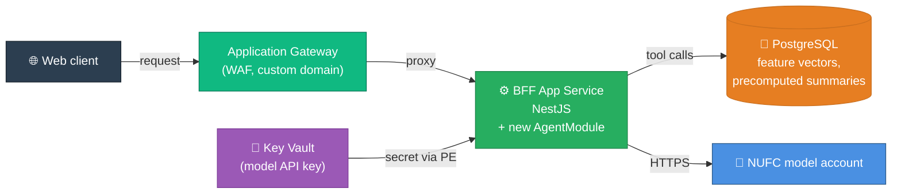
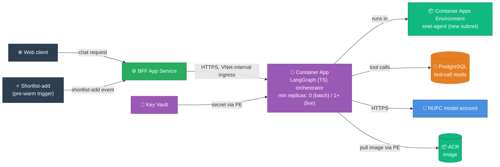
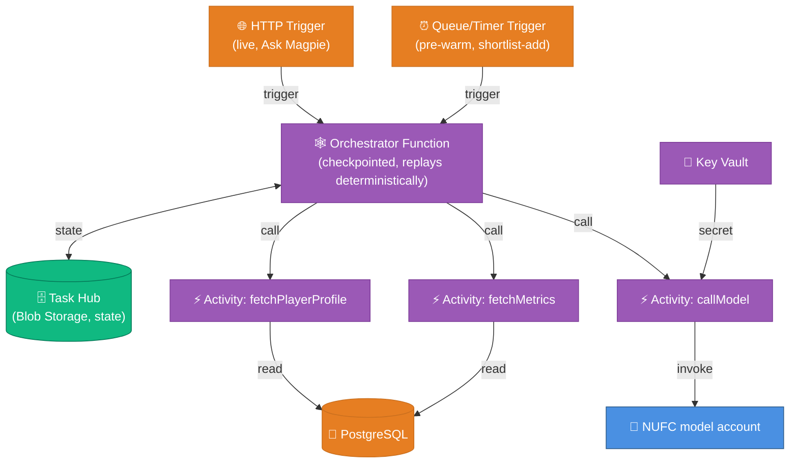
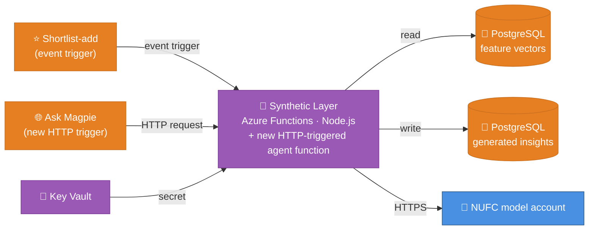

# ND-679: Agent/Orchestration Runtime Hosting Substrate — Research

_Produced by the 🔍 Research phase. Owned by @architect. Do not edit after Evaluate phase begins._

## Context

This is Decision 5 of 5 in ND-679. Decisions 1–3's research each independently proposed an agent-orchestration option for its own feature (Player Summary Option F, Strengths & Risks Option E, Ask Magpie Option E), and each flagged the same open question: where does the orchestrator process physically run. This decision resolves the hosting substrate once, for reuse by whichever of those options gets chosen per feature, rather than letting each feature answer the question separately.

Binding constraints: no new Snowflake touchpoint — the substrate only reads PostgreSQL via tool calls. It must support two trigger shapes with different latency and availability needs: scheduled/pre-warm (shortlist-add, cold-start-tolerant) and live conversational (Ask Magpie, cold-start-intolerant). Secrets, specifically Decision 4's model API key, must be injectable via Key Vault regardless of which substrate is chosen. Cost predictability — idle-cost behavior, scale-to-zero vs. always-warm — is an explicit evaluation axis. Today, no Container App resource is provisioned anywhere in the platform; it appears only as Azure Functions Flex Consumption's underlying substrate, an implementation detail rather than a resource the team provisions directly.

## Options

### Option A — Host inside the BFF (NestJS module/provider), no new deployable

**Description:** The agent-orchestration logic (LangGraph or hand-rolled graph, per whichever of Decisions 1–3's agent option is chosen) runs as a new NestJS module/provider inside the existing BFF App Service process. No new Azure resource, no new deployment pipeline, no new VNet subnet. The BFF already owns the role-filtering-at-read-time pattern, Key Vault secret injection, and outbound VNet integration; the agent module would call the same app-db repositories other BFF services already use, plus the model API (Decision 4) over HTTPS.

**Industry precedent:** Hosting LLM-orchestration logic directly inside an existing BFF/API-gateway process is a common early-stage pattern — for example Vercel AI SDK's documented "API route as agent host" pattern for Next.js apps — favored for simplicity until load or isolation needs force a split into a dedicated service.

**Diagram:**

**Pros:**

- Zero new infrastructure: no new Terraform module, subnet, Key Vault wiring, or CI pipeline — reuses the BFF's existing App Service, VNet integration, and secrets pattern wholesale
- Best possible latency for the live conversational trigger (Ask Magpie) — no network hop to a sibling service, no cold start, since the BFF is already always-warm
- Simplest operational model: one deployable to monitor, one log stream, one place secrets land
- Naturally satisfies "shared substrate across Decisions 1–3" since it is just more BFF code

**Cons:**

- Puts a stateful, potentially long-running (multi-step, multi-LLM-call) workload inside the same process that serves every other latency-sensitive BFF endpoint, which risks event-loop/connection-pool contention with unrelated requests under NestJS's single-process Node.js model
- Blurs the Serving Layer's stated boundary: the BFF is framed as an orchestration/caching/shielding layer over precomputed data, not a place that owns multi-step AI generation logic — Decisions 1 and 2's own research already treats "model-calling in the BFF" as an open architectural fork, not a settled choice
- The pre-warm trigger shape (tolerant of being slow) and the live trigger shape (intolerant) would both run inside the same process and scaling unit, with no way to give the batch workload a different scaling/cost profile than the interactive workload
- Scale-out of the BFF would scale the agent workload along with everything else, even if agent calls are not the bottleneck
- No independent versioning or rollback of agent logic separate from the rest of the BFF release cadence

**Unknowns/risks:**

- Whether Node.js's single-threaded event loop can absorb LangGraph's multi-step reasoning loops (potentially tens of seconds) without degrading unrelated BFF request latency under real concurrent load — unverified
- Whether adding a heavier dependency tree (LangGraph plus transitive dependencies) to the BFF's bundle affects its own cold-start/deploy characteristics

---

### Option B — New sibling Azure Container App

**Description:** A new, dedicated Azure Container App (within a new or existing Container Apps Environment) hosts the agent/orchestrator as its own long-running Node.js/TypeScript process. The BFF (or a Synthetic Layer trigger) calls it over HTTPS within the VNet, the same shape as the existing `ComputeTriggerClient`-style call to the Function App's HTTP trigger, but to a Container App ingress endpoint instead. Container Apps supports both scale-to-zero (min replicas 0, cost-efficient for the pre-warm/batch trigger) and a minimum replica count of 1+ (always-warm, for the live conversational trigger) — the two trigger shapes could run as two separate Container App revisions/apps sharing one Container Apps Environment, or one app configured for a minimum of 1 replica to cover both.

**Industry precedent:** Azure's own reference architecture for "Deploy an AI agent with Azure Container Apps" documents this exact shape: a containerized LangGraph/LangChain agent behind Container Apps ingress, scale-to-zero plus KEDA-based scaling rules. Container Apps is Microsoft's stated recommended target for stateful agentic workloads that need more control than Functions but not full Kubernetes.

**Diagram:**

**Pros:**

- Best fit for LangGraph's persistent-process assumptions (in-memory or checkpointed graph state across tool calls, longer-lived connections) — this is the hosting shape Decisions 1–3's own research names as the one that "most naturally" fits a stateful agent graph
- Genuinely independent scaling/cost/versioning unit: the pre-warm and live-conversational workloads can get different min-replica/scaling configs without affecting the BFF or each other
- Supports both idle-cost behaviors on the same primitive: scale-to-zero for the batch trigger, warm pool for the live trigger
- Clean secrets story: Key Vault access via managed identity and private endpoint, the same model already used by the Function App and BFF
- Natural single shared substrate for all three features' agent options: one Container App (or Container Apps Environment with multiple apps) that Decisions 1, 2, and 3 all call into

**Cons:**

- Genuinely new infrastructure primitive: a new Terraform module, a new subnet (the VNet's `172.30.0.0/21` is already fully allocated across named subnets, so this would need the unallocated remainder or a VNet resize), a new ACR image build/push step in CI, new private endpoint/DNS wiring. The project's CI/CD targets zip-publish for Functions; Container Apps needs a containerized build-and-push flow not currently exercised anywhere
- Cold start still applies to the scale-to-zero configuration. Container Apps cold starts are typically slower than Function Flex Consumption cold starts for small payloads, though this only matters for the pre-warm path, which already tolerates slowness
- A minimum-replica-count of 1 or more (for the live trigger) reintroduces an always-on cost, working against the "pay for what runs" cost principle
- No existing precedent in this codebase for container-image-based deployment
- Introduces a new named Azure resource class to document, monitor, and alert on, not covered by any existing NFR doc

**Unknowns/risks:**

- Exact min-replica cost for an always-warm Container App at this workload's expected size is unestimated — no Container Apps pricing row exists in the current Cost Optimization doc
- Whether splitting pre-warm and live triggers into two separate Container Apps (versus one app serving both) is cheaper or simpler is not evaluated here
- VNet subnet budget — whether a new subnet fits inside the current `/21` allocation without resizing — is an infra-team question

---

### Option C — Reshaped Azure Durable Functions orchestration (stays in the Compute/Synthetic Functions hosting convention)

**Description:** Instead of a literal LangGraph process, the orchestrator is expressed as a Durable Functions orchestrator function, the same primitive already used for the Compute Layer's pipelines. An HTTP-triggered orchestrator (live conversational path) or a queue/timer-triggered one (pre-warm path) sequences "tool-call" steps as Activity Functions (`fetchPlayerProfile`, `fetchMetrics`, and similar, each a bounded PostgreSQL read), checkpointing state into the Task Hub between steps exactly as Compute's orchestrators do today, then calls the model API as a final activity. This is agent-like multi-step orchestration without adopting LangGraph itself, closer to hand-rolled graph logic expressed in Durable Functions' native fan-out/sequence primitives.

**Industry precedent:** Azure's own documentation describes Durable Functions as usable for orchestrating AI workflows, including a documented chat-history/stateful-entity pattern, but this is less common and less battle-tested for agentic tool-calling than LangGraph; most public Durable Functions plus AI examples are batch/pipeline-shaped, not live-chat-shaped.

**Diagram:**

**Pros:**

- Zero new hosting primitive: reuses the exact runtime, deployment (zip publish, no container image), Task Hub, VNet integration, and Key Vault injection pattern Compute already has in production
- Durable Functions orchestrators are deterministic-replay and checkpointed by design, giving "resumable, inspectable multi-step runs" for free, a LangGraph-specific benefit (checkpointing) without the framework
- Flex Consumption scale-to-zero fits the pre-warm/batch trigger shape exactly as it does for nightly Compute runs, the same near-zero-cost-when-idle profile already proven
- CI/deployment story is already solved: same pipeline shape as Compute/Synthetic, no new build tooling

**Cons:**

- Flex Consumption cold start is a real problem for the live conversational trigger. Ask Magpie's synchronous/streamed conversational flow is explicitly cold-start-intolerant, and Flex Consumption's whole value proposition is scaling to zero between runs. It does support an "always ready instances" setting, but that reintroduces the same idle-cost tradeoff as Option B's min-replica config, without Container Apps' session/state affinity story
- Durable Functions orchestrators are not literally LangGraph. All three sibling research docs name LangGraph specifically as the concrete framework, so this option means hand-rolling equivalent primitives instead of adopting an existing framework, a real divergence from what was proposed per-feature
- Durable Functions' orchestrator-replay model imposes constraints (orchestrator code must be deterministic, no direct I/O inside the orchestrator function itself, only inside Activities) that are a poor fit if the orchestrator needs to branch on model output mid-run. Workable, but a sharper edge than LangGraph's native state-graph model
- The existing 30-minute Compute activity timeout convention is irrelevant for a chat response that needs to return in seconds; new timeout values would need defining from scratch
- Still a second Function App deployment unit distinct from Compute's existing one, so not truly "zero new infra," only zero new infra class

**Unknowns/risks:**

- Whether Flex Consumption's "always ready instances" setting can deliver conversational-grade latency (sub-few-seconds) reliably enough for live chat is unverified
- Whether hand-rolling agent-graph semantics in Durable Functions is actually less engineering effort than Option B once tool-call branching, partial failure, and retry-with-context logic are built out is unclear without a prototype
- The HTTP-triggered orchestration pattern for synchronous low-latency responses is not Durable Functions' most common use case (designed around "start and poll for completion," not request/response) and may need a thin synchronous wrapper

---

### Option D — Request-driven extension of the existing Synthetic Layer

**Description:** The Synthetic Layer's scope (today "scheduled/event-driven batch only") is extended with a new HTTP trigger class, making it capable of handling both the pre-warm trigger (already a natural fit for Synthetic's existing event-driven trigger shape) and, with the new HTTP trigger, the live conversational path. Same runtime family as Compute/Synthetic today (Azure Functions, Node.js, Flex Consumption), same deployment and secrets pattern, but as the Synthetic Layer's own Function App rather than Compute's.

**Industry precedent:** Less a named industry pattern and more an internal-consistency argument — many platforms split "batch model scoring" and "live model inference" into the same logical service family (for example Azure ML's batch endpoints versus online endpoints, which share tooling but differ in hosting config), the shape this option proposes for Synthetic.

**Diagram:**

**Pros:**

- Most architecturally "correct" home per the HLD's own layer purpose statement: the Synthetic Layer doc explicitly names "AI-generated player summaries and insights" as a Synthetic Layer responsibility already, and this is literally where Decisions 1–3's non-agent options already plan to land their generation step
- Reuses Synthetic's already-planned hosting model (Flex Consumption, same runtime/deployment/secrets pattern as Compute), no new primitive, consistent with the "separate deployment unit, independent scaling and versioning" rationale already given for why Synthetic is its own Function App distinct from Compute
- Keeps model-calling logic entirely out of the Serving Layer, preserving the BFF's stated role as a thin orchestration/caching layer, resolving Player Summary Research's open question about BFF versus Synthetic in the "exclusively Synthetic Layer" direction
- One shared home for all of Decisions 1–3's generation logic, batch and live alike, since Synthetic already owns both per-player precompute and (with this extension) on-demand generation

**Cons:**

- The Synthetic Layer is explicitly scoped today as "planned, not yet implemented" and scheduled/event-driven only. Adding an HTTP trigger class is a scope change to a container that does not exist in code yet, meaning there is no existing implementation to extend, only a doc to amend; this is less "reuse" than Option A or C and more "build it with this shape from scratch"
- Same Flex Consumption cold-start tension as Option C for the live conversational trigger; being "Synthetic" rather than "Compute" does not change the underlying Flex Consumption cold-start characteristics
- No existing precedent in this codebase for a Function App receiving direct live user-facing HTTP traffic with conversational latency requirements. Compute's one HTTP trigger today is admin-key-gated, fire-and-poll, response proxied verbatim, not a live chat turn
- Blurs Synthetic's originally-stated "scheduled/event-driven" identity. Once it accepts live HTTP triggers indistinguishable in latency-sensitivity from a Serving Layer endpoint, the Compute/Synthetic versus Serving boundary gets less clean, exactly the distinction the Synthetic Layer's "Not responsible for: Serving the UI directly" line is trying to preserve

**Unknowns/risks:**

- Whether a request-driven Synthetic Function App would sit on the same subnet as the existing Function App or need its own is not addressed in the current Infrastructure doc, which only names one Function App today
- Whether Flex Consumption's always-ready-instance mode (the same open question as Option C) can hit conversational latency targets
- Whether extending a not-yet-built layer's scope mid-design is simpler or harder than adding a genuinely new container (Option B) is largely a sequencing/estimation question rather than a technical one

---

### Option E (rejected-by-inspection comparison point) — Azure Kubernetes Service

**Description:** A dedicated AKS cluster hosts the orchestrator as a long-running pod/deployment, with full control over scaling, networking, and sidecar patterns.

**Why not pursued as a real option:** AKS is a cluster-management primitive, not a single-workload hosting choice. It requires node pool management, its own networking/RBAC model, and ongoing cluster operations overhead wildly disproportionate to a 10-30-user platform with one new stateful workload. No other part of this platform uses or plans to use Kubernetes; introducing it here would mean standing up an entirely new operational discipline (cluster upgrades, node patching, Kubernetes-specific Terraform modules) for a single agent process that Container Apps (Option B) already serves at a fraction of the operational cost. Included only as the "too heavy" comparison point.

---

### Option F — Azure AI Foundry Agent Service (cross-cutting — see shared file)

**Description:** Microsoft's managed, hosted agent runtime (threads/runs/tools model, similar in intent to OpenAI's Assistants API). Unlike AWS Bedrock AgentCore, it is not framework-agnostic — the thread/run/tool-calling loop is the service's own orchestration engine, not a substrate for arbitrary agent code. Adopting this option does not compose independently with Decision 4 (model hosting/access pattern) and Decision 6 (orchestration framework choice) the way every other option on this page does: it answers all three by platform adoption in one step, not by independent choice. **This is a cross-cutting option, not scoped to this decision alone** — see `01 Research - Cross-Cutting Option - Azure AI Foundry Agent Service.md` for the full description, diagram, pros/cons, unknowns/risks, and its own open questions. Evaluate should treat picking this option as a combined decision across Decisions 4, 5, and 6, not just this one's AC × Options matrix.

**Industry precedent:** see the shared cross-cutting file.

**Pros / Cons / Unknowns/risks:** see the shared cross-cutting file — summarized there against the combined acceptance criteria of Decisions 4, 5, and 6 together, not duplicated here to avoid drift between copies.

---

## Open Questions

| #   | Question                                                                                                                                                                                                                                                                                                                                                                                                                      | Owner                  |
| --- | ----------------------------------------------------------------------------------------------------------------------------------------------------------------------------------------------------------------------------------------------------------------------------------------------------------------------------------------------------------------------------------------------------------------------------- | ---------------------- |
| 1   | Is a single shared substrate across Decisions 1-3 actually realistic given their different trigger/latency profiles, or should pre-warm (Player Summary, Strengths & Risks) and live (Ask Magpie) genuinely run on different substrates? (Evaluation-input — "one substrate, two configs" is plausible but unproven; "two substrates, one per trigger shape" is an equally legitimate answer this research does not rule out) | @architect             |
| 2   | Can Azure Functions Flex Consumption's "always ready instances" setting realistically deliver conversational-grade latency for the live trigger, removing the cold-start objection to Options C/D? (Viability-blocking for C/D — untested in this codebase)                                                                                                                                                                   | @architect / @infra    |
| 3   | Does the chosen agent framework (LangGraph specifically) actually need to run outside the BFF, or is Option A's in-process risk overstated for the realistic call volume (10-30 users)? (Evaluation-input — Decisions 1-3's research assumed a new deployment unit without quantifying BFF headroom)                                                                                                                          | @architect             |
| 4   | Is there VNet subnet budget for a new Container Apps Environment subnet without resizing the existing allocation? (Viability-blocking for Option B — unresolved without an infra-team capacity check)                                                                                                                                                                                                                         | @infra                 |
| 5   | Does adopting Container Apps (Option B) commit the team to a containerized build/deploy pipeline it doesn't otherwise need, given every other app ships via zip publish or App Service image config? (Evaluation-input)                                                                                                                                                                                                       | @infra                 |
| 6   | If Option C or D is chosen, is a hand-rolled Durable-Functions-based orchestration an acceptable substitute for literal LangGraph, given all three sibling decisions named LangGraph specifically as their concrete framework choice? (Viability-blocking for C/D — needs explicit sign-off, not an implementation detail)                                                                                                    | @architect / developer |
| 7   | Does Option D require Infrastructure/Terraform scope beyond what's already planned for standing up the (not-yet-implemented) Synthetic Layer, given this would be its first HTTP-triggered, live-latency-sensitive workload? (Evaluation-input)                                                                                                                                                                               | @architect / @infra    |
| 8   | What is the realistic idle-cost delta between Option B's min-replica-≥1 Container App and Option A/C/D's reuse of an already-warm (BFF) or already-scale-to-zero (Functions) resource? (Evaluation-input — no Container Apps pricing data exists in the current Cost Optimization doc)                                                                                                                                        | @infra                 |
