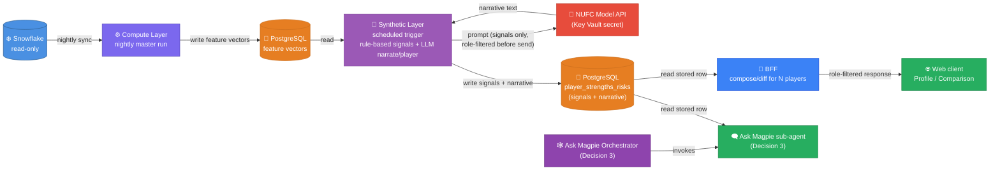
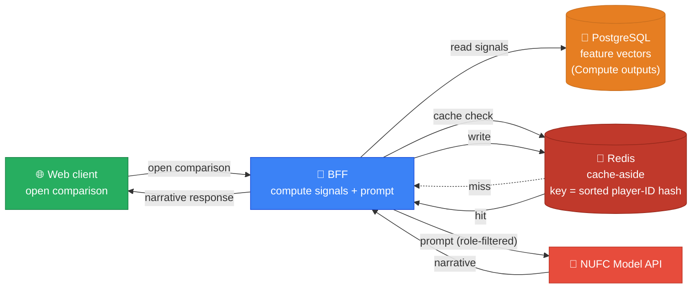
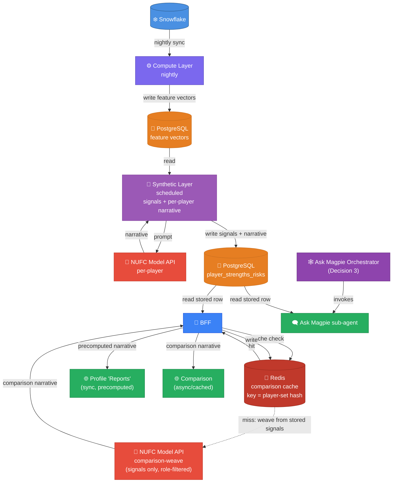
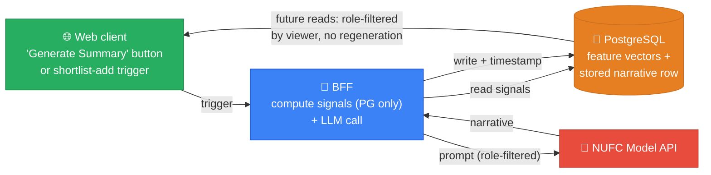
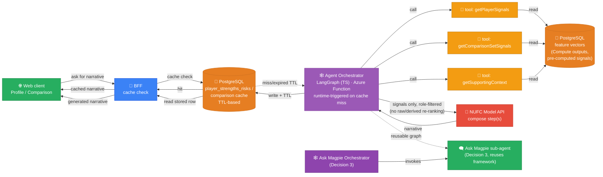

# ND-679: Strengths and Risks Summary — Research

_Produced by the 🔍 Research phase. Owned by @architect. Do not edit after Evaluate phase begins._

## Context

This is Decision 2 of 3 in ND-679. The problem: decide the generation strategy (pre-computed, runtime, or hybrid) for the Strengths and Risks Summary, a narrative of a player's strengths, weaknesses, and risks originally scoped for Player Comparison behind the flag `flagCompareAiSummary`. ND-671 relabelled Profile Overview's "risks" section to "Reports" and deferred risk detection to this feature, so the summary may also need to fill that gap. The design principle is already settled and is not re-opened here: deterministic rules compute the strength/risk signals first, and the model only narrates signals that are already computed. The open question this phase explores is per-player versus per-comparison-set narrative generation — comparison sets change frequently, which plausibly favors runtime generation over pre-computation. The chosen approach is reused by Ask Magpie's strengths-and-risks sub-agent (Decision 3) and carries the same role-restriction concern as Decision 1 around injury and scouting data.

## Options

### Option A — Fully pre-computed per-player (Synthetic Layer batch), composed at runtime for comparisons

**Description:** Synthetic Layer computes deterministic strength/risk signals per player (percentile outliers, injury/contract/form/age flags) nightly after Compute, matching the existing trigger pattern for that layer. For each player it also calls the LLM once to narrate that player's own strengths/risks, storing the narrative and signal set in PostgreSQL (e.g. `player_strengths_risks`). Comparison and Profile both read these per-player rows through the BFF; the BFF, or a thin Synthetic Layer composition function, diffs or merges the signal sets for N selected players into a comparison view, either algorithmically ("Player A's top speed is a strength not shared by B/C") or via a second, cheaper LLM call that stitches pre-written sentences instead of regenerating from scratch.

**Industry precedent:** The pre-aggregate-the-atomic-unit, compose-views-at-read-time pattern used in sports analytics (e.g. Opta- and StatsBomb-style per-player radar/strength profiles computed once, then diffed client-side for comparison UIs). Mirrors how recommendation systems pre-compute per-item embeddings and do pairwise comparison at query time.

**Diagram:**

**Pros:**

- Matches the existing Synthetic Layer contract exactly: scheduled trigger, PostgreSQL-only I/O, no new Snowflake touchpoint.
- One LLM call per player per refresh cycle regardless of how many comparison permutations scouts build; cost is bounded by player count (hundreds), not by comparison combinatorics.
- Ask Magpie's strengths-and-risks sub-agent (Decision 3) can read the same per-player row already serving Profile and Comparison.
- Role-restriction enforcement happens once, server-side, at read time (the BFF filters restricted fields out of the stored JSON before serializing) rather than needing per-call prompt-time redaction logic for every generation path.

**Cons:**

- Does not generate a true comparison narrative; the prose a scout might expect ("A is faster but B has fewer injury risks") is synthesized after the fact from per-player text, which can read as list-like rather than a cohesive paragraph.
- Pays for N LLM calls nightly even for players nobody looks at that day. The waste is bounded and predictable, but it exists.
- Freshness is bounded by the nightly cycle; a signal change intraday (e.g. a new injury flag) is not reflected until the next Synthetic run.

**Unknowns/risks:**

- Whether NUFC's prompt design can produce a comparison-quality narrative purely by diffing two already-written per-player texts, or whether a comparison genuinely needs its own generation pass.
- Total nightly cost at full squad-plus-scouted-player population; needs NUFC's cost-per-generation input.

---

### Option B — Fully runtime, per-comparison-set (generate-on-open, cache-aside)

**Description:** No pre-computation. When a scout opens a comparison (or the Profile "Reports" section), the BFF computes the deterministic signals on the fly from already-materialized PostgreSQL data, builds a prompt from the exact player set, calls the LLM synchronously or via a short-poll job, and caches the result in Redis keyed by a canonical sorted-player-ID-set hash with a TTL tied to NUFC's freshness bar.

**Industry precedent:** The generic LLM-as-a-service-with-cache-aside pattern (e.g. GitHub Copilot's suggestion cache, OpenAI's prompt caching). Correct when the request space is small or skewed, and widely documented as a poor fit for high-cardinality combinatorial inputs.

**Diagram:**

**Pros:**

- Narrative is a genuine comparison narrative, generated with full context of the actual set, not stitched from pieces.
- No wasted generation for player combinations nobody ever requests; true pay-per-use, potentially cheaper if comparison sets are long-tail and rarely repeated.
- Freshness is naturally tight: it always reflects the latest materialized signals, with no nightly-batch lag.

**Cons:**

- Comparison sets are high-cardinality (combinatorial across a growing player population); the cache-hit rate is plausibly low, meaning most opens are cache misses that pay full LLM latency and cost on the critical path.
- Violates the BFF's documented bounded-exception contract as currently scoped: the only sanctioned synchronous external call today is a sub-second bounded Snowflake fallback for populations of 500 rows or fewer. An LLM call is multi-second with no precedent bound in that doc today, and would need a new documented exception with its own bound, or be pushed async.
- Does not naturally produce a reusable per-player artifact for Profile or Ask Magpie's sub-agent; each surface would need its own runtime generation path.
- Cost is unbounded by anything except request volume, which conflicts with the proposed cost guardrail EC unless paired with rate limiting.

**Unknowns/risks:**

- Actual comparison-set cache-hit rate is unmeasured.
- Whether NUFC's acceptable wait time tolerates multi-second synchronous generation on comparison-open.

---

### Option C — Hybrid: per-player pre-computed (Synthetic) + runtime comparison-level generation, Redis-cached

**Description:** Combines A and B. The Synthetic Layer pre-computes and stores per-player signals and a per-player narrative nightly, serving Profile "Reports" and feeding Ask Magpie directly at zero runtime cost for those surfaces. For Comparison specifically, the BFF generates a dedicated comparison narrative at runtime from the pre-computed per-player signals; only the prose-weaving step is a live LLM call, not full recomputation. The result is cached in Redis by player-set hash with a short TTL.

**Industry precedent:** Mirrors e-commerce per-item enrichment, cross-item comparison at request time: pre-generate per-SKU spec summaries in batch, then synthesize the comparison table or narrative live. Standard way search and recommendation systems separate expensive per-entity feature computation from cheap request-time composition.

**Diagram:**

**Pros:**

- Fills the Profile risk-detection gap from ND-671 with zero added runtime latency or cost, the same shape as Option A for that surface.
- Comparison gets genuine comparison-aware prose, addressing Option A's stitched-text weakness, while costing less per call than Option B because the prompt only weaves already-extracted signals rather than recomputing or deriving them.
- Ask Magpie's sub-agent (Decision 3) can reuse the stored per-player narrative and signals directly, with comparison narrative generation available as a secondary on-demand tool if needed.
- Degrades gracefully: if the runtime comparison call fails or times out, the BFF can still render the per-player cards (signals plus narrative) instead of nothing, fitting the proposed graceful-degradation EC.

**Cons:**

- Two generation paths to build, test, and keep in prompt-sync with NUFC — more moving parts than A or B alone.
- Still carries Option B's architectural tension: the comparison-time LLM call sits on the BFF's synchronous request path, not today's documented bounded-exception shape, and needs either a new documented exception or an async/polling UX for comparisons specifically.
- Requires explicit role-filtering twice: once when Synthetic writes the per-player narrative, again at comparison-weave time.

**Unknowns/risks:**

- Whether a signals-only, no-raw-data comparison prompt is cheap and fast enough to meet acceptable wait times.
- Where the comparison-weave call should live: BFF or Synthetic Layer, which today documents only scheduled or event-driven triggers, not request-driven ones.

---

### Option D — Minimal/manual: on-demand only, no cache, trigger-gated

**Description:** No Synthetic Layer involvement for M1.5. Deterministic signal computation happens in the BFF, reading already-materialized PostgreSQL feature data. The LLM call fires synchronously only on an explicit user trigger (e.g. a "Generate Summary" button, or shortlist-add), with the result persisted to PostgreSQL as a timestamped row, a write-through cache with no TTL eviction logic, refreshed only on explicit regenerate.

**Industry precedent:** The generate-and-cache-in-DB-with-no-eviction pattern common in early-stage AI feature rollouts: a deliberately minimal baseline, not an industry best practice for a feature expected to scale.

**Diagram:**

**Pros:**

- Simplest possible build: no new scheduled job, no Synthetic Layer scope, usable as a First Release MVP while NUFC's cost and freshness answers are pending.
- Cost is strictly bounded by explicit user action, satisfying the proposed cost-guardrail EC with the least engineering effort.
- Easy to reason about for role-restriction: generation happens once, at a known point, with the requesting user's role known at generation time, though the stored output must still be filtered per-viewer, not per-generator.

**Cons:**

- Does not fill the Profile "Reports" gap from ND-671 with the same zero-latency precomputed experience Options A and C give; the first view after a data change always pays LLM latency.
- No reuse story for Ask Magpie's sub-agent beyond reading whatever happens to already be stored, which may be stale or absent.
- Manual, explicit-trigger UX may not match what NUFC wants.
- Still sits on the BFF's synchronous path for an LLM call exactly like Option B, carrying the same architectural tension.

**Unknowns/risks:**

- Whether request-only generation is acceptable to NUFC or seen as a weaker MVP than committing to at least Option A's Profile-filling batch job, given ND-671 already shipped a UI relabel implying risk content is expected to just be there.

---

### Option E — Runtime, agent-orchestrated generation (LangGraph-style), TTL-cached output in PostgreSQL

**Description:** Generation is runtime-triggered, hosted on Azure (same Node.js/TypeScript Function App or App Service family as the rest of the platform — this could run as an Azure Function invoked by the BFF, or as a dedicated step inside the Synthetic Layer if its trigger model is extended to request-driven, per the existing open question about extending that trigger model). Instead of a single stuffed-context prompt call, generation is handled by a small agent graph (LangGraph for TypeScript, or a comparable orchestration framework) with a bounded, fixed set of tool nodes:

- `getPlayerSignals(playerId)` — reads the already-computed strength/risk flags and percentile outliers from PostgreSQL. This tool does not re-derive signals; it only fetches what is already computed, preserving the binding design principle that the model never decides what counts as a strength or risk.
- `getComparisonSetSignals(playerIds[])` — fetches the same per-player signal rows for each player in a comparison set, for the comparison-narrative path.
- `getSupportingContext(playerId)` — optional tool for lower-cardinality supporting facts already materialized in PostgreSQL (position, age, contract status) needed for narrative framing. Explicitly not a vector-database lookup — "retrieval" here means discrete, typed tool calls over the platform's own structured PostgreSQL data, not RAG in the vector-search sense; a dedicated RAG/vector database remains out of scope for M1.5.
- A final `composeNarrative` node that takes the fetched signal/context payloads and produces the prose.

The agent can make 2–4 tool calls and a short reasoning loop before emitting the final narrative, rather than a single stuffed prompt built by the caller ahead of time. This targets both per-player and per-comparison-set narratives: the same graph can run with either one player ID or a player-ID set as its starting input, with the tool-selection step picking the single-player vs. multi-player code path accordingly.

The output is written to a `player_strengths_risks`-style PostgreSQL table (or a dedicated `comparison_strengths_risks_cache` table, same shape, keyed by sorted player-ID-set hash like Option B/C's Redis key), used purely as a TTL-based cache for the agent's final narrative — not as an execution log or state store. The stored artifact is identical in shape to Option A/C's stored narrative; only the generation mechanism that produced it is multi-step rather than single-call. On a cache hit within TTL, no agent run happens at all; on a miss, the full graph executes and the result is written back with a fresh TTL.

**Industry precedent:** LangGraph (TypeScript) is LangChain's graph-based agent orchestration library for building stateful, multi-step tool-calling agents with explicit control flow, commonly used for RAG-with-tools and multi-hop reasoning agents. The broader pattern — an LLM orchestrator making discrete, typed tool calls against first-party structured data rather than one stuffed prompt — is the standard shape of "function calling"/"tool use" agents as documented by OpenAI's function-calling API and Anthropic's tool-use API, both of which explicitly support "fetch structured facts via tool call, then reason/compose" without requiring a vector database.

**Diagram:**

**Pros:**

- Narrative quality for comparisons is a genuine strength: the agent can reason over N players' signal sets step by step rather than relying on stitched per-player text (Option A's weakness) or a single large stuffed prompt (Option B/C's weave call), potentially producing a more coherent comparison paragraph with explicit cross-player claims
- Tool-call boundaries make the "model never derives signals" principle structurally enforceable, not just a prompt-writing convention — the only way the agent gets data is through signal-fetching tools that return pre-computed rules-engine output
- The orchestration framework itself is reusable scaffolding for Ask Magpie's strengths-and-risks sub-agent (Decision 3), which is already expected to need multi-step tool use
- TTL-cache shape is identical to the existing hybrid options (A/C), so BFF/Synthetic read paths, role-filtering-at-read enforcement, and Ask Magpie's reuse story are unaffected by swapping the generation mechanism underneath

**Cons:**

- Meaningfully more engineering surface than any of A–D: a new dependency, a new execution runtime concern (long-running multi-step invocation, retries mid-graph, partial-failure handling), and new prompt/tool-schema maintenance, for signals that are already fully computed before the agent ever runs
- Latency is strictly worse than a single-call option for the same work — multiple sequential tool calls plus a final composition call versus Option B/C's one weave call, cutting against the same BFF latency-target and bounded-exception concerns already flagged against B/C
- Comparison sets are already high-cardinality; an agent framework adds reasoning/tool-call overhead per comparison-set cache miss without removing the underlying combinatorics problem — not more cost-bounded than Option B's cache-aside approach, if anything more expensive per miss
- The value the agent framework adds here is arguably oversized for a narration-only task where the hard part (what is a strength/risk) is already deterministic — a single prompt with the per-player and comparison-set signals already assembled by the caller (Option C's weave call) can likely produce comparable prose without an orchestration framework, agent state management, or a new runtime dependency
- No existing precedent anywhere in this codebase or HLD for hosting an agent-orchestration framework — it would be the first, with its own hosting-plan, cold-start, and observability questions

**Unknowns/risks:**

- Whether LangGraph (TypeScript) or any comparable framework has a hosting story that fits the existing Azure Functions Flex Consumption / App Service model, or needs a different runtime shape
- Whether the quality uplift from multi-step tool-call reasoning over a comparison set is actually measurable versus Option C's single weave-call prompt — unverified without a side-by-side eval
- Same open architectural question as Options B/C: whether this generation step lives in the BFF or the Synthetic Layer, now compounded by the fact that an agent framework is a heavier dependency to place in either layer than a single HTTP call to the model API
- Cost per narrative is higher and less predictable than any other option here, needing NUFC's cost-per-generation input even more than Options A/C already do

---

## Open Questions

| #   | Question                                                                                                                                                                                                                                                                                                                                               | Owner                                 |
| --- | ------------------------------------------------------------------------------------------------------------------------------------------------------------------------------------------------------------------------------------------------------------------------------------------------------------------------------------------------------ | ------------------------------------- |
| 1   | What is NUFC's acceptable wait time for an on-open/on-trigger comparison narrative (Options B/C/D)? Decides whether any synchronous-LLM-on-request-path option is viable, or only the fully-precomputed Option A survives.                                                                                                                             | NUFC                                  |
| 2   | What trigger does NUFC want: shortlist-add, comparison-open, or request-only? Changes the cost/latency trade-offs across B, C, D.                                                                                                                                                                                                                      | NUFC                                  |
| 3   | What is the real comparison-set cache-hit rate — do scouts re-open the same comparisons often? No usage telemetry exists yet; determines whether Option B's or C's Redis cache-aside layer earns its complexity.                                                                                                                                       | Product/analytics                     |
| 4   | Can the BFF's documented bounded-exception pattern be extended to cover a multi-second LLM call, or does this need a new, separately-documented exception with its own latency bound? Options B and the comparison half of C cannot be adopted as drafted without resolving this.                                                                      | @architect                            |
| 5   | Should the Synthetic Layer's trigger model be extended to support request-driven (not just scheduled/event-driven) invocation, to host a comparison-weave call (Option C)? New scope for that container either way.                                                                                                                                    | @architect                            |
| 6   | What is the total LLM cost per nightly batch run at full player population (Options A/C) versus per-request cost at realistic comparison volume (Options B/C/D)? Needed to compare options against NUFC's budget ceiling.                                                                                                                              | NUFC                                  |
| 7   | Where exactly must role-filtering be enforced for stored per-player narratives — at Synthetic write-time or at BFF read-time — and is one alone sufficient? Choosing the wrong enforcement point is a real leakage risk.                                                                                                                               | @architect / Access Management design |
| 8   | Does LangGraph (TypeScript) or any comparable agent framework have a supported hosting shape on Azure Functions Flex Consumption / App Service that fits this platform's existing runtime, timeout, and cold-start constraints? (Viability — factual question about framework-to-hosting-plan compatibility)                                           | @architect / @infra                   |
| 9   | Is multi-step agent reasoning actually necessary for narration-only output here, given the hard part (signal derivation) is already deterministic and settled — or is this over-engineered relative to Option C's single weave-call prompt? (Evaluation-input — build-complexity-vs-quality trade-off needing a side-by-side prose-quality comparison) | NUFC / @architect                     |
| 10  | What is the per-narrative cost ceiling NUFC will accept, given Option E's multiple-LLM-call generation is strictly more expensive per cache miss than every other option here? (Viability — pure cost-per-call arithmetic once NUFC supplies a budget figure)                                                                                          | NUFC                                  |
| 11  | Should the agent framework, once introduced, become the shared execution substrate for Ask Magpie's sub-agents (Decision 3) regardless of whether Option E is chosen for Decision 2 — i.e. is this really a Decision-3-scoped question being pulled forward? (Evaluation-input — sequencing/ownership call across two decisions)                       | @architect                            |
