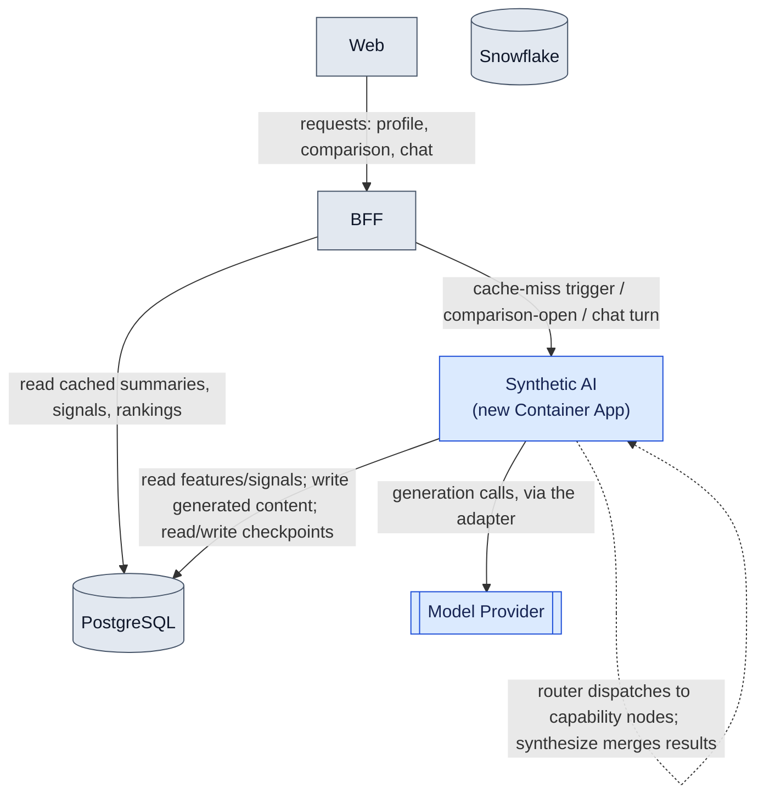
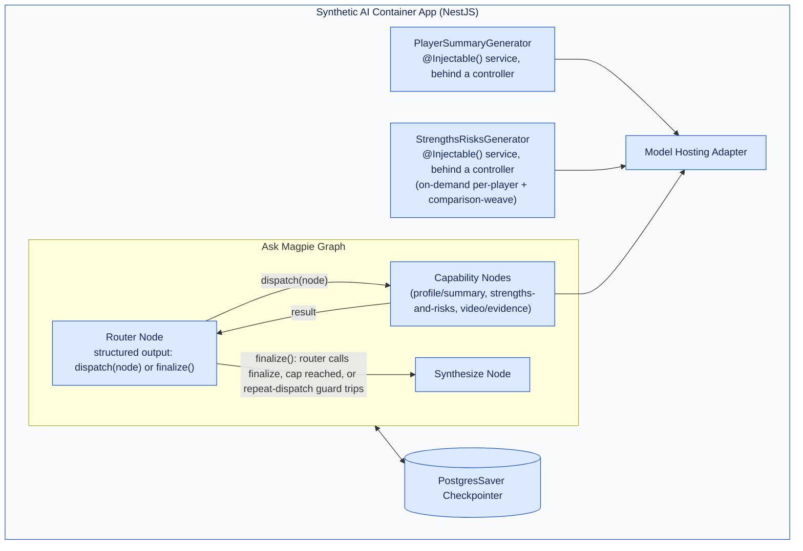
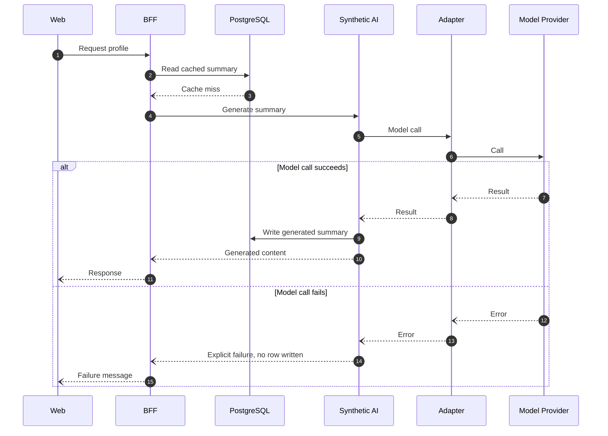
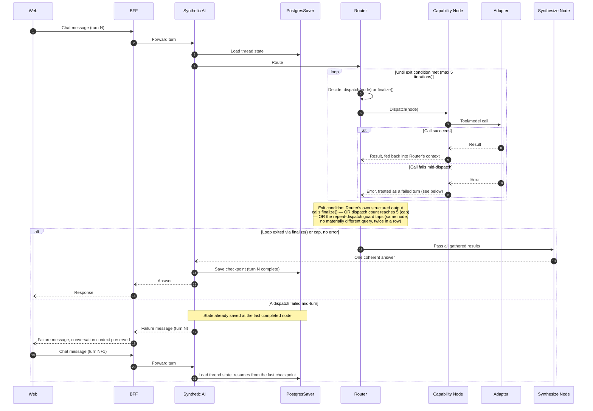
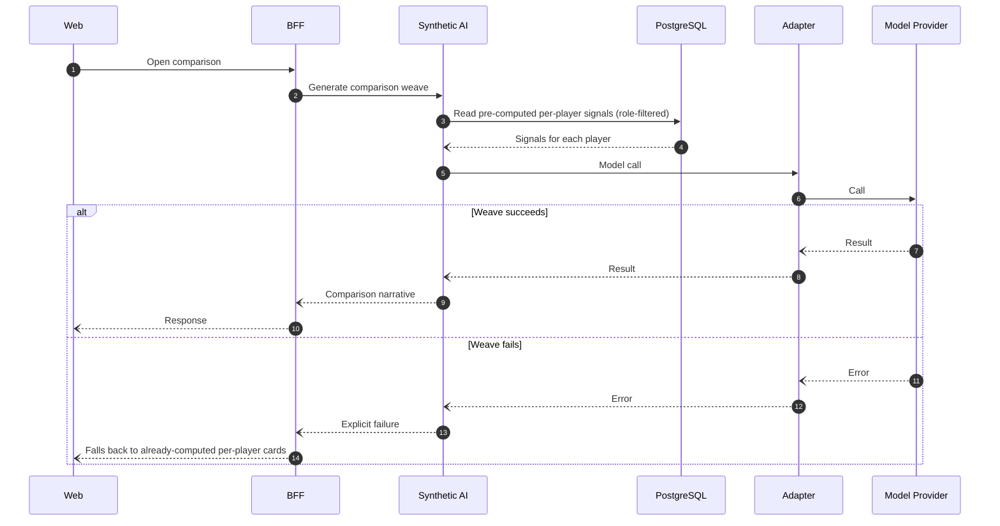

# Architecture — AI Features (ND-679)

One new container, Synthetic AI, hosts generation and orchestration for all three features: AI-Generated Player Summary, Strengths and Risks Summary, and Ask Magpie. The BFF stays a pure cache-aside reader for the first two and a pass-through proxy for the third; all model calls route through one in-house Model Hosting Adapter — an in-process code module inside Synthetic AI's own codebase, not a separate deployable or network service.

Source material: `design/00 Frame.md`, the six `design/02 Evaluate - *.md` files, `design/Report.md`.

## Scope

This document covers the three feature decisions (Player Summary, Strengths and Risks Summary, Ask Magpie) and the three cross-cutting infrastructure decisions that host them (model hosting/access pattern, agent runtime hosting, agent orchestration framework). All six decisions are settled and recorded in the Decision Register below.

## New container: Synthetic AI

A new Azure Container App, sibling to the platform's existing nine HLD containers (Canonical/Snowflake, Compute/Durable Functions, Synthetic, Serving BFF/Web/Auth, Data, Infrastructure, CI/CD). Destination doc: `docs/Target Architecture (HLD)/MVP/01. Containers/10. Synthetic AI.md`.

Synthetic AI is distinct from the existing "Synthetic" container (`03. Synthetic.md`): that container is a planned, scheduled-only Azure Functions deployment for deterministic-adjacent model outputs (rankings, similarity, projections). Synthetic AI is a separate Container App built specifically for live generative and conversational workloads.

**Responsibility reassignment:**

- `03. Synthetic.md`'s Responsibilities section currently lists "AI-generated player summaries and insights" as a Synthetic Layer deliverable; `00. System Overview.md`'s principle #4 states "model generation ... and AI insights live in the Synthetic Layer."
- This solution moves that responsibility — AI-generated summaries, narratives, and conversational generation (Decisions 1, 2, 3) — to Synthetic AI.
- The existing Synthetic container keeps its deterministic-adjacent responsibilities (rankings, similarity, projections, role-fit scoring) and loses the AI-narrative bullet.
- Both `03. Synthetic.md` and System Overview's principle #4 must be updated at Publish to reflect this split; see Affected architecture documents below.

| Attribute                          | Value                                                                                                                                                                                                                                                                                                                                                                                                                                                  |
| ---------------------------------- | ------------------------------------------------------------------------------------------------------------------------------------------------------------------------------------------------------------------------------------------------------------------------------------------------------------------------------------------------------------------------------------------------------------------------------------------------------ |
| Runtime                            | Node.js, TypeScript                                                                                                                                                                                                                                                                                                                                                                                                                                    |
| Hosting                            | Azure Container App, UK South, platform's existing single VNet, new dedicated subnet                                                                                                                                                                                                                                                                                                                                                                   |
| Deployment units                   | One: a single long-running Azure Container App (min-replica ≥ 1), hosting Ask Magpie's live conversational graph, Decision 1's on-demand cache-miss generation, and Decision 2's on-demand per-player generation and comparison-weave — all three features are HTTP-triggered, synchronous call-and-wait workloads with no scheduled component. Full Terraform module, naming, SKU, and sizing detail in `solution/Design - Agent Runtime Hosting.md`. |
| Shared platform resources reused   | Pushes to the platform's existing `platform-container-registry-01` Container Registry (not a new registry); secrets via the existing `platform-apps-kv-01` Key Vault; diagnostics via the existing `platform-law-01` Log Analytics Workspace — the same sinks every other container already uses. A dedicated managed identity, `synthetic-ai-mi-01`, is the only genuinely new identity, scoped to `AcrPull` on the shared registry only.             |
| Application framework              | NestJS — the same framework the BFF already uses, for team familiarity and to follow the platform's existing Swagger-decorator convention (`.claude/skills/swagger.md`) on every endpoint. Each decision's generator (Player Summary Generator, Strengths & Risks Generator) is a NestJS `@Injectable()` service class, exposed via a controller as an HTTP endpoint. Full detail in `solution/Design - Agent Runtime Hosting.md`.                     |
| Internal auth (BFF → Synthetic AI) | VNet-level network isolation (no public ingress) plus a shared-secret header, the Container Apps equivalent of Compute's `x-functions-key` mechanism (`ComputeTriggerClient`) — Container Apps has no built-in function-key auth the way Azure Functions does, so Synthetic AI validates its own shared secret via a NestJS guard. Secret sourced from Key Vault.                                                                                      |

## System context



Snowflake remains read-only via the Compute container and is unaffected by this change; it appears here for context completeness only.

## Component view — inside Synthetic AI



The adapter is the single shared dependency across all three features' generation code and Ask Magpie's capability nodes. The checkpointer is used only by the Ask Magpie graph. The sequence diagrams below give the adapter its own participant lane to show the logical call structure; this does not imply a separately hosted component.

## Decision register

| #   | Decision                             | Chosen outcome                                                                                                                                                                                                                                                                                                                                                                                                                                                   | Scope / ownership                                                                                                                                                                                                                                                           | Affected interfaces                                                                                                                                                                                                                                                                                                                                                                                                                                                                                  | Failure / recovery & consequences                                                                                                                                                                                                                                                                                                                                                                                                         | Verification                                                                                                                                                                                                                 |
| --- | ------------------------------------ | ---------------------------------------------------------------------------------------------------------------------------------------------------------------------------------------------------------------------------------------------------------------------------------------------------------------------------------------------------------------------------------------------------------------------------------------------------------------- | --------------------------------------------------------------------------------------------------------------------------------------------------------------------------------------------------------------------------------------------------------------------------- | ---------------------------------------------------------------------------------------------------------------------------------------------------------------------------------------------------------------------------------------------------------------------------------------------------------------------------------------------------------------------------------------------------------------------------------------------------------------------------------------------------- | ----------------------------------------------------------------------------------------------------------------------------------------------------------------------------------------------------------------------------------------------------------------------------------------------------------------------------------------------------------------------------------------------------------------------------------------- | ---------------------------------------------------------------------------------------------------------------------------------------------------------------------------------------------------------------------------- |
| 1   | AI-Generated Player Summary          | Dedicated-compute generation in the new container; BFF stays a pure cache-aside reader                                                                                                                                                                                                                                                                                                                                                                           | New container owns model-calling; BFF owns PostgreSQL read + cache-miss trigger                                                                                                                                                                                             | BFF→Synthetic AI HTTP call on cache miss; Synthetic AI→PostgreSQL write                                                                                                                                                                                                                                                                                                                                                                                                                              | Generation failure returns an explicit failure to BFF; no stale or partial row is ever written                                                                                                                                                                                                                                                                                                                                            | Cache-hit path returns instantly; cache-miss path round-trips through generation once per player per invalidation window                                                                                                     |
| 2   | Strengths and Risks Summary          | Both halves are on-demand, matching Decision 1's pattern: per-player signals and narrative generated in Synthetic AI on cache miss; comparison-weave narrative generated at runtime in the same container, consuming the stored per-player signals. No scheduled/nightly component — superseded, see `design/02 Evaluate - Strengths and Risks Summary.md` for the original nightly-batch recommendation and this file's own revision note below                 | Synthetic AI owns both generation paths; BFF triggers the per-player generation on cache miss and the weave on comparison-open                                                                                                                                              | BFF→Synthetic AI HTTP call on cache miss (per-player) and on comparison-open (weave); both write to or read from PostgreSQL synchronously within the same call                                                                                                                                                                                                                                                                                                                                       | Per-player generation failure returns an explicit failure, no partial row written, same as Decision 1; comparison-weave failure degrades to the already-computed per-player cards                                                                                                                                                                                                                                                         | Cache-hit path returns instantly; cache-miss path round-trips through generation once per player per invalidation window, same cadence as Decision 1                                                                         |
| 3   | Ask Magpie                           | LangGraph `StateGraph`, running as a long-running graph process inside Synthetic AI, with a named router node, one capability node per domain (profile/summary, strengths-and-risks, video/evidence), and a named `synthesize` node for multi-capability answers. The router loops with the capability nodes (a supervisor pattern) rather than a single-pass fan-out: each dispatch's result returns to the router, which decides to dispatch again or finalize | Synthetic AI owns the full conversational turn; BFF proxies chat requests and responses between Web and Synthetic AI                                                                                                                                                        | Web→BFF→Synthetic AI (chat turn); Synthetic AI→PostgreSQL (checkpoint read/write via `PostgresSaver`); each loop iteration may read PostgreSQL via the capability node's tool, retrieval-augmenting the router's next decision                                                                                                                                                                                                                                                                       | A failed turn resumes from its last checkpoint instead of losing conversation context. The loop exits when any of three conditions is met: the router's own structured output calls `finalize()`; the dispatch count reaches the cap (5); or a repeat-dispatch guard trips (the same node dispatched twice in a row with no materially different query)                                                                                   | Checkpointer rows are inspectable per thread/session; the router's dispatch count is the auditable enforcement point for the action-limit guardrail; full tool registry and loop detail in `solution/Design - Ask Magpie.md` |
| 4   | Model Hosting / Access Pattern       | One in-house adapter interface, built once and reused by all three features' generation code and by Ask Magpie's capability nodes                                                                                                                                                                                                                                                                                                                                | Synthetic AI owns the adapter; it abstracts the model provider entirely. The adapter is an in-process code module inside Synthetic AI's own codebase, not a separate deployable or network service — calls to it are in-process function calls, not network hops            | Every model call from Decisions 1, 2, and 3 goes through this adapter, never directly to a provider SDK                                                                                                                                                                                                                                                                                                                                                                                              | A provider swap means one new adapter implementation, not a change at every call site                                                                                                                                                                                                                                                                                                                                                     | The adapter is the single point where cross-feature guardrails — rate limiting, redaction, logging — are enforced                                                                                                            |
| 5   | Agent/Orchestration Runtime Hosting  | A new sibling Azure Container App — not Durable Functions, not a BFF module, not an extension of the Synthetic container. One deployment unit only: with Decision 2's nightly batch retired (all three features are now on-demand, HTTP-triggered), there is no scheduled workload left to justify a second Container Apps Job. Runs NestJS, the same framework as the BFF; each generator is an `@Injectable()` service behind a controller endpoint            | Infrastructure: new Terraform modules (one Container App, one dedicated managed identity), new VNet subnet, new containerized CI/CD pipeline — reusing the platform's existing shared Container Registry, Key Vault, and Log Analytics Workspace, not provisioning new ones | BFF makes a synchronous HTTP call to Synthetic AI and waits for the generated content or chat response in the same call — unlike `ComputeTriggerClient`'s fire-and-forget trigger-and-poll pattern, generation must complete before the BFF can answer the originating request. Authenticated via VNet isolation plus a shared-secret header validated by a NestJS guard — Container Apps' analogue of Compute's `x-functions-key` mechanism, since Container Apps has no built-in function-key auth | Min-replica ≥ 1 removes cold-start risk for every entry point, since all three features now share the one always-warm Container App. **Fallback:** if the VNet subnet budget check (Verification obligations, below) fails with no remediation, revisit toward Durable Functions for the less latency-sensitive paths (Decisions 1 and 2); Ask Magpie's live-trigger requirement still needs a persistent, warm compute option regardless | Validated once the containerized CI/CD pipeline and VNet subnet are provisioned                                                                                                                                              |
| 6   | Agent Orchestration Framework Choice | LangGraph (TypeScript), used for Ask Magpie's router/capability-node graph; Decisions 1 and 2 do not use LangGraph, they only share the container's hosting                                                                                                                                                                                                                                                                                                      | Ask Magpie module depends on `@langchain/langgraph` and its `PostgresSaver` checkpointer                                                                                                                                                                                    | Checkpointer schema lives inside `libs/app-db`'s Drizzle-managed schema as new tables, not a separate connection                                                                                                                                                                                                                                                                                                                                                                                     | LangGraph's built-in cross-turn memory is the only memory mechanism in play; no hosting-provided checkpointer exists                                                                                                                                                                                                                                                                                                                      | Checkpointer rows are queryable via the same Drizzle schema as every other table in `libs/app-db`                                                                                                                            |

## Settled cross-cutting decisions

**Checkpointer schema placement:**

- The checkpointer's tables (a checkpoints table and a writes table, named per LangGraph's `PostgresSaver` schema requirements) live inside `libs/app-db`'s Drizzle-managed schema, consistent with every other table in the platform.

**Role-restriction enforcement point:**

- Enforcement happens at write time, inside Synthetic AI, not at the BFF's read path, via **per-role stored variants**.
- For Decisions 1 and 2: both decisions' on-demand generation calls (cache-miss and comparison-weave) write one row per distinct role-visibility level (for example, a scouting-safe variant and a full-access variant), not one row per player.
- The BFF's cache lookup key is `(player, role-visibility-level)`, not player alone — the resolved role-visibility level becomes part of the cache key the same way existing BFF caches already key on multiple request dimensions (season, competition, rate mode).
- This is what makes "already safe for the role that will consume it" literally true: the BFF's read path selects the variant matching the caller's role-visibility level, performs no authorization computation of its own, and stays both instant and safe.
- Redaction-before-storage (a single maximally-redacted row) is not used, since it cannot serve two roles with different visibility levels from one stored row.
- For Decision 3: Ask Magpie's conversational turns are generated live inside Synthetic AI on every request, so enforcement happens at generation time in the same container, before the answer leaves it — there is no cached-read path to reconcile.
- The underlying role-visibility-level set and its mapping to Access Management's role model are owned by Access Management and consumed here by reference; this architecture settles the enforcement mechanism and cache-key shape only, not Access Management's role scheme.
- **Dependencies** (tracked in Verification obligations below): (1) this enforcement point has no role model to resolve a caller's role-visibility level against until Access Management's roles land; (2) the final role-visibility-level set (how many variants, which fields differ) needs Access Management/product confirmation before Decisions 1 and 2's cache schema is finalized.

**Provider independence:**

- Decision 4's adapter is the only place a model-provider choice touches the system.
- Every other component — the three features' generation code, Ask Magpie's capability nodes — depends on the adapter's interface, not on a specific provider SDK.
- The provider selection itself does not affect this architecture.

## Triggers

One trigger shape covers every entry point into Synthetic AI.

| Trigger type                      | Used by                                                                                                                        | Shape                                                                                                                                                                                                                                                                                                                                                                                                                                                                                                                                                                                                                       |
| --------------------------------- | ------------------------------------------------------------------------------------------------------------------------------ | --------------------------------------------------------------------------------------------------------------------------------------------------------------------------------------------------------------------------------------------------------------------------------------------------------------------------------------------------------------------------------------------------------------------------------------------------------------------------------------------------------------------------------------------------------------------------------------------------------------------------- |
| HTTP (synchronous, call-and-wait) | Decision 1's cache-miss generation; Decision 2's on-demand per-player generation and comparison-weave; Decision 3's chat turns | The BFF makes a synchronous HTTP call to Synthetic AI's long-running Container App and blocks until the generated content or chat response is ready. This differs from Compute's fire-and-forget trigger-ack pattern (`ComputeTriggerClient`, Decision Register row 5), which returns an acknowledgement and polls separately. Decision 2's per-player generation uses the exact same cache-miss pattern as Decision 1, scoped the same way: a call is only made when the stored `player_strengths_risks` row is missing or its `source_data_version` is older than Compute's current materialized version for that player. |
| Schedule (cron)                   | None                                                                                                                           | Retired. The original design pre-computed Decision 2's per-player signals and narrative on a nightly Container Apps Job; that schedule is retired in favor of the on-demand cache-miss pattern above, since Compute's own upstream data only changes once a day regardless, and pre-computing for every changed player regardless of whether anyone views them added a batch-throughput risk with no corresponding benefit over generating lazily on first view. No Container Apps Job exists anywhere in this architecture.                                                                                                |
| Queue                             | None                                                                                                                           | No Azure Storage Queue or Service Bus trigger exists anywhere in Synthetic AI. All traffic is synchronous HTTP. This is a settled absence, not a gap.                                                                                                                                                                                                                                                                                                                                                                                                                                                                       |

## Representative flows

### Player Summary, cache miss

Trigger: HTTP (synchronous, call-and-wait) — the BFF blocks on the `BFF→Synthetic` call until a result or failure is returned.



`BFF→Synthetic` request and response:

```jsonc
// Request
{
  "playerId": "p-10234",
  "roleVisibilityLevel": "scouting-safe"
}

// Success response
{
  "summary": "A composed, defensively reliable centre-back...",
  "sourceDataVersion": "2026-10-11"
}

// Failure response — no partial row is ever written
{
  "errorCode": "GENERATION_FAILED",
  "message": "Model call failed after retries; no summary was stored."
}
```

### Ask Magpie, conversational turn with mid-run failure and resume

Trigger: HTTP (synchronous, call-and-wait) — one call per turn; the BFF proxies the request and blocks for that turn's answer.



`Web→BFF→Synthetic` request and response:

```jsonc
// Request
{
  "threadId": "thread-88b2",
  "message": "How does this player compare to our current left-back?",
  "roleVisibilityLevel": "scouting-safe"
}

// Response
{
  "answer": "Compared to the current left-back, this player offers more progressive carries...",
  "turnId": "turn-12"
}
```

### Strengths and Risks Summary, comparison-weave on comparison-open

Trigger: HTTP (synchronous, call-and-wait) — same pattern as every other entry point into Synthetic AI (see Triggers above). Decision 2's per-player generation (not diagrammed separately) follows Decision 1's cache-miss flow exactly, just against the `player_strengths_risks` table; this diagram covers the comparison-weave path, which is specific to Decision 2.



`BFF→Synthetic` request and response:

```jsonc
// Request
{
  "playerIds": ["p-10234", "p-10987", "p-11042"],
  "roleVisibilityLevel": "scouting-safe"
}

// Success response
{
  "comparisonNarrative": "Across these three, p-10234 offers the most progressive carrying..."
}

// Failure response — signals the BFF to fall back to per-player cards
{
  "errorCode": "WEAVE_FAILED",
  "message": "Comparison weave failed; serve the already-computed per-player cards instead."
}
```

Decision 2's per-player generation follows Decision 1's cache-miss flow exactly (same request/response shape, same `(player, role-visibility-level)` cache key, same `source_data_version` staleness check), just reading/writing `player_strengths_risks` instead of `player_ai_summary`. The processing itself still splits into the two settled steps from the retired nightly-batch design: deterministic signal computation in-process (no model call), followed by exactly one Model Hosting Adapter call to narrate those signals into prose — per the Frame/Research-settled constraint (`design/02 Evaluate - Strengths and Risks Summary.md`, line 7). No separate diagram is added for this flow; it is Decision 1's diagram above with a different table.

## Verification obligations (for Publish)

| Item                                                                                                                                                  | Owner                              | Scope                                                                                                                                                                                                                                                                                                                            |
| ----------------------------------------------------------------------------------------------------------------------------------------------------- | ---------------------------------- | -------------------------------------------------------------------------------------------------------------------------------------------------------------------------------------------------------------------------------------------------------------------------------------------------------------------------------- |
| Adapter rate-limiting and backpressure implementation (Decision 4)                                                                                    | Synthetic AI team                  | The adapter owns this responsibility; implementation is scoped as delivery work. With Decision 2's nightly batch retired, this is sized against normal on-demand peak concurrent traffic across all three features, not a nightly batch spike — a materially smaller and more typical web-traffic concern than originally scoped |
| Document the new named egress exception (model API call) in the Security NFR doc, mirroring the existing Snowflake exception (Decision 4)             | `@architect` / Security review     | Must land before implementation starts, not after                                                                                                                                                                                                                                                                                |
| Confirm Access Management's roles land in the same release (Decision 3, Frame dependency)                                                             | NUFC / Access Management           | The role-restriction enforcement point above has no role model to resolve a caller's role-visibility level against until this lands                                                                                                                                                                                              |
| Confirm the final role-visibility-level set (how many stored variants, which fields differ per variant) for Decisions 1 and 2's per-role cache schema | NUFC / Access Management / product | Blocks finalizing the `(player, role-visibility-level)` cache-key shape before the schema migration                                                                                                                                                                                                                              |
| VNet subnet budget (Decision 5)                                                                                                                       | `@infra`                           | Sizing exercise before the Terraform module is built; see the fallback noted in the Decision Register row 5                                                                                                                                                                                                                      |
| Checkpointer PostgreSQL schema access-control review (Decision 6)                                                                                     | `@data`                            | Review alongside the schema migration                                                                                                                                                                                                                                                                                            |

## Affected architecture documents

- New: `docs/Target Architecture (HLD)/MVP/01. Containers/10. Synthetic AI.md`
- Update: `docs/Target Architecture (HLD)/MVP/00. System Overview.md` — add Synthetic AI to the container list and data flow diagram; reword principle #4 to reflect the Synthetic / Synthetic AI responsibility split
- Update: `docs/Target Architecture (HLD)/MVP/01. Containers/03. Synthetic.md` — remove "AI-generated player summaries and insights" from Responsibilities, now owned by Synthetic AI
- Update: `docs/Target Architecture (HLD)/MVP/02. Non-Functional Concerns/01. Security.md` — document the new named egress exception for the model API call, mirroring the existing Snowflake exception

## Considered Options

A full options analysis is in `design/02 Evaluate - *.md` (one file per decision). Each of the six decisions considered four to seven options spanning hand-rolled versus framework-based approaches, pre-computation versus runtime generation strategies, and three distinct Azure hosting substrates (Durable Functions, Container Apps, Azure AI Foundry's two agent products). A cold-start-risk re-weighting on Decision 5 — Ask Magpie's live conversational trigger cannot tolerate Flex Consumption's cold start — cascaded into Decision 6: LangGraph's checkpointer no longer competes with Durable Functions' state model once hosted on a persistent Container App, which reopened Ask Magpie's own LangGraph option. LangGraph won on built-in cross-turn memory and multi-capability answer synthesis. Decisions 1 and 2 kept their original generation-strategy shapes, rehosted onto the same shared Container App.
