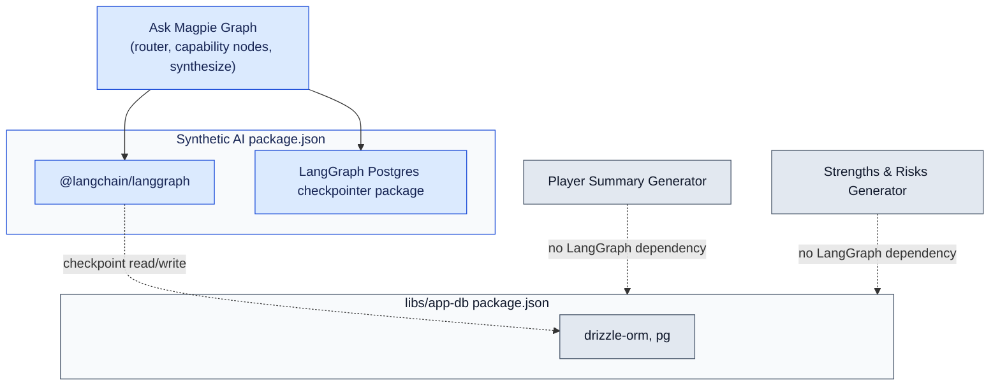
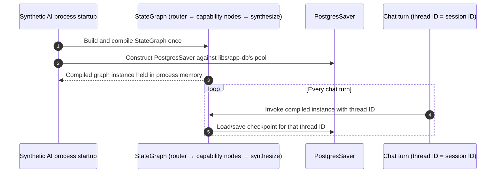

# Design — Agent Orchestration Framework (Decision 6)

Ask Magpie's `StateGraph` depends on `@langchain/langgraph`, declared in Synthetic
AI's own `package.json` and compiled once at process startup; its cross-turn memory
persists through a `PostgresSaver` checkpointer backed by two new tables inside
`libs/app-db`'s Drizzle schema. See `solution/Architecture.md` for the converged
container, hosting, and decision-register entry — this document covers the
framework dependency, checkpointer schema, and graph-compilation lifecycle only.

## Dependency placement

`@langchain/langgraph` and its Postgres-backed checkpointer package are added to
Synthetic AI's `package.json`, not to a shared `libs/` package — only the Ask
Magpie module (Decision 3) uses LangGraph, and Decisions 1 and 2 do not depend on
it at all. This follows the project's independent per-app dependency convention
(`.claude/skills/dependencies.md`): a package used by exactly one app belongs in
that app, not in the root or in a shared lib.

## Checkpointer schema

Two new tables land inside `libs/app-db`'s Drizzle-managed schema, shaped to
LangGraph's `PostgresSaver` schema requirements.

| Table                          | Key columns                                            | Purpose                                                                                                                                                |
| ------------------------------ | ------------------------------------------------------ | ------------------------------------------------------------------------------------------------------------------------------------------------------ |
| `ask_magpie_checkpoints`       | `thread_id`, `checkpoint_id` (composite PK)            | One row per saved graph state; `checkpoint` column holds the serialized state blob; `parent_checkpoint_id` links to the prior checkpoint in the thread |
| `ask_magpie_checkpoint_writes` | `thread_id`, `checkpoint_id`, `task_id` (composite PK) | Pending intermediate writes for a checkpoint not yet finalized; one row per task-level write, consumed on resume                                       |

Both tables are added by a new Drizzle migration in `libs/app-db`, generated via
`yarn nx run app-db:generate --name=ask_magpie_checkpointer_schema` per the
project's existing migration conventions (`.claude/skills/app-db.md`) — schema
files edited first, migration SQL and snapshot generated afterward, never hand-authored.
`thread_id` is the conversation's checkpoint key, matching Decision 3's
one-thread-per-Ask-Magpie-session model (`solution/Design - Ask Magpie.md`).

## Graph compilation lifecycle

The `StateGraph` — router node, one capability node per domain, and the named
`synthesize` node, as detailed in `solution/Design - Ask Magpie.md` — is built and
compiled once at Synthetic AI's process startup. The compiled graph instance is
reused across every chat turn for every thread; only the thread ID varies per
invocation, selecting which checkpoint `PostgresSaver` resumes from. No
per-request graph construction occurs.

## Access control

The checkpointer's two tables are a new PostgreSQL schema asset and require the
access-control review already tracked in `solution/Architecture.md`'s
Verification obligations table (Decision 6, owner `@data`, scope: review
alongside the schema migration). This document does not resolve that review.
