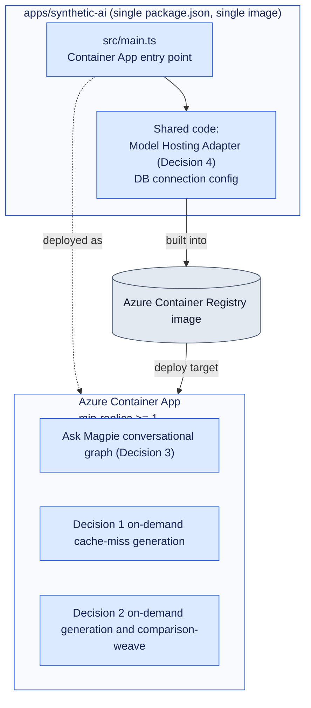

# Design — Agent Runtime Hosting (Decision 5)

One codebase, one container image, one Azure deployment unit: a single long-running Container App hosting all three features. See `solution/Architecture.md`'s Decision Register row 5 for the chosen outcome and its rationale; this document details the deployment shape behind it.

## Deployment units

| Unit         | Azure resource | Entry point                     | Scaling                      | Hosts                                                                                                                                 |
| ------------ | -------------- | ------------------------------- | ---------------------------- | ------------------------------------------------------------------------------------------------------------------------------------- |
| Live runtime | Container App  | `apps/synthetic-ai/src/main.ts` | min-replica ≥ 1, always warm | Ask Magpie's graph (Decision 3); Decision 1's on-demand cache-miss generation; Decision 2's on-demand generation and comparison-weave |

The unit builds from the `apps/synthetic-ai` package and its container image. The Model Hosting Adapter and the database connection code are unduplicated modules shared by all three features inside that single app.

## Why one unit

All three features are HTTP-triggered, synchronous call-and-wait workloads the BFF waits on inside the originating request, with no scheduled component. Min-replica ≥ 1 removes cold-start risk for all of them. No workload here has a different shape that would benefit from a second, independently-scaling deployment unit.

## Application framework

Synthetic AI is a NestJS application, the same framework the BFF already uses (`apps/serving/bff`), chosen for team familiarity and consistency with the platform's existing Swagger-decorator convention (`.claude/skills/swagger.md`) on every endpoint.

Each decision's generator — `PlayerSummaryGenerator`, `StrengthsRisksGenerator` — and the Ask Magpie graph's entry point are NestJS `@Injectable()` services behind controllers. Nest's dependency injection wires the Model Hosting Adapter into each, the same DI pattern the BFF's own `ComputeTriggerClient` already uses for `ConfigService`.

## Azure resources and Terraform modules

Following the platform's existing naming convention (`<domain>-<app>-<azure-service>-<instance>` for Terraform module instances, `<project>-<app>-<env>` for the Azure resource name itself — see `serving-bff-app-service-01` / `nufc-bff-dev` and `compute-player-data-flow-function-app-01` for the existing pattern):

| Terraform module instance        | Azure resource type            | Azure resource name       | New or reused                                                                                                                                                                                    |
| -------------------------------- | ------------------------------ | ------------------------- | ------------------------------------------------------------------------------------------------------------------------------------------------------------------------------------------------ |
| `synthetic-ai-container-app-01`  | Azure Container App            | `nufc-synthetic-ai-<env>` | New module (`modules/container-app` does not exist yet — first Container App on this platform)                                                                                                   |
| `synthetic-ai-mi-01`             | User-assigned managed identity | —                         | New, dedicated to this workload — not a shared platform identity, per the platform's existing one-MI-per-workload pattern (`serving-bff-mi-01` is the precedent)                                 |
| `platform-container-registry-01` | Azure Container Registry       | —                         | **Reused**, not new — this is the platform's existing shared ACR, the same one the BFF already pulls its image from. Synthetic AI pushes to a new repository path inside it, not a new registry. |
| `platform-apps-kv-01`            | Key Vault                      | —                         | Reused, same Key Vault the BFF and Compute already read secrets from                                                                                                                             |
| `platform-law-01`                | Log Analytics Workspace        | —                         | Reused — Synthetic AI's Container App diagnostic settings route here, the same sink every other container already logs to                                                                        |

`synthetic-ai-mi-01` gets an `AcrPull` role assignment scoped to `platform-container-registry-01` only, following the platform's least-privilege pattern (`serving-bff-mi-01`'s own `AcrPull`-only assignment is the precedent) — not `Contributor` on the resource group.

## SKU and sizing

CPU, memory, and replica counts are exposed as Terraform variables with defaults, not hardcoded, per the platform's existing sizing-variable convention (e.g. `app_service_sku`, `compute_plan_sku`):

| Variable                            | Applies to   | Default              |
| ----------------------------------- | ------------ | -------------------- |
| `synthetic_ai_container_app_cpu`    | Live runtime | 0.5 vCPU per replica |
| `synthetic_ai_container_app_memory` | Live runtime | 1 Gi per replica     |
| `synthetic_ai_min_replicas`         | Live runtime | 1                    |
| `synthetic_ai_max_replicas`         | Live runtime | 3                    |

These are starting defaults for a 10-to-30-user platform; a dev-vs-prod resize is a tfvars override, not a code change.

## Networking

Synthetic AI deploys into the platform's existing single VNet (UK South), in a new subnet dedicated to this container (naming it `snet_synthetic_ai`, alongside the existing `snet_bff` and `snet_compute` subnets on `platform-vnet-01`). The subnet budget check is tracked as a verification obligation in `solution/Architecture.md` (Decision 5 row and Verification obligations table); this document states the requirement, not its resolution.

## Secrets

The Container App accesses Key Vault via managed identity, the same pattern Compute and the BFF already use. It stores no connection string or API key outside Key Vault.

## Internal auth (BFF → Synthetic AI)

Two layers secure the BFF's calls into Synthetic AI.

1. **VNet-level network isolation.** Synthetic AI has no public ingress; it is reachable only from inside the platform's VNet, the same posture as every other internal container.
2. **A shared-secret header**, validated by a NestJS guard on every Synthetic AI endpoint. This is the Container Apps equivalent of Compute's `x-functions-key` mechanism (`apps/serving/bff/src/modules/compute-runs/compute-trigger.client.ts`'s existing pattern: a header carrying a secret resolved from config/Key Vault, checked by the receiving service), since Container Apps has no built-in function-key auth the way Azure Functions does.

The secret is sourced from Key Vault, the same two-Key-Vault pattern as every other secret in this document.

## Observability

The Container App sends diagnostic logs and metrics to `platform-law-01`, the platform's existing shared Log Analytics Workspace — the same sink the BFF and Compute already use, via its own diagnostic settings. No new observability tooling is introduced; Synthetic AI's logs are visible in the same place every other container's logs already are.

## CI/CD

A new containerized build/push pipeline builds the image and pushes it to the existing shared `platform-container-registry-01` — this is the platform's first containerized pipeline, alongside its existing zip-publish pipelines for Functions and App Service, but it targets the ACR the BFF already uses, not a new registry. The pipeline then deploys the image to the Container App, the single deploy target.

**Containerization notes, since this is the platform's first containerized NX app** (BFF and Compute both deploy via zip-publish, not a container): the NX webpack executor for `apps/synthetic-ai` needs `generatePackageJson: true` (the default omits `node_modules`, leaving the container with nothing to run) and the Dockerfile needs `COPY .yarnrc.yml ./` (Yarn 4 defaults to PnP without it). Workspace library resolution (`libs/app-db`, the Model Hosting Adapter if it lives in a shared lib) needs `nodeExternals` set to externalize only `Object.keys(dependencies)`, with an explicit alias per workspace lib it depends on. Both the Drizzle migration config and the runtime connection module need `ssl: { rejectUnauthorized: false }` set independently — SSL is not inherited between them.

## Configuration

| Variable                     | Applies to                                            | Source                                                                           | Purpose                                                                               |
| ---------------------------- | ----------------------------------------------------- | -------------------------------------------------------------------------------- | ------------------------------------------------------------------------------------- |
| `DATABASE_URL`               | Container App                                         | Key Vault reference                                                              | PostgreSQL connection string                                                          |
| `KEY_VAULT_URI`              | Container App                                         | Container App environment config                                                 | Resolves managed-identity Key Vault access at startup                                 |
| `MIN_REPLICAS`               | Container App                                         | Container App scale config (not an app env var; set at the Azure resource level) | Enforces min-replica ≥ 1                                                              |
| `MODEL_PROVIDER_CONFIG`      | Container App                                         | Key Vault reference                                                              | Provider credentials and endpoint consumed by the Model Hosting Adapter (Decision 4)  |
| `SYNTHETIC_AI_SHARED_SECRET` | Both the BFF's client config and Synthetic AI's guard | Key Vault reference                                                              | Validates incoming requests are from the BFF, not an arbitrary caller inside the VNet |

## Failure and recovery

The Container App's instance failures are handled by the Azure Container Apps platform's standard instance replacement. This is an accepted platform-level behavior — this design does not re-implement it.
