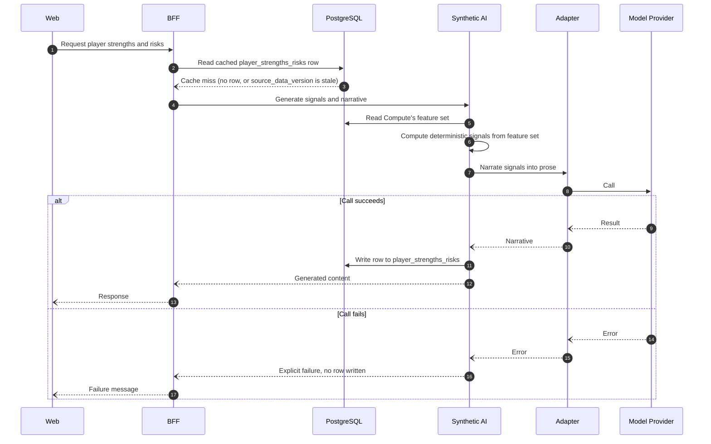
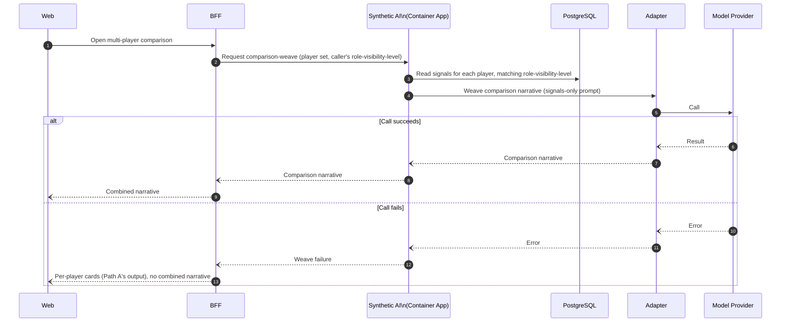

# Design — Strengths and Risks Summary (Decision 2)

Strengths and Risks Summary splits into two independent generation paths inside Synthetic AI: an on-demand path that generates per-player signals and narrative on cache miss, and a runtime weave that composes a comparison-aware narrative from those signals on demand. The two paths share the container's image, adapter, and database, and nothing else — see `Architecture.md`'s Decision 2 row and the per-role stored-variant mechanism, both settled there.

Both paths run inside `StrengthsRisksGenerator`, a NestJS `@Injectable()` service class, exposed via two controller endpoints matching `Architecture.md`'s Strengths and Risks representative flows: `POST /strengths-risks/generate` for Path A's per-player generation, and `POST /strengths-risks/compare` for Path B's comparison weave. The Model Hosting Adapter is injected into it through NestJS constructor injection, the same pattern `ComputeTriggerClient` uses for `ConfigService` in the BFF. Incoming requests are authenticated per `solution/Design - Agent Runtime Hosting.md`.

## Path A — on-demand per-player generation (cache miss)

| Aspect           | Behavior                                                                                                                                                                                                                                                                                                                                                   |
| ---------------- | ---------------------------------------------------------------------------------------------------------------------------------------------------------------------------------------------------------------------------------------------------------------------------------------------------------------------------------------------------------- |
| Trigger          | HTTP (synchronous, call-and-wait): the BFF calls Synthetic AI on cache miss, the same shape as Decision 1's cache-miss trigger                                                                                                                                                                                                                             |
| Scope            | A cache miss is a missing `player_strengths_risks` row for the requested `(player, role-visibility-level)`, or a stored row whose `source_data_version` is older than Compute's current materialized version for that player — the same staleness mechanism Decision 1 uses                                                                                |
| Input            | The requested player's feature set, read from PostgreSQL                                                                                                                                                                                                                                                                                                   |
| Processing       | Two steps per request, per the Frame/Research-settled constraint (`design/02 Evaluate - Strengths and Risks Summary.md`, line 7): first, Synthetic AI computes deterministic signals from the feature set in-process — no model call; second, exactly one adapter call narrates those signals into prose. Only the second step reaches the Model Provider. |
| State change     | One row per `(player, role-visibility-level)` written to `player_strengths_risks`, including the player's current `source_data_version`                                                                                                                                                                                                                    |
| Failure handling | A failed generation returns an explicit failure to the BFF; no partial row is ever written; the next request is a fresh cache miss, with no retry machinery                                                                                                                                                                                                |

### `player_strengths_risks` schema

New table in `libs/app-db`'s Drizzle schema, one row per player per role-visibility-level:

| Column                  | Type                         | Notes                                                                                                                                                                                              |
| ----------------------- | ---------------------------- | -------------------------------------------------------------------------------------------------------------------------------------------------------------------------------------------------- |
| `id`                    | uuid, PK                     |                                                                                                                                                                                                    |
| `player_id`             | uuid, FK to the player table |                                                                                                                                                                                                    |
| `role_visibility_level` | text                         | Matches the role-visibility-level set from `Architecture.md`'s role-restriction enforcement point                                                                                                  |
| `signals`               | jsonb                        | Structured per-player strengths/risks signals; consumed by Path B                                                                                                                                  |
| `narrative`             | text                         | Per-player narrative; served directly on single-player views                                                                                                                                       |
| `source_data_version`   | text, not null               | Compute's materialized-output version for this player at generation time; the BFF's cache-miss check compares against this column, the same mechanism as Decision 1's `source_data_version` column |
| `generated_at`          | timestamptz                  | Set by Synthetic AI on each successful write                                                                                                                                                       |

The unique constraint is `(player_id, role_visibility_level)`: a new generation overwrites the prior row for that pair, it does not append.

## Path B — runtime comparison weave (long-running Container App)

| Aspect           | Behavior                                                                                                                              |
| ---------------- | ------------------------------------------------------------------------------------------------------------------------------------- |
| Trigger          | BFF's synchronous call on comparison-open                                                                                             |
| Input            | Path A's pre-computed `signals` column, read for every player in the comparison set, filtered to the caller's `role_visibility_level` |
| Processing       | One adapter call per comparison-open: a signals-only prompt weaves a comparison-aware narrative across the player set                 |
| State change     | None. The woven narrative is not written to `player_strengths_risks` or any other table                                               |
| Failure handling | BFF falls back to displaying the already-computed per-player cards from Path A instead of a combined narrative                        |

Comparison sets are high-cardinality with a low assumed cache-hit rate. Caching the weave output is not worth the storage and invalidation cost; each comparison-open regenerates the narrative fresh.

## Role enforcement across both paths

| Path                                | Enforcement mechanism                                                                                                               |
| ----------------------------------- | ----------------------------------------------------------------------------------------------------------------------------------- |
| A — on-demand per-player generation | Writes one distinct row per role-visibility-level per player, the same stored-variant mechanism as Decision 1                       |
| B — runtime weave                   | Reads only the `player_strengths_risks` row matching the caller's current role-visibility-level; never reads another role's variant |

Because Path B reads a single role-filtered row set and performs no cross-role aggregation, there is no cross-role leakage path inside the weave step itself.

## Verification

- On-demand generation: a cache-miss request writes exactly one row per `(player, role-visibility-level)` pair, or returns an explicit failure with no row written.
- Comparison weave: a comparison-open with a role-visibility-level that has no stored signals for one of the selected players returns the weave failure path (per-player cards), not a partial or player-missing narrative.
