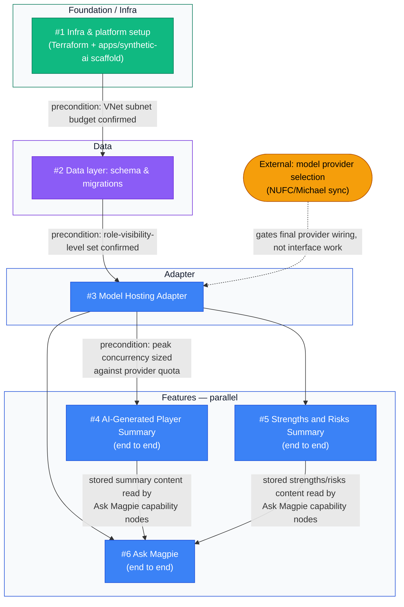

# Efforts — AI Features (ND-679)

Six delivery stories, each a logical unit end to end rather than a per-layer slice: Infra & platform setup, Data layer, Model Hosting Adapter, then the three features (Player Summary, Strengths and Risks, Ask Magpie) built cross-layer in parallel. Research and documentation items are folded into the story they block as preconditions or acceptance-criteria lines, not tracked separately. Estimates are the developer's input, not pre-filled here.

## Work breakdown

| #   | Summary                                                                                                                                                                                                                                                                                                                                                                                                                                                                                                                                                                                                                                                                                      | Type  | Layer                    | Depends on |
| --- | -------------------------------------------------------------------------------------------------------------------------------------------------------------------------------------------------------------------------------------------------------------------------------------------------------------------------------------------------------------------------------------------------------------------------------------------------------------------------------------------------------------------------------------------------------------------------------------------------------------------------------------------------------------------------------------------- | ----- | ------------------------ | ---------- |
| 1   | Infra & platform setup for Synthetic AI: Terraform modules (Container Apps Environment, one long-running Container App, dedicated managed identity, wiring into the existing shared Container Registry, Key Vault, and Log Analytics Workspace, one containerized CI/CD deploy target) plus scaffolding `apps/synthetic-ai` (Node.js/TypeScript, single long-running entry point). Precondition: VNet subnet budget for the new Container Apps Environment subnet must be confirmed before the Terraform work can complete. Acceptance criteria include the Security NFR doc update documenting the new named egress exception (model API call), mirroring the existing Snowflake exception. | chore | Infra                    | None       |
| 2   | Data layer — schema & migrations: `player_ai_summary` table (Decision 1), `player_strengths_risks` table (Decision 2), and the LangGraph checkpointer tables `ask_magpie_checkpoints` / `ask_magpie_checkpoint_writes` (Decision 6), each with its Drizzle migration. Precondition: the final role-visibility-level set (stored variants, differing fields) must be confirmed with Access Management/product before these schemas can be finalized. Acceptance criteria include a checkpointer schema access-control review.                                                                                                                                                                 | feat  | Data                     | #1         |
| 3   | Model Hosting Adapter: provider-agnostic interface, Key Vault secret resolution, rate-limiting/backpressure queue (Decision 4). The backpressure queue's concrete concurrency limit depends on sizing peak on-demand concurrent request volume against the selected provider's quota — confirm this sizing as part of the story, not separately.                                                                                                                                                                                                                                                                                                                                             | feat  | Synthetic AI             | #2         |
| 4   | AI-Generated Player Summary — end to end: Synthetic AI generator (Decision 1), BFF cache-aside wiring (read + cache-miss trigger), Web display including the ND-671 Profile "Reports" gap fill.                                                                                                                                                                                                                                                                                                                                                                                                                                                                                              | feat  | Synthetic AI + BFF + Web | #3         |
| 5   | Strengths and Risks Summary — end to end: on-demand per-player generation plus comparison-weave (Decision 2), BFF comparison-open wiring, Web "Reports" section UI with comparison trigger.                                                                                                                                                                                                                                                                                                                                                                                                                                                                                                  | feat  | Synthetic AI + BFF + Web | #3         |
| 6   | Ask Magpie — end to end: LangGraph `StateGraph` (router, capability nodes, synthesize node, supervisor loop, tools registry — Decisions 3 & 6), BFF chat proxy, Web chat UI. Capability nodes read Decision 1 and 2's stored data via tools, so this story also depends on #4 and #5 being far enough along that the Player Summary and Strengths and Risks tables and generated content exist.                                                                                                                                                                                                                                                                                              | feat  | Synthetic AI + BFF + Web | #3, #4, #5 |

## Dependency graph

Stories #4, #5, and #6 run in parallel once the Model Hosting Adapter (#3) is ready. #6 additionally depends on #4 and #5 being far enough along that the Player Summary and Strengths and Risks tables and generated content exist, since Ask Magpie's capability nodes read that stored data via tools.

Model provider selection is an external dependency, pending the NUFC/Michael sync. It gates #3's final provider wiring, not its interface/adapter work — the adapter's contract is provider-agnostic by design (Decision 4).

## Effort estimate

| #   | Description                                                                                                                                                                                                                                                                                                           | Estimate(d) |
| --- | --------------------------------------------------------------------------------------------------------------------------------------------------------------------------------------------------------------------------------------------------------------------------------------------------------------------- | ----------- |
| 1   | Infra & platform setup for Synthetic AI: Terraform modules (Container Apps Environment, one long-running Container App, dedicated managed identity, shared Container Registry/Key Vault/Log Analytics Workspace wiring, one containerized CI/CD deploy target), `apps/synthetic-ai` scaffold, Security NFR doc update | 2           |
| 2   | Data layer — schema & migrations: `player_ai_summary`, `player_strengths_risks`, LangGraph checkpointer tables, access-control review                                                                                                                                                                                 | 2           |
| 3   | Model Hosting Adapter: provider-agnostic interface, Key Vault secret resolution, rate-limiting/backpressure queue                                                                                                                                                                                                     | 2           |
| 4   | AI-Generated Player Summary — end to end: Synthetic AI generator, BFF cache-aside wiring, Web display + ND-671 gap fill                                                                                                                                                                                               | 3           |
| 5   | Strengths and Risks Summary — end to end: on-demand generation + comparison-weave, BFF comparison-open wiring, Web Reports section                                                                                                                                                                                    | 3           |
| 6   | Ask Magpie — end to end: LangGraph StateGraph (router, capability nodes, synthesize, supervisor loop, tools registry), BFF chat proxy, Web chat UI                                                                                                                                                                    | 5-10        |
