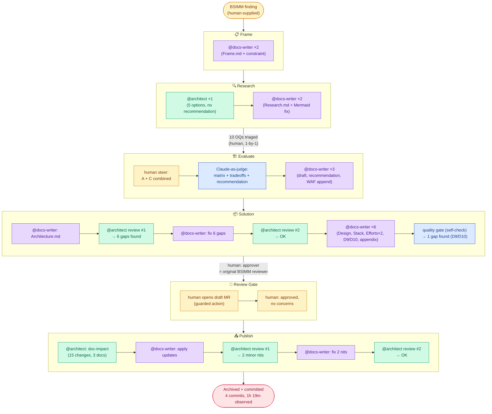
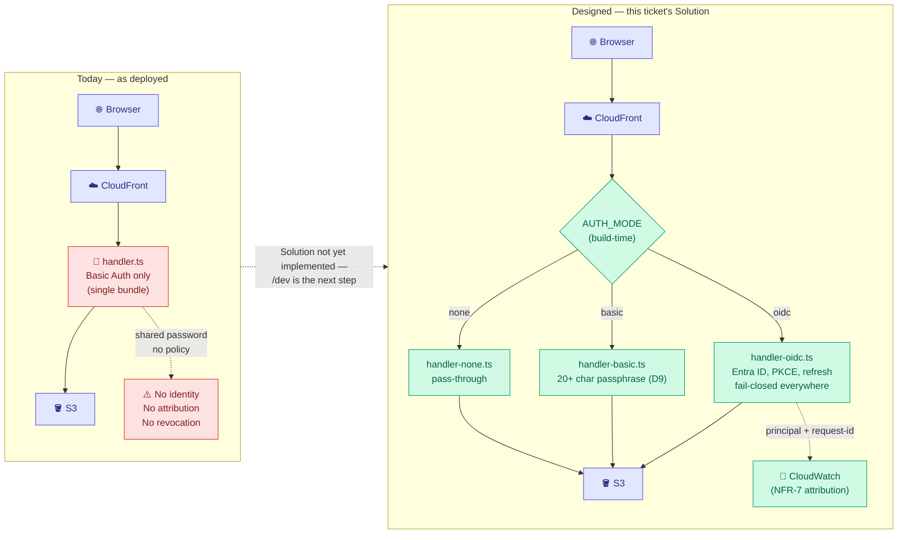
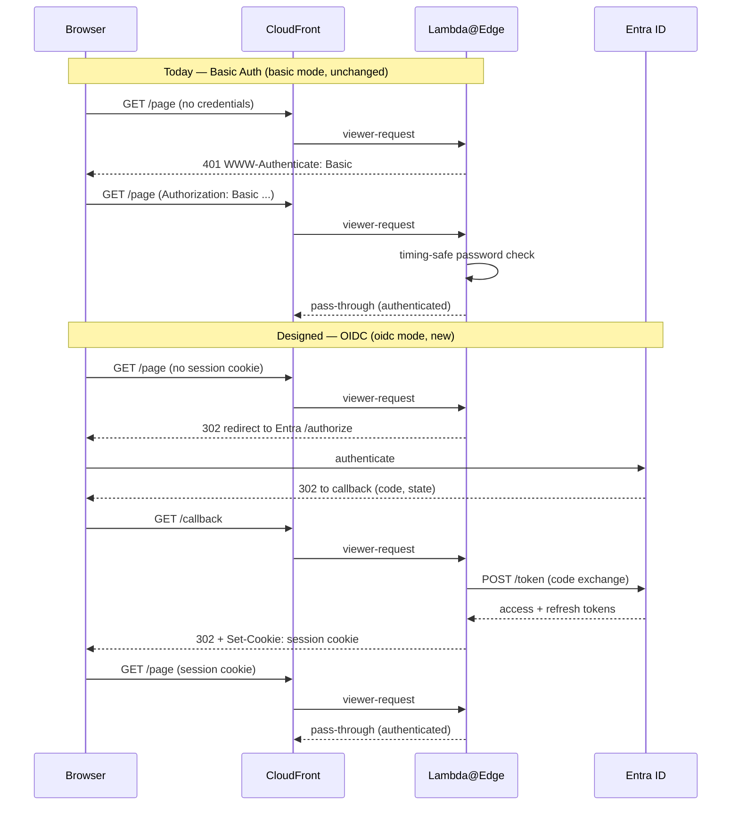

# Session Showcase — Claude ↔ Engineer Collaboration

**Ticket:** DESIGN-20261017-UX3J — Configurable Site Authentication (No Auth / Basic Auth / OIDC SSO)
**Trigger:** two BSIMM findings from a security review (Dmitry Vyrostkov, 2026-10-15) — no SSO/identity on the shared Basic Auth password, and no password policy enforced
**Flow run:** full `/design` lifecycle, Frame → Research → Evaluate → Solution → Review Gate → Publish (Address Feedback skipped — approved with no concerns)
**Observed work:** 1h 19m (`design/stat.json`) · **Subagent delegations:** 28 (22 `@docs-writer`, 6 `@architect`)

This document is a reflective showcase of how the session actually unfolded — not a design artifact itself. The design record remains `design/Report.md` and `solution/Architecture.md`.

---

## 1. The resulting solution, in one paragraph

The site's Lambda@Edge auth handler (`apps/lambda-auth`) becomes **deploy-time configurable** across three modes — `none`, `basic`, `oidc` — selected via an `AUTH_MODE` build-time variable, one of three dedicated entry points (`handler-none.ts` / `handler-basic.ts` / `handler-oidc.ts`) bundled per deployment (no dead code shipped for unused modes). `oidc` mode implements direct Entra ID OIDC — authorization-code + PKCE, no Cognito — with a signed session cookie, silent token refresh, and fail-closed handling on every invalid-input path. Existing deployments default to `basic` mode with zero required action. Ten settled decisions (D1–D10) cover the mechanism, migration safety, attribution (NFR-7), and the two originally-overlooked policy items (password-strength and a none-mode safety warning).

---

## 2. Collaboration timeline — who decided what

| #   | Decision point                                                                                                                                                                                                                                | Decided by                                                              | How                                                                                                                                                                                                                             |
| --- | --------------------------------------------------------------------------------------------------------------------------------------------------------------------------------------------------------------------------------------------- | ----------------------------------------------------------------------- | ------------------------------------------------------------------------------------------------------------------------------------------------------------------------------------------------------------------------------- |
| 1   | Ticket title & local ID (no tracker)                                                                                                                                                                                                          | 🧑 Human                                                                | Picked Claude's proposed title from a quick option                                                                                                                                                                              |
| 2   | Track = Project, subfolder = `v1/Containers/Auth.md`                                                                                                                                                                                          | 🧑 Human                                                                | Confirmed Claude's proposal                                                                                                                                                                                                     |
| 3   | Feature branch                                                                                                                                                                                                                                | 🧑 Human                                                                | Skipped — worked on `main`                                                                                                                                                                                                      |
| 4   | Frame requirements (4 known + 5 proposed ECs)                                                                                                                                                                                                 | 🤖 Claude → 🧑 Human                                                    | Claude proposed `[proposed]` ECs from gap analysis; human accepted all, then **added a new constraint** (Entra app-registration request, per-instance, external) that Claude had not surfaced                                   |
| 5   | 5 architecture options researched                                                                                                                                                                                                             | 🤖 Claude (`@architect`)                                                | Delegated research, no recommendation (by design — Research never recommends)                                                                                                                                                   |
| 6   | 10 open questions triaged (Viability vs. Evaluation-input)                                                                                                                                                                                    | 🧑 Human, one by one                                                    | Each OQ answer shaped the Evaluate-phase requirements matrix directly                                                                                                                                                           |
| 7   | **Runtime vs. deployment-model split** — Option A's token flow + Option C's build-time bundle selection, evaluated as one combined candidate rather than five mutually exclusive options                                                      | 🧑 Human                                                                | A free-text steer ("A+C my choise") that changed the shape of the Evaluate matrix — the single highest-leverage human decision in the session                                                                                   |
| 8   | Final recommendation (A+C hybrid)                                                                                                                                                                                                             | 🤖 Claude, as LLM-judge                                                 | Built the Requirements×Options matrix and Tradeoffs table from settled criteria, then scored the human's A+C combination against all 5 original options — confirmed it was the strongest fit, not just accepted it uncritically |
| 9   | Migration default for existing deployments (`AUTH_MODE` unset → `basic`)                                                                                                                                                                      | 🧑 Human                                                                | Chose the safe, no-action-required option over a hard-fail-on-unset alternative                                                                                                                                                 |
| 10  | NFR-7 attribution mechanism (CloudWatch log correlation vs. a real-time-logs enrichment pipeline)                                                                                                                                             | 🧑 Human                                                                | Chose the lightweight option — explicitly trading perfect single-record attribution for zero new infrastructure                                                                                                                 |
| 11  | Architecture decision register (D1–D8)                                                                                                                                                                                                        | 🤖 Claude, as LLM-judge                                                 | Synthesized 8 settled decisions from Frame + Evaluate + the two human calls above, each with consequence and verification obligation                                                                                            |
| 12  | **Independent structural review found 6 real gaps** (initial-exchange failure handling, cookie size budget, invalid-signature handling, open-redirect exposure, Lambda@Edge rollout-consistency risk, least-privilege nuance for `none` mode) | 🤖 Claude, as LLM-judge (`@architect` vs. the authoring `@docs-writer`) | A second model, with no stake in the first draft, caught gaps the authoring pass missed — all 6 were real, all 6 got fixed, second pass returned **OK**                                                                         |
| 13  | Design-quality-gate found 2 Frame ECs (passphrase policy, none-mode warning) with **no corresponding decision anywhere**                                                                                                                      | 🤖 Claude, self-check against its own Frame output                      | Caught by a systematic requirement-to-decision mapping check, not by accident                                                                                                                                                   |
| 14  | How to close those 2 gaps (operational-only passphrase policy; build-time-warning-only for `none` mode, no hard block)                                                                                                                        | 🧑 Human                                                                | Chose the lighter-touch option both times over a code-enforced alternative                                                                                                                                                      |
| 15  | **Ticket count: 7 → 3**                                                                                                                                                                                                                       | 🧑 Human                                                                | "do a fewer tickets... 2-3 will be fine" — Claude had over-decomposed the WBS; human corrected scope immediately, Claude re-grouped without losing any traceability                                                             |
| 16  | Estimates                                                                                                                                                                                                                                     | 🧑 Human                                                                | Declined to fill in — explicitly accepted leaving `Efforts.md`'s estimate column empty                                                                                                                                          |
| 17  | Approver for the design MR                                                                                                                                                                                                                    | 🧑 Human                                                                | Named the original BSIMM reviewer (Dmitry Vyrostkov) — closing the loop with the person who raised the finding                                                                                                                  |
| 18  | Doc-impact list for Publish (15 section-level changes across 3 HLD/NFR docs)                                                                                                                                                                  | 🤖 Claude (`@architect`), verified against actual file content          | Caught 2 more stale statements (NFR-6, NFR-7 wording) that the Architecture.md's own summary table hadn't named                                                                                                                 |
| 19  | Published-doc review found 2 altitude/completeness nits (`redirect.ts` undocumented; a Design.md-level TTL number leaked into the HLD doc)                                                                                                    | 🤖 Claude, as LLM-judge                                                 | Minor, but a clean example of the review catching an altitude violation, not just a factual error                                                                                                                               |
| 20  | Implementation tickets recorded at Publish?                                                                                                                                                                                                   | 🧑 Human                                                                | Declined — WBS in `solution/Efforts.md` stands as the reference instead                                                                                                                                                         |

**Pattern across the whole session:** Claude authored, proposed, and drafted; a _second_ Claude invocation (`@architect`, with an explicit "do not write files" read-only mandate) reviewed that output adversarially before it reached the human. Every structural/security gap that got fixed in this design was caught by that second pass, not the first draft — and every _scope, preference, or risk-tolerance_ call (migration default, attribution depth, ticket granularity, approver, ticket enforcement mechanisms) was made by the human.

---

## 3. Stages and agent invocations

**22 `@docs-writer` delegations** (authoring/editing — never writes a design artifact inline), **6 `@architect` delegations** (always read-only review, max 2 iterations per review loop). Every `@architect` pass before the Review Gate was a self-check — no production code existed yet to review against; it was reviewing the _design's internal consistency_, not implementation.

---

## 4. Current state vs. designed flow

**Simplified sequence — today's Basic Auth request vs. the designed OIDC request:**

**Important — certainty check:** as of this design's completion, `apps/lambda-auth/src/handler.ts` is still the _only_ handler file in the repo. `handler-none.ts`, `handler-basic.ts`, `handler-oidc.ts`, and `lib/{cookie,jwks,pkce,redirect}.ts` do not exist yet — they are the Solution's specification, not shipped code. The 3-ticket WBS in `solution/Efforts.md` is the path from "Today" to "Designed" above.

---

## 5. Where this showcases human ↔ LLM judgment well

- **Human-only calls:** anything that's a genuine preference, risk tolerance, or organizational fact — migration safety default, attribution-mechanism depth, ticket granularity, approver identity, which enforcement mechanism (code vs. process) to use for a policy. None of these have a single objectively-correct answer; Claude surfaced the tradeoff, the human picked.
- **LLM-as-judge calls:** anything that's a structured evaluation against stated criteria — scoring 5 options against a requirements matrix, running a WAF assessment against fixed pillars, checking whether every Frame requirement traces to a decision, adversarially re-reviewing another Claude instance's own draft. These are the calls a second pair of eyes (human or model) is good at catching precisely _because_ they're checklist-shaped, not preference-shaped — and in this session, the review passes caught real, concrete issues (6 structural gaps, 2 missing Frame requirements, 2 altitude violations) every single time they ran.
- **The one steer that mattered most** was human: combining Option A and Option C rather than picking one of five discrete options. That single free-text sentence reshaped the entire Evaluate matrix and every downstream artifact — a judgment call no amount of matrix-scoring would have produced on its own.

---

## 6. Conversation reconstruction, grouped by phase

A phase-by-phase walk through the real exchange, each with the human decisions and the agents involved, as a companion to the decision table in Section 2.

### Kickoff (pre-Frame)

The human pasted the two BSIMM findings verbatim (quoted supervisor comments, dated 15 Oct 2026) plus one explicit implementation instruction inline — three deploy-time auth modes, reuse the existing Lambda@Edge handler, store the OIDC token in a cookie — via `/design`, with no ticket ID (no external tracker in this repo).

- **Human decisions:** accepted Claude's proposed local ID and title as-is.
- **Agents involved:** none yet — orchestrator only (resume detection, ID generation).

### Frame

Track and subfolder (Project / `v1/Containers/Auth.md`) were confirmed in one round; branch checkout was skipped (stayed on `main`). Claude drafted `00 Frame.md` with 4 known + 5 proposed requirements pulled from the pasted findings and a gap-analysis pass over the existing handler and NFRs.

- **Human decisions:** confirmed track/subfolder; skipped the feature-branch offer; accepted all proposed ECs; **added a requirement Claude hadn't surfaced** — the per-instance Entra app-registration dependency on Admins Helpdesk — folded into the Frame as a constraint before the stage closed.
- **Agents involved:** `@docs-writer` ×2 (initial `00 Frame.md`; the added constraint).

### Research

`@architect` returned five options with diagrams and no recommendation, as designed.

- **Human decisions:** confirmed the option set was complete; triaged all 10 open questions (Viability vs. Evaluation-input) across three batches, one by one; caught and reported a Mermaid parse error (invalid `classDef` inside a `sequenceDiagram`) by pasting the actual error text back.
- **Agents involved:** `@architect` ×1 (the five options); `@docs-writer` ×2 (writing `01 Research.md`; fixing the Mermaid error).

### Evaluate

The matrix and tradeoffs table were drafted, reviewed, and confirmed — then, mid-stage, the human reframed the recommendation entirely.

- **Human decisions:** _"i think option A applicable for runtime and option C best for deployment model,"_ then _"A+C my choise"_ — reframing the recommendation from "pick one of five options" to "combine two orthogonal dimensions of two of them," a steer the matrix hadn't been built to represent until that point; accepted the closing WAF assessment without changes.
- **Agents involved:** none delegated — Claude built the matrix, re-scored the A+C combination, wrote the recommendation, and ran the WAF assessment directly (all Claude-as-judge work, no subagent).

### Solution

The largest and most review-heavy phase. A concern scan surfaced two genuinely open questions before any file was written.

- **Human decisions:** picked the lighter-weight option for both the migration default (`AUTH_MODE` unset → `basic`) and the NFR-7 attribution mechanism (CloudWatch log correlation over a real-time-logs pipeline); asked for lighter diagram colors; said _"do a fewer tickets... 2-3 will be fine,"_ collapsing a 7-ticket WBS to 3; chose the lighter enforcement option for both D9 (operational-only passphrase policy) and D10 (build-time warning, no hard block) once the quality gate found the gap.
- **Agents involved:** `@docs-writer` authored `Architecture.md`, `Design.md`, `Stack.md`, `Efforts.md` (twice — 7 tickets then 3), the D9/D10 additions, and the Considered Options appendix (9 delegations total); `@architect` ran two independent structural reviews — the first returned **six concrete gaps** (initial-exchange failure handling, cookie-size budget, invalid-signature handling, an open-redirect exposure, a Lambda@Edge rollout-consistency risk, a least-privilege nuance for `none` mode), all fixed, second pass **OK**. Two more Mermaid bugs surfaced and were fixed by `@docs-writer`: a semicolon inside a sequence-diagram message, and `call` as a reserved Mermaid keyword used as a `classDef` name. The design-quality-gate self-check (Claude directly, no subagent) caught the D9/D10 gap.

### Review Gate

- **Human decisions:** named the original BSIMM reviewer, Dmitry Vyrostkov, as approver — closing the loop with the person who raised the finding; opened the actual draft MR externally (a guarded, human-performed action — Claude presented the exact title/body and waited for the URL rather than attempting it directly); confirmed _"approved, nothing to address"_ on resume, skipping Address Feedback outright.
- **Agents involved:** none — this phase is entirely orchestrator + human by design (the human-approval gate).

### Mid-flow aside (during Publish)

While a Publish review pass ran in the background, the human asked for a message to Admins Helpdesk requesting Entra app registrations — for this canonical template _and_ for a named client project ("Collinson").

- **Human decisions:** requested the draft; will send it personally.
- **Agents involved:** none — Claude drafted the email text directly and explicitly did not send it or treat the request as authorization to contact a third-party mailbox.

### Publish

- **Human decisions:** confirmed the doc-impact list before any doc was touched; confirmed the doc updates were ready for review; declined to record implementation tickets at the final wrap-up question.
- **Agents involved:** `@architect` mapped doc impact across three HLD/NFR docs (15 section-level changes), catching two more factually-stale NFR statements beyond what `Architecture.md`'s own summary table had named; `@docs-writer` applied all 15 changes in one pass; `@architect` reviewed the published docs twice — first pass found two minor altitude nits (an undocumented helper module, a Design.md-level numeric detail that had leaked into the HLD doc), `@docs-writer` fixed both, second pass **OK**. Archival and effort-recording were orchestrator-only (no subagent).

### Aftermath

- **Human decisions:** requested this `SESSION.md` as a deliberate showcase artifact, then in follow-up turns asked for the comparison sequence diagram and this phase-grouped reconstruction to be added.
- **Agents involved:** none — authored directly.
