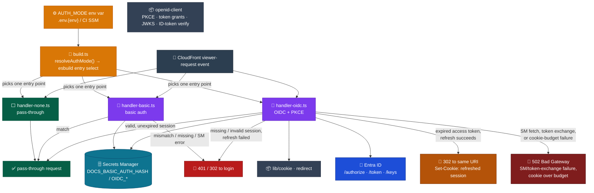

# Auth — Overview

Implementation detail for the Auth container: the Lambda@Edge handler enforcing one of three deploy-time-selected auth modes (`none` / `basic` / `oidc`) on every CloudFront viewer request. Mirrors `docs/Target Architecture (HLD)/v1/Containers/Auth.md`.

## Component detail

- `build.ts` — `resolveAuthMode(raw)` reads `AUTH_MODE` from the environment: unset resolves to `basic`; `none`/`basic`/`oidc` pass through; anything else throws before esbuild runs. The resolved mode selects `src/handler-${AUTH_MODE}.ts` as the single esbuild entry point bundled to `dist/index.js` (CJS, `node22`, `@aws-sdk/client-secrets-manager` external); `SM_SECRET_NAME`/`AWS_REGION` are injected via `define` as before. An explicit `AUTH_MODE=none` prints a stdout warning (no access control) but does not fail the build.
- `src/handler-none.ts` — unconditional pass-through. Returns `event.Records[0].cf.request` unmodified; makes no Secrets Manager call, sets no cookie, imports nothing beyond the `aws-lambda` types.
- `src/handler-basic.ts` — the former `handler.ts`, relocated verbatim; behavior unchanged. `getHash()` fetches and caches (module-scope `cachedHash`) `DOCS_BASIC_AUTH_HASH` from Secrets Manager on cold start, validating its 64-character lowercase-hex shape. `handler()` decodes `Authorization: Basic <base64>`, takes the password half of `user:password`, and compares `timingSafeEqual(sha256(password), Buffer.from(stored, 'hex'))`. Every failure path converges on the same `unauthorized()` 401.
- `src/handler-oidc.ts` — authorization-code + PKCE flow against Entra ID, via `openid-client` (not a hand-rolled implementation — see Key decisions). `getSecrets()` caches `OIDC_CLIENT_ID`/`OIDC_CLIENT_SECRET`/`OIDC_TENANT_ID`/`OIDC_SESSION_SIGNING_KEY` from Secrets Manager at cold start; `getConfig()` caches the result of `openid-client`'s `discovery()` call (Entra metadata + JWKS) alongside it. A missing/malformed secret field, a failed discovery call, or a failed token exchange returns a 502 (`errorResponse()`), never a pass-through. On `/_auth/callback`, it reads the PKCE cookie (verifier, state, and the original request path) and calls `authorizationCodeGrant()`, which validates the PKCE verifier and `state` against the request and verifies the returned ID token's signature/issuer/audience, all in one call; a validation failure (`AuthorizationResponseError`) restarts Flow 1, while any other failure (network, 5xx) returns a 502. On success, it discards the access token (never read again), signs a two-cookie session (refresh token + `sub`/`upn`/`exp` from the verified ID token claims) via `lib/cookie.ts`'s `signSessionCookie`, and redirects to the path from the PKCE cookie while clearing it. On every other path, it verifies only the session cookie's own HMAC signature and `exp` — no live Entra call — passing through unchanged on a valid, unexpired session (stripping the `Cookie` header before forwarding to S3), and redirecting to `/authorize` on any failure — missing/tampered cookie, invalid session. On an expired session with a valid refresh token, it calls `refreshTokenGrant()` (which verifies the ID token the same way if Entra re-issues one), signs a refreshed session cookie, and issues a 302 redirect to the same URI rather than passing the request through directly — a CloudFront viewer-request trigger cannot attach a `Set-Cookie` header to a response it also forwards to origin, so the redirect immediately re-requests the page, which then lands on the valid-session pass-through branch.
- `src/lib/cookie.ts` — HMAC-SHA256-signed, `__Host-`-prefixed cookies: the session is split across a refresh-token cookie (`__Host-docs_refresh`) and an identity cookie (`__Host-docs_identity`, holding `sub`/`upn`/`exp`) — not a single cookie, and not including the access token (see Key decisions) — plus the PKCE cookie (`__Host-docs_pkce`, holding the verifier, state, and the post-login redirect path). `sign`/`verify` are timing-safe; `assertByteBudget` throws past the ~4093-byte limit browsers actually enforce per cookie.
- `src/lib/redirect.ts` — `sanitizeRedirectTarget()` restricts the post-login redirect to a same-origin relative path, rejecting protocol-relative, backslash, absolute, and control-character values.
- PKCE generation, Entra metadata/JWKS discovery and caching, and ID-token verification are owned directly by `openid-client` (`authorizationCodeGrant`/`refreshTokenGrant`/`discovery`/`buildAuthorizationUrl`/`randomPKCECodeVerifier`/`calculatePKCECodeChallenge`/`randomState`) — there is no local `lib/pkce.ts` or `lib/jwks.ts` module; both existed earlier and were removed once real-world testing surfaced bugs the library models correctly by default (see Key decisions).

## Integration pattern — deploy

CDK (`EdgeStack`, see `../Infrastructure/00. Overview.md`) provisions only a placeholder passthrough Lambda and its IAM role at synth/deploy time. The real handler ships out-of-band, in two NX targets:

1. `lambda-auth:build` → `scripts/ci/lambda-auth-build.sh` — loads `AUTH_MODE` from `.env.{env}` (local) or CI config alongside `SM_SECRET_NAME`/`AWS_REGION` from SSM, then runs `build.ts` and zips `dist/index.js` to `dist/lambda-auth.zip`. Exactly one handler's code is bundled per build.
2. `lambda-auth:deploy` → `scripts/ci/lambda-edge-deploy.sh` — hard-fails unless `AWS_REGION=us-east-1` (Lambda@Edge region constraint). Sequence: `update-function-code` → wait for update → `publish-version` → `add-permission` granting `edgelambda.amazonaws.com` invoke on the new version → directly patches the _live_ CloudFront distribution's `LambdaFunctionAssociations` via `get-distribution-config` / `update-distribution` (not through CDK) → waits for CloudFront propagation (~2 min) → removes `AllowCloudFrontInvoke-*` permission statements for every published version older than latest−1.

This deploy must be re-run after any CDK deploy touching `EdgeStack`/`DocsStack` — CDK only ever wires the placeholder.

## Key decisions

- Exactly one of `handler-none.ts`/`handler-basic.ts`/`handler-oidc.ts` is bundled per build, selected by `AUTH_MODE`; unset defaults to `basic`.
- `basic` mode checks only the password half of `user:password`; the username is decoded but not validated. The comparison runs `timingSafeEqual` over SHA-256 digests, never over raw plaintext.
- `basic` and `oidc` secrets are cached at module scope with no TTL; a rotated secret takes effect only on the next cold start.
- The Secrets Manager IAM policy resource ARN uses a wildcard secret-name suffix (`{secretName}-*`) and a wildcard region (`arn:aws:secretsmanager:*:...`).
- `oidc` session, identity, and PKCE cookies are `__Host-`-prefixed, HMAC-signed, `HttpOnly; Secure; SameSite=Lax`, and each independently byte-budgeted to under ~4093 bytes (the real browser per-cookie limit, not a value this app can safely raise); signing uses `timingSafeEqual`.
- `oidc` mode does not store the access token at all — it's read once at token exchange and discarded. It was never read again anywhere in the handler, and was also the single largest, most per-user-variable field driving oversized-cookie failures in production (two different real users hit different overage amounts on the same app). Removing it was a deliberate deviation from the original Design.md `{at, rt, sub, upn, exp}` cookie contract, not an oversight.
- `oidc` mode verifies the **ID token's** signature, issuer, and audience once, at the point tokens are received (login and silent refresh) — via `openid-client`, not a per-request check. The access token is not verified at all: Microsoft documents that Graph-scoped access tokens may be opaque, and live testing against the DataArt tenant confirmed this app's access token is not a reliably verifiable JWS. Every request after issuance is authenticated against the session cookie's own HMAC and `exp`, not a live Entra call.
- `oidc` mode migrated from a hand-rolled PKCE/JWKS/token-exchange implementation (raw `fetch`, manual `jose`-based JWKS verification) to `openid-client`, after real-world testing against the live Entra tenant surfaced bugs — an oversized session cookie, a login redirect loop from per-request access-token verification, and a second oversized-cookie failure for a different user — that the library models correctly by default (PKCE/state validation, ID-token verification including audience, token-response handling).
- `oidc` mode strips the `Cookie` header before forwarding an authenticated request to S3.
- `oidc` mode fails closed on any verification failure (bad cookie signature, expired/missing session, failed ID-token verification at issuance, failed refresh) by redirecting to `/authorize`, never by passing the request through.
- `oidc` mode returns a 502 on a Secrets Manager fetch failure, a failed Entra metadata discovery, a failed token exchange, or a session cookie exceeding its byte budget — never a pass-through, never a silent retry.
- A successful silent token refresh issues a 302 redirect to the same URI with the refreshed session cookie, not a same-response pass-through.
- `oidc` post-login redirects are restricted to same-origin relative paths via `sanitizeRedirectTarget`, and the redirect target travels in the signed PKCE cookie across the Entra round-trip — not packed into the OAuth `state` parameter, which is left as an opaque value `openid-client` validates directly.
