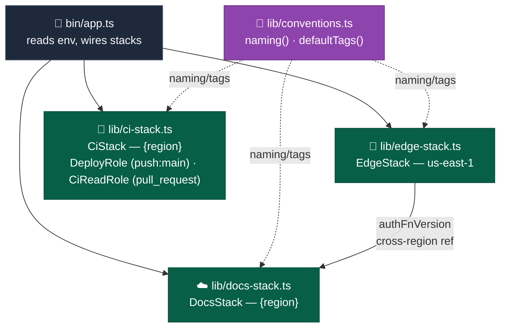

# Infrastructure — Overview

Implementation detail for the Infrastructure container: three independent CDK stacks instantiated from `apps/infra/bin/app.ts`. Mirrors `docs/Target Architecture (HLD)/v1/Containers/Infrastructure.md`.

## Component detail

- `bin/app.ts` — entry point. Reads config from env vars (`ENVIRONMENT`, `WORKLOAD`, `LOCATION_SHORT`, `CF_PRICE_CLASS`, `ORG_PREFIX`, `LAMBDA_REGION`, `AWS_REGION`, GitHub OIDC identifiers), throwing immediately if `LAMBDA_REGION`, `LOCATION_SHORT`, `ORG_PREFIX`, or any GitHub identifier is missing. Instantiates `EdgeStack` in `LAMBDA_REGION`, then `DocsStack` in `AWS_REGION` — passing the live `edgeStack` construct as a prop — then `CiStack` independently. Both `EdgeStack` and `DocsStack` set `crossRegionReferences: true`.
- `lib/conventions.ts` — single source of truth for resource naming (`naming()`) and tagging (`defaultTags()`). Every stack derives bucket/function/secret/role names from the same 4 props (`orgPrefix`, `environment`, `workload`, `locationShort`); no stack hardcodes a name.
- `lib/edge-stack.ts` (`EdgeStack`, deployed in `LAMBDA_REGION`) — IAM role assumable by both `lambda.amazonaws.com` and `edgelambda.amazonaws.com` (composite principal, required for Lambda@Edge), with an inline policy scoped to `secretsmanager:GetSecretValue` on the auth secret. The Lambda function ships with **placeholder** inline passthrough code (`exports.handler = async (event) => event.Records[0].cf.response`) — the real handler is deployed separately (see `../Auth/00. Overview.md`). `memorySize` is deliberately left unset (defaults to 128 MB) to avoid changing the version hash. `currentVersion` gets `RemovalPolicy.RETAIN` — Lambda@Edge versions can't be deleted while still replicated to edge locations.
- `lib/docs-stack.ts` (`DocsStack`, deployed in `AWS_REGION`) — S3 bucket (versioned, `RETAIN`, `enforceSSL`, `BLOCK_ALL` public access), a placeholder Secrets Manager secret (value populated later by `lambda-auth:sm-push`, never by CDK), and a CloudFront distribution: OAC-signed S3 origin, `errorResponses` remapping S3's 403-for-missing-object to `/404.html`, and an `edgeLambdas` viewer-request association pointing at `edgeStack.authFnVersion`. Price class resolves from `CF_PRICE_CLASS` via a lookup map, defaulting to `PriceClass_100`.
- `lib/ci-stack.ts` (`CiStack`) — GitHub Actions OIDC federation, issuing **two** roles off the same OIDC provider rather than one. Conditionally creates the provider (`CREATE_OIDC_PROVIDER` env flag, default `true`) since it's an AWS-account-wide singleton and a shared account must create it only once. Both roles pin the `sub` claim with `StringEquals` (no wildcard) to the exact claim GitHub presents for one event only, using org/repo numeric IDs so the trust relationship survives a repo rename: `DeployRole`'s `sub` is `repo:{org}@{orgId}/{repo}@{repoId}:ref:refs/heads/main` (assumable only by `cd.yml`, triggered by a push to `main`); `CiReadRole`'s `sub` is `repo:{org}@{orgId}/{repo}@{repoId}:pull_request` (assumable only by `ci.yml`). `DeployRole` carries the write-capable inline policies — S3 object/list on the site bucket, CloudFront invalidation and distribution-config actions, Lambda code/version/permission actions split across unversioned and versioned ARN patterns, and SSM `GetParameter` scoped to `/{orgPrefix}/{environment}/{workload}/*`. `CiReadRole` carries only that same SSM `GetParameter` policy — nothing else — since `ci.yml`'s build step needs to read non-secret `VITE_*` config but must never be able to write to the site bucket, touch CloudFront, or update the auth Lambda before a PR is reviewed and merged.

## Integration patterns

- Cross-stack, cross-region wiring: `DocsStack` receives the live `EdgeStack` construct (not an ARN string) as a prop, so CDK generates the CloudFormation cross-region export/import automatically — the reason both stacks set `crossRegionReferences: true`.
- NX targets (`apps/infra/project.json`) wrap the `cdk` CLI: `synth`/`diff`/`destroy` target `'**'` (all stacks); `bootstrap` runs twice sequentially (once per default region, once for `$LAMBDA_REGION`); `provision` is `cdk deploy '**' --require-approval never`; `output`/`output-ci` run `describe-stacks` for stack outputs. `env-push`/`env-pull`/`sm-push`/`sm-pull` follow the same shape used identically across all three apps for SSM/Secrets Manager sync.
- Deploy ordering is implicit: `bin/app.ts` constructs `EdgeStack` before `DocsStack`, but the actual apply order under `provision` (`'**'`) is resolved by CDK's own dependency graph, derived from the cross-stack reference — not by script sequencing.

## Key decisions

- `EdgeStack` and `DocsStack` are split because Lambda@Edge functions must be authored in `us-east-1` while the rest of the stack deploys in the workload's actual region — a single-stack design would force everything into `us-east-1`.
- `CiStack`'s OIDC provider creation is opt-out (`CREATE_OIDC_PROVIDER=false`), not opt-in, because the default case for this starter kit is one dedicated AWS account per client engagement (see `bootstrap-client` skill) — a fresh account has no provider yet.
- Region strings never appear as literals inside `lib/` — always threaded through as stack props derived from env vars — enforcing the root `CLAUDE.md` hard-stop constraint (region is deployment configuration only) structurally, not just by convention.
- `CiStack` issues two roles, not one, because `ci.yml` (pull_request) and `cd.yml` (push to main) used to share a single role whose trust policy wildcarded the `sub` claim — any PR run, including one that edited `ci.yml` itself, could assume deploy-grade AWS credentials (S3 write, CloudFront update, Lambda `UpdateFunctionCode` on the auth function) before human review. Splitting the role and matching each `sub` claim exactly (`StringEquals`, not `StringLike`) means a pull_request run can structurally never present a token the deploy role's trust policy accepts, regardless of what the workflow file on that PR branch says.
