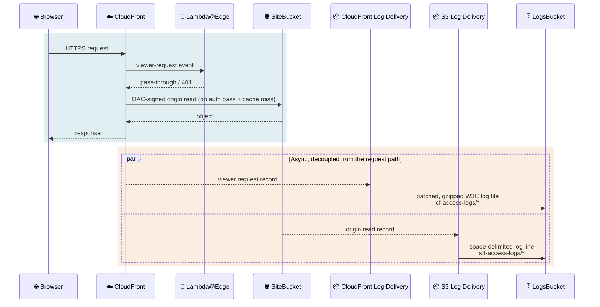
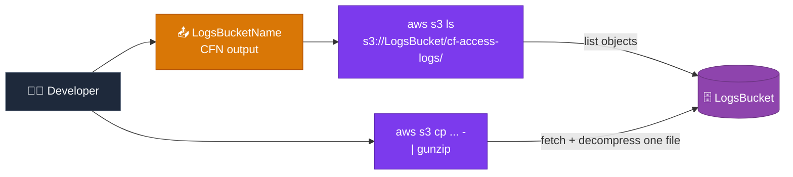

# Infrastructure — Access Logging

Implementation detail for `LogsBucket` in `apps/infra/lib/docs-stack.ts`: the two independent access-log streams (CloudFront standard logs, S3 server-access logs) and the manual retrieval workflow. Companion to `./00. Overview.md`.

## Request and log-delivery flow

Both log streams are produced by AWS-managed delivery services, not by the request/response path itself — the viewer's response is never blocked on, or aware of, log delivery. Per AWS's documented behavior for these features: CloudFront delivers batched log files to the target bucket on the order of minutes up to about an hour after the request; S3 server-access-log delivery is best-effort and can lag by several hours. Neither stream is real-time.

## What each stream logs, and why the "who" signal differs

| Stream                   | Prefix            | Delivery mechanism                                                        | Format                                                                                                                                                                                                      | "Who" signal                                                                                                                                                                    |
| ------------------------ | ----------------- | ------------------------------------------------------------------------- | ----------------------------------------------------------------------------------------------------------------------------------------------------------------------------------------------------------- | ------------------------------------------------------------------------------------------------------------------------------------------------------------------------------- |
| CloudFront standard logs | `cf-access-logs/` | CloudFront Log Delivery service, ACL grant on `LogsBucket`                | Gzipped, tab-separated, W3C extended log format — date/time, edge location, client IP, method, host, URI path, HTTP status, referer, user-agent, cache result, time-taken, X-Forwarded-For, TLS/cipher info | Real end-viewer IP, user-agent, and status — the stream that shows who actually hit the site, useful for spotting basic-auth brute-forcing                                      |
| S3 server-access logs    | `s3-access-logs/` | S3's own logging service, bucket policy wired by `serverAccessLogsBucket` | Space-delimited log lines per request                                                                                                                                                                       | Requester is almost always CloudFront's OAC service principal, not the end viewer's IP — low "who" signal, but catches any access to the bucket that happens outside CloudFront |

The two streams are independent and additive: CloudFront logs tell you who requested what over HTTPS; S3 logs tell you whether the bucket itself was touched by anything other than CloudFront's own origin reads.

## `LogsBucket` configuration

`LogsBucket` is the single destination for both streams, declared in `createLogsBucket()`:

- `objectOwnership: OBJECT_WRITER`, not CDK's default `BUCKET_OWNER_ENFORCED`. CloudFront's standard-logging delivery writes objects via an ACL grant, not a bucket policy — `BUCKET_OWNER_ENFORCED` disables ACLs entirely and would silently drop CloudFront log delivery. S3's own server-access-log delivery uses a bucket policy instead (wired automatically by `serverAccessLogsBucket` on the site bucket), so it works under either ownership setting — which is why one bucket can serve both streams.
- `blockPublicAccess: BLOCK_ALL` and `enforceSSL: true` — the bucket is private and TLS-only, same as the site bucket.
- `lifecycleRules: [{ expiration: cdk.Duration.days(180) }]` — objects under both prefixes expire 180 days after creation, bounding storage growth without manual cleanup.
- `removalPolicy: RETAIN` — the bucket survives stack deletion, consistent with the site bucket and the auth secret.
- The bucket name is exported as the `LogsBucketName` CloudFormation output on `DocsStack`, alongside the existing `CloudFrontDomain` and `SiteBucketName` outputs — the canonical way to obtain the bucket name for retrieval.

## Manual retrieval flow

No Athena table or dashboard exists yet — a deliberate choice for a small internal team (about 10 users). Retrieval is a manual CLI workflow against the bucket named by the `LogsBucketName` output:

Typical sequence: `aws s3 ls s3://<LogsBucketName>/cf-access-logs/` to list available log files, then `aws s3 cp s3://<LogsBucketName>/cf-access-logs/<file> - | gunzip` to stream and decompress a single file for reading. CloudFront log files are gzipped; S3 server-access log lines under `s3-access-logs/` are plain text and need no decompression step.

## Key decisions

- One `LogsBucket` serves both log streams rather than two separate buckets, because `OBJECT_WRITER` ownership satisfies both delivery mechanisms (ACL-based for CloudFront, bucket-policy-based for S3) simultaneously — a second bucket would add operational surface without a corresponding benefit.
- Retrieval stays manual (`aws s3 ls` / `cp` / `gunzip`) rather than wiring Athena or a dashboard, because engagement team size (~10 users) does not yet justify the added infrastructure; see `./00. Overview.md` for the rest of the Infrastructure container.
