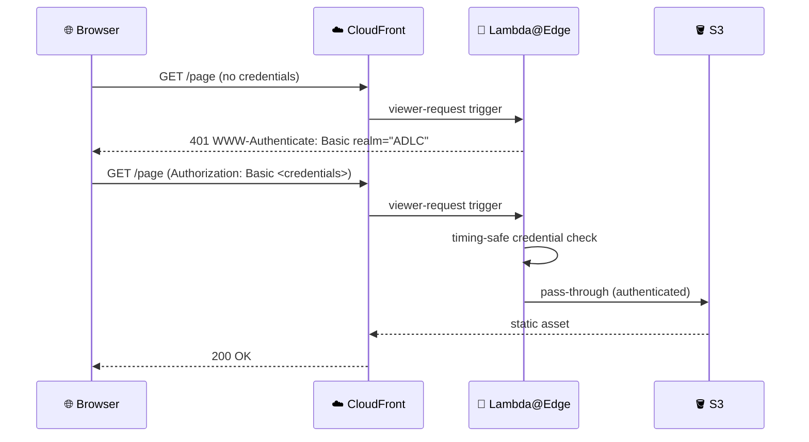

# Auth Container

Lambda@Edge handler supporting three deploy-time-selected auth modes — `none`, `basic`, `oidc` — selected via the `AUTH_MODE` build-time env var. Exactly one mode's code ships per build.

## Baseline diagrams

`basic` mode (unchanged from today's single-mode behavior):



`none` mode: unconditional pass-through to S3 on every request — no credential check, no cookie, no Secrets Manager call.

`oidc` mode — first login, steady-state, silent refresh, forced re-login:

```mermaid
sequenceDiagram
    participant B as Browser
    participant CF as CloudFront
    participant LAE as Lambda@Edge (handler-oidc)
    participant SM as Secrets Manager
    participant ID as Entra ID
    participant S3 as S3

    Note over B,S3: Flow 1 — first login, no session cookie
    B->>CF: GET /page (no session cookie)
    CF->>LAE: viewer-request trigger
    LAE->>LAE: generate PKCE verifier/challenge + state (openid-client)
    LAE-->>B: 302 to Entra /authorize + Set-Cookie: PKCE cookie (verifier, state, original path)
    B->>ID: authenticate
    ID-->>B: 302 to callback (code, state)
    B->>CF: GET /callback?code=...&state=...
    CF->>LAE: viewer-request trigger
    LAE->>SM: GetSecretValue (client secret) + discover Entra metadata (cached per cold start)
    LAE->>ID: POST /token (code + PKCE verifier + client secret)
    Note right of LAE: openid-client validates state + PKCE verifier against the request,<br/>and verifies the returned ID token's signature/issuer/audience — all in one call
    ID-->>LAE: access + refresh + ID tokens
    LAE->>LAE: discard access token (never read again); keep refresh token + sub/upn from the verified ID token
    LAE-->>B: 302 to original path (from PKCE cookie) + Set-Cookie: session cookie pair, clears PKCE cookie

    Note over B,S3: Flow 2 — subsequent authenticated request, session not expired
    B->>CF: GET /page (session cookie, not expired)
    CF->>LAE: viewer-request trigger
    LAE->>LAE: verify session cookie HMAC + exp (no live Entra call)
    LAE->>S3: pass-through
    S3-->>CF: static asset
    CF-->>B: 200 OK

    Note over B,S3: Flow 3 — silent refresh, session expired, refresh token valid
    B->>CF: GET /page (session cookie, exp passed)
    CF->>LAE: viewer-request trigger
    LAE->>ID: POST /token (refresh token grant)
    Note right of LAE: openid-client verifies the ID token if Entra re-issues one;<br/>otherwise the identity already established at login is kept
    ID-->>LAE: new access token (discarded) + refresh token (+ ID token)
    LAE-->>B: 302 to same URI + Set-Cookie: updated session cookie pair
    B->>CF: GET /page (session cookie, not expired)
    CF->>LAE: viewer-request trigger
    LAE->>S3: pass-through
    S3-->>CF: static asset
    CF-->>B: 200 OK (instant redirect, no visible re-login)

    Note over B,S3: Flow 4 — refresh token expired/invalid, forces fresh login
    B->>CF: GET /page (session cookie, refresh token also expired/invalid)
    CF->>LAE: viewer-request trigger
    LAE->>ID: POST /token (refresh token grant)
    ID-->>LAE: error (invalid_grant)
    LAE-->>B: 302 to Entra /authorize (re-enters Flow 1)
```

**Why the access token isn't verified per-request, and isn't stored:** this app's access token (Microsoft Graph's default scope, no exposed custom API) is not guaranteed to be a verifiable JWT — Microsoft documents that Graph-bound access tokens may be opaque, which live testing against the DataArt tenant confirmed (signature verification failed on every request, not because of tampering, but because the token isn't a genuine JWS for this scope). The **ID token**, which Entra always issues as a real signed JWT, is verified once, at the moment tokens are received (login and refresh) — that's the one point a live Entra signature check proves anything. Every later request trusts the session cookie's own HMAC instead. The access token itself is never read anywhere after the token exchange, so it is not persisted at all — it was also the single largest, most per-user-token-size-variable field, and dropping it removed a real production failure mode (one user's token fit the cookie budget, a second user's token — same app, same tenant — did not).

## Responsibilities

- Select auth behavior at build time via `AUTH_MODE` (`none`/`basic`/`oidc`) — no runtime toggle
- `none` mode: intercept every viewer request and pass through unconditionally
- `basic` mode: parse the `Authorization` header, validate the password credential (timing-safe), return a `401 WWW-Authenticate` challenge for unauthenticated requests, pass through authenticated requests
- `oidc` mode: perform authorization-code + PKCE login against Entra ID (via `openid-client`), issue and verify a signed session cookie, silently refresh an expired session using a valid refresh token, and fail closed on invalid signature, invalid session cookie, or expiry
- `oidc` mode: verify the ID token's signature, issuer, and audience once, at the point tokens are received (login and refresh) — not the access token, and not on every request; see the diagram note above
- `oidc` mode: log the authenticated principal alongside CloudFront's `x-edge-request-id` for attribution
- `oidc` mode: the post-login redirect target is validated as a same-origin relative path, rejecting absolute or protocol-relative values (NFR-8) — carried in the signed PKCE cookie across the Entra redirect round-trip, not in the `state` parameter

## Technology

| Component    | Choice                                                                                                                                                                                                                                                                                                                                                                                                                                                                                                                                                                                                                    |
| ------------ | ------------------------------------------------------------------------------------------------------------------------------------------------------------------------------------------------------------------------------------------------------------------------------------------------------------------------------------------------------------------------------------------------------------------------------------------------------------------------------------------------------------------------------------------------------------------------------------------------------------------------- |
| Runtime      | Node.js (Lambda@Edge)                                                                                                                                                                                                                                                                                                                                                                                                                                                                                                                                                                                                     |
| Language     | TypeScript                                                                                                                                                                                                                                                                                                                                                                                                                                                                                                                                                                                                                |
| OIDC client  | `openid-client` (built on `oauth4webapi`) — PKCE generation, authorization-code grant, refresh-token grant, and ID-token signature/issuer/audience verification (including its own JWKS fetch/cache), used in `oidc` mode only. Replaced a hand-rolled implementation (raw `fetch` token exchange, manual `jose`-based JWKS verification, manual PKCE/state generation) once real-world testing surfaced bugs the library models correctly by default — see `apps/lambda-auth/src/lib/cookie.ts`'s module doc comment and the archived `[DESIGN-20261017-UX3J]` story's Post-Archival Incident note for the full history. |
| Deploy model | Lambda@Edge — CDK provisions a placeholder in `us-east-1`; exactly one of `handler-none.ts`/`handler-basic.ts`/`handler-oidc.ts` is bundled per build per `AUTH_MODE`, shipped via `lambda-auth:deploy` after CDK. Re-run after any DocsStack deploy. See `Engineering Guide/Infrastructure/02 Deploy Lifecycle.md`                                                                                                                                                                                                                                                                                                       |

Reading the Discuss container's comments is not gated by anything beyond this Lambda — since giscus reads via its App's own token, not the viewer's, the configured auth gate (whichever `AUTH_MODE` is selected) is the only thing standing between an anonymous visitor and the comment content. Posting is separately gated by GitHub repository permission, independent of this Lambda (see NFR-6).

## Constraints

- Handler execution must complete within 5 seconds
- Response payload must be under 1 MB
- Secrets Manager `GetSecretValue` is the only permitted external call — no VPC access, no async file I/O beyond the SDK call
- Memory is capped at 128 MB (Lambda@Edge viewer-request ceiling) — set explicitly in CDK
- Execution logs are written to CloudWatch Logs in the CloudFront edge region handling the request, not in `us-east-1`; the CDK log group must carry an explicit removal policy
- `basic` mode: password hash loaded from Secrets Manager at cold start; comparisons must be timing-safe; the shared password must be a 20+ character randomly generated passphrase, enforced operationally (runbook), not by code
- `oidc` mode: session is split across two signed cookies — a refresh-token cookie and an identity (`sub`/`upn`/`exp`) cookie — each `HttpOnly; Secure; SameSite=Lax`, each independently budgeted to stay under the ~4093-byte limit browsers actually enforce per cookie (not a value this app can safely raise; see `lib/cookie.ts`). The access token is not stored — it's read once at token exchange and discarded, since nothing in this handler ever reads it again. The PKCE cookie is short-lived, scoped to the login redirect round-trip, and also carries the post-login redirect path. An invalid session-cookie signature, a failed ID-token verification at issuance, or a missing/malformed secret field fails closed — never passed through
- `oidc` mode: no session revocation mechanism exists — a compromised or offboarded session remains valid until natural token expiry; an accepted limit
- `AUTH_MODE=none` build prints a no-access-control warning to stdout but still succeeds

## Secrets Manager payload

```json
{
  "DOCS_BASIC_AUTH_HASH": "<basic mode only>",
  "OIDC_CLIENT_ID": "<oidc mode only>",
  "OIDC_CLIENT_SECRET": "<oidc mode only>",
  "OIDC_TENANT_ID": "<oidc mode only>",
  "OIDC_SESSION_SIGNING_KEY": "<oidc mode only>"
}
```

Each mode's handler reads only its own fields: `handler-none.ts` reads none; `handler-basic.ts` reads `DOCS_BASIC_AUTH_HASH`; `handler-oidc.ts` reads the four `OIDC_*` fields. `OIDC_SESSION_SIGNING_KEY` is kept separate from `OIDC_CLIENT_SECRET` so the two can be rotated independently.

## Key paths

| Path                                    | Purpose                                                                                                                                                                                                                                                      |
| --------------------------------------- | ------------------------------------------------------------------------------------------------------------------------------------------------------------------------------------------------------------------------------------------------------------ |
| `apps/lambda-auth/src/handler-none.ts`  | `none`-mode entry point                                                                                                                                                                                                                                      |
| `apps/lambda-auth/src/handler-basic.ts` | `basic`-mode entry point                                                                                                                                                                                                                                     |
| `apps/lambda-auth/src/handler-oidc.ts`  | `oidc`-mode entry point — owns PKCE/state/redirect-target handling and calls `openid-client` directly for discovery, authorization-code grant, and refresh-token grant                                                                                       |
| `apps/lambda-auth/src/lib/`             | Shared helpers — `cookie.ts` (session/PKCE cookie sign/verify, byte-budget enforcement), `redirect.ts` (same-origin redirect-target guard). PKCE generation and JWKS/ID-token verification are owned by `openid-client` directly, not a local `lib/` module. |
