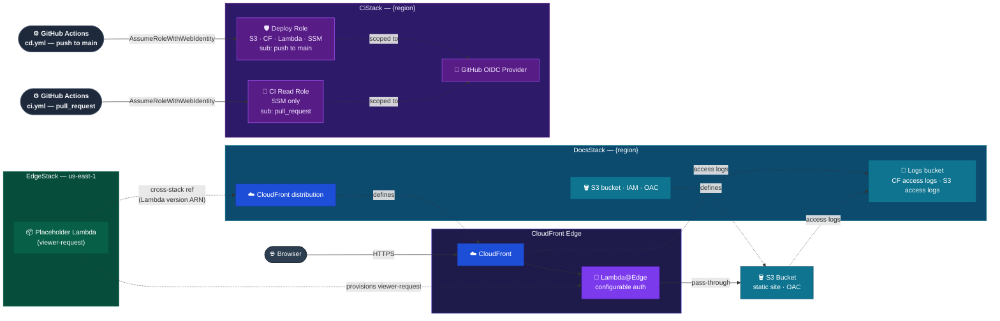

# Infrastructure Container

AWS CDK definitions for all cloud resources.

## Baseline diagram

_Auth decision path (401 challenge vs pass-through) is shown in `Containers/Auth.md`._

## Responsibilities

- CloudFront distribution configured with `defaultRootObject: index.html`; an `errorResponses` entry remaps S3 403 → HTTP 404 (private S3 buckets return 403 for missing objects, not 404)
- `ResponseHeadersPolicy` attached to the default behavior adds HSTS, `X-Content-Type-Options`, `X-Frame-Options: DENY`, `Referrer-Policy`, and a CSP scoped to `'self'` plus `https://giscus.app` to every response — see [NFR-9](../Non-Functional%20Concerns/Requirements.md)
- S3 bucket as static site origin (Origin Access Control)
- IAM roles and resource policies
- All resources defined as CDK constructs — no manual provisioning
- Secrets Manager secret provisioned as an empty placeholder (`{}`); value is populated post-deploy by `lambda-auth:sm-push` — never set by CDK; the populated payload's shape varies by `AUTH_MODE`, but the CDK-provisioned secret container itself is unchanged
- Dedicated, private logs bucket captures both CloudFront standard access logs (every viewer request — IP, path, status, edge location) and the site bucket's own S3 server-access logs, with a 180-day expiration lifecycle rule; previously neither existed
- GitHub OIDC provider (`CiStack`) enabling GitHub Actions to authenticate via short-lived credentials; two roles, each trusted for exactly one triggering event — a pull_request-only read role (SSM only) and a push-to-main-only deploy role (S3, CloudFront, Lambda, SSM) — so a PR can never assume deploy-grade credentials before human review
- The Lambda code shipped into `EdgeStack`'s placeholder via `lambda-auth:deploy` varies by the build-time `AUTH_MODE` selector in `apps/lambda-auth`; `EdgeStack`'s and `DocsStack`'s CDK-managed resources (placeholder Lambda, IAM role, secret container) are unchanged by this selector

## Technology

| Component     | Choice      |
| ------------- | ----------- |
| IaC framework | AWS CDK     |
| Language      | TypeScript  |
| Distribution  | CloudFront  |
| Origin        | S3 (static) |
| Edge auth     | Lambda@Edge |

## Key paths

| Path          | Purpose                   |
| ------------- | ------------------------- |
| `apps/infra/` | CDK stacks and constructs |

## Constraints

- Region is deployment configuration — never hardcoded in source or documentation
- All stateful resources (S3 buckets, log groups) must have explicit removal policies
- IAM policies must follow least-privilege — no `*` actions or resources without justification

## Naming conventions

| Name                 | Pattern                                           |
| -------------------- | ------------------------------------------------- |
| AWS resources        | `{org}-{env}-{wl}-{locationShort}-{type}-{index}` |
| Secrets Manager path | `{org}/{env}/{wl}/lambda-auth`                    |
| SSM Parameter Store  | `/{org}/{env}/{wl}/{app}/env`                     |

All naming logic is centralised in `apps/infra/lib/conventions.ts`.
