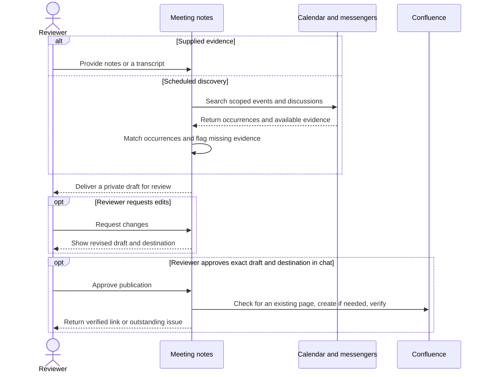

# Meeting notes

Turn evidence from a meeting into a draft that records what people decided, who owns each action, and which questions remain open. The daily job discovers meetings and delivers drafts privately. A reviewer can then publish an approved draft to Confluence.

## Zoom recording and transcript review

Choose **Hourly Zoom meeting notes** for calls recorded in Zoom. The first hourly check at least 15 minutes after a call ends matches its Outlook invitation to the Zoom occurrence and checks the transcript against the recording. A single call covering multiple projects produces one topic-grouped draft. The BA or PM reviews it in chat. After approval, the plugin verifies the Confluence page, then saves an Outlook reply draft containing the approved notes for the original invitees. The reviewer sends it. Manual requests can also start from a meeting link or supplied material. [Zoom meeting procedure](references/zoom-meeting-notes.md)

## What good notes look like

Someone who missed the meeting can tell what was settled, what they need to do, and what still needs a decision. A reviewer can trace each commitment to the discussion. The [result contract](references/result-contract.md) defines the fields and review criteria for every draft.

For example, suppose Maya says at 14:20, “I'll send the pilot estimate. Friday could work for launch if QA signs off.” The notes should capture one action for Maya to send the estimate, with its due date marked **TBD**. Friday belongs under open questions as a possible launch date pending QA sign-off. Both entries can point to 14:20 in the transcript.

## Connectors and integrations

| Path                         | What it uses                                                                                                                                                                                                             |
| ---------------------------- | ------------------------------------------------------------------------------------------------------------------------------------------------------------------------------------------------------------------------ |
| Supplied notes or transcript | No connector is needed to draft notes in chat.                                                                                                                                                                           |
| Daily discovery and review   | A host scheduler, read access to Outlook Calendar and selected Microsoft Teams chats or channels, and a private result view for the designated reviewer. Zoom Team Chat or meeting assets are optional evidence sources. |
| Approved publication         | An interactive session with Atlassian access to search, create and read back a page under the selected Confluence parent.                                                                                                |

## Sequence diagram

