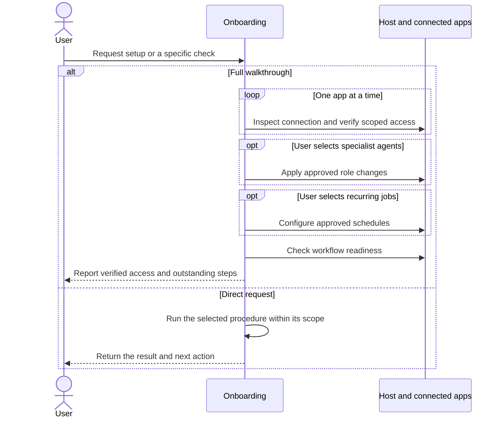

# Onboarding

Find out which Business Analysis workflows can run in the user's workspace. Guide them through first-time setup or take them directly to a connection, specialist, job, or readiness check they want to revisit.

## Connectors and integrations

| Path                             | What it uses                                                                                                                                                                           |
| -------------------------------- | -------------------------------------------------------------------------------------------------------------------------------------------------------------------------------------- |
| Skill guide or setup preview     | Packaged documentation and templates. No external connection is needed.                                                                                                                |
| Full connection check            | Atlassian for Jira and Confluence, Zoom, Microsoft Teams, Outlook Email and Outlook Calendar. Verify Jira and Confluence separately. A targeted check needs only the selected service. |
| Connection setup                 | Host connection controls or Plugin Management when available, with app listing links as a fallback.                                                                                    |
| Optional specialist or job setup | A supported local Codex project for agent installation, or a host scheduler for creating a recurring job. Each job declares its own source requirements.                               |

## Sequence diagram

