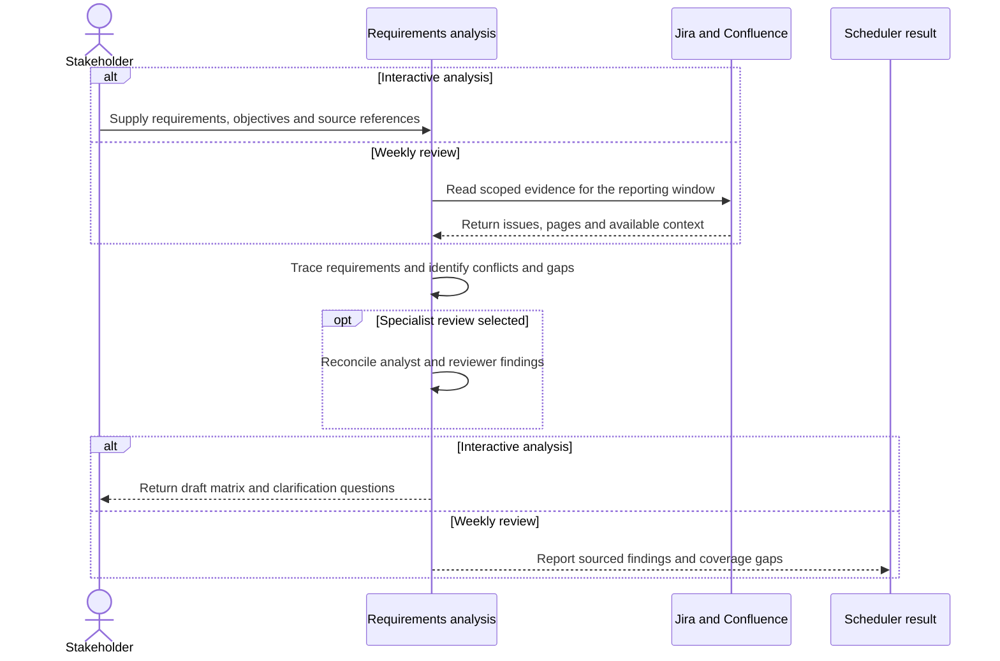

# Requirements analysis

Help stakeholders decide what is in scope by tracing each requirement to its source, surfacing contradictions, and identifying questions that need a decision. The weekly review applies this analysis to a defined reporting window.

## Connectors and integrations

| Path                                      | What it uses                                                                                                                                                  |
| ----------------------------------------- | ------------------------------------------------------------------------------------------------------------------------------------------------------------- |
| Supplied brief and stakeholder objectives | No connector is needed. For linked inputs, read only the selected requirements sources.                                                                       |
| Weekly requirements review                | A host scheduler and Atlassian read access to both the selected Jira project and Confluence space. The report goes to the configured result destination.      |
| Optional specialist review                | The business analyst and requirements reviewer roles. Delegation needs a supported host and authorization. Their instructions also support sequential review. |

## Sequence diagram

