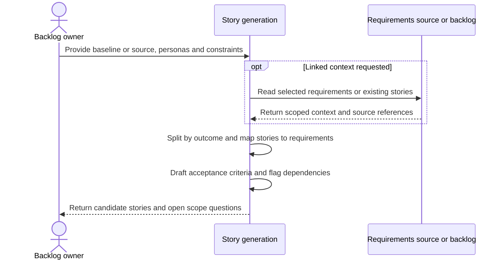

# Story generation

Translate a reviewed requirements baseline into candidate backlog stories. Each story describes a user outcome, testable acceptance criteria, and the requirement that justifies its scope.

## Connectors and integrations

| Path                                    | What it uses                                                                                                                           |
| --------------------------------------- | -------------------------------------------------------------------------------------------------------------------------------------- |
| Supplied baseline                       | No connector is needed. The user can supply a baseline directly or reuse the output of requirements analysis.                          |
| Linked requirements or existing backlog | Read access to the chosen source, such as a Confluence page or Jira backlog through Atlassian. The skill returns story drafts in chat. |

## Sequence diagram

